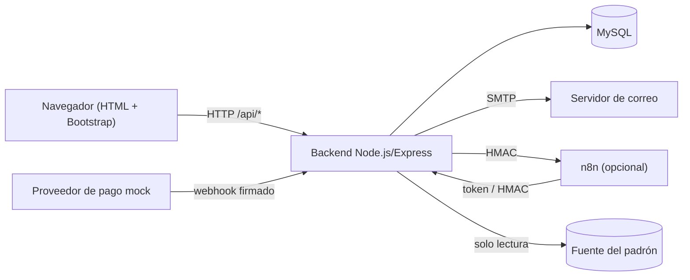

# Especificación de requerimientos de software (SRS)

| Campo | Valor |
|---|---|
| ID documental | DOC-01-04 |
| Versión | 1.0 |
| Estado | BORRADOR — PENDIENTE DE VALIDACIÓN |
| Fecha de generación | 2026-10-16 |
| Responsable | PENDIENTE DE ASIGNACIÓN |
| Evidencia base | rama `feature/verificacion-seguridad`, commit `4742737` |

## Propósito

Documento SRS con estructura adaptada de IEEE 830 / ISO/IEC/IEEE 29148. Integra el contexto general y remite a los documentos especializados para no duplicar contenido.

## Alcance

Sistema "Suite Institucional — Suministros Institucionales" (`suministros-backend` 1.0.0 y frontend estático). SRS reconstruido por ingeniería inversa; **no** constituye una especificación contractual aprobada.

## 1. Introducción

### 1.1 Propósito del sistema
Plataforma web para que entidades institucionales colombianas soliciten una cuenta verificada y compren suministros con controles de elegibilidad. Ver [01_DOCUMENTO_DE_VISION_Y_PROPOSITO.md](01_DOCUMENTO_DE_VISION_Y_PROPOSITO.md).

### 1.2 Definiciones
Ver [../02_ANALISIS/12_GLOSARIO_DEL_NEGOCIO.md](../02_ANALISIS/12_GLOSARIO_DEL_NEGOCIO.md). Términos clave: padrón, terna, vitrina, restringido, revisión legal, verificación, autorización por compra, outbox, MFA, session_version.

### 1.3 Referencias
`../docs/REGISTRO_VERIFICADO.md`, `../docs/ARQUITECTURA_OBJETIVO.md`, `../docs/ARQUITECTURA_VERIFICACION.md`, `../docs/POLITICA_VERIFICACION_IDENTIDAD.md`, `../docs/TRATAMIENTO_DATOS_PERSONALES.md`, `../backend/README.md`.

### 1.4 Convenciones
IDs REQ-F, REQ-NF, RN, UC, TC, BUG según el catálogo maestro; marcas [OBS], [INF], [REC]; estados de implementación definidos en [03_METODO_DE_LEVANTAMIENTO_DE_REQUERIMIENTOS.md](03_METODO_DE_LEVANTAMIENTO_DE_REQUERIMIENTOS.md).

## 2. Descripción general

### 2.1 Perspectiva del producto
Aplicación monolítica Node.js/Express que sirve la API REST `/api/*` y el frontend estático desde el mismo origen (ADR-001), con MySQL (ADR-002), correo por nodemailer (ADR-007) y n8n como notificador opcional (ADR-006).

### 2.2 Funciones del producto
Registro verificado y aprobación; autenticación con MFA; mi cuenta; catálogo segmentado; carrito, checkout y pago mock; pedidos y comprobantes; verificación institucional y autorización de restringidos; administración de catálogo, clientes, personal y permisos; asistente; atención y reportes; auditoría; automatizaciones. Detalle: [05_REQUERIMIENTOS_FUNCIONALES.md](05_REQUERIMIENTOS_FUNCIONALES.md).

### 2.3 Usuarios
ACT-01 a ACT-11: [02_IDENTIFICACION_DE_INTERESADOS.md](02_IDENTIFICACION_DE_INTERESADOS.md).

### 2.4 Restricciones
[10_RESTRICCIONES_Y_LIMITACIONES.md](10_RESTRICCIONES_Y_LIMITACIONES.md).

### 2.5 Supuestos y dependencias [INF]
- La fuente del padrón está disponible y es fiable (hoy es una base de laboratorio).
- Existe un servidor SMTP (o se usa la consola en laboratorio).
- Las claves `ENC_KEY`, `HMAC_KEY`, `JWT_SECRET`, `MFA_TOKEN_PEPPER` están configuradas y respaldadas.
- Ver [../00_GESTION_DEL_PROYECTO/10_LIMITACIONES_Y_SUPUESTOS.md](../00_GESTION_DEL_PROYECTO/10_LIMITACIONES_Y_SUPUESTOS.md).

## 3. Requerimientos específicos

### 3.1 Interfaces externas
| Interfaz | Descripción | Evidencia |
|---|---|---|
| Usuario | 21 páginas HTML en `../frontend/` (Bootstrap 5.3.3, Chart.js 4.4.4 por CDN) | `../frontend/*.html` |
| API | REST JSON bajo `/api/*` (17 routers) | `../backend/src/app.js` |
| Base de datos | MySQL vía `mysql2/promise`, consultas parametrizadas | `../backend/src/db.js` |
| Correo | SMTP (nodemailer) | `../backend/src/seguridad/correo.js` |
| n8n | Webhooks firmados HMAC; endpoints con `x-automation-token` | `../backend/src/automationOutbox.js` |
| Pagos | Webhook mock HMAC (`x-payment-timestamp`, `x-payment-signature`) | `../backend/src/routes/pagos.js` |
| Padrón | Conexión MySQL de solo lectura | `../backend/src/seguridad/padron.js` |

Contratos detallados: [../04_DESARROLLO/08_CONTRATOS_Y_ENDPOINTS_DE_API.md](../04_DESARROLLO/08_CONTRATOS_Y_ENDPOINTS_DE_API.md).

### 3.2 Requerimientos funcionales
REQ-F-001 a REQ-F-040: [05_REQUERIMIENTOS_FUNCIONALES.md](05_REQUERIMIENTOS_FUNCIONALES.md). Historias: [08_HISTORIAS_DE_USUARIO.md](08_HISTORIAS_DE_USUARIO.md).

### 3.3 Requerimientos no funcionales
REQ-NF-001 a REQ-NF-018: [06_REQUERIMIENTOS_NO_FUNCIONALES.md](06_REQUERIMIENTOS_NO_FUNCIONALES.md).

### 3.4 Reglas de negocio
RN-001 a RN-023: [07_REGLAS_DE_NEGOCIO.md](07_REGLAS_DE_NEGOCIO.md).

### 3.5 Requerimientos de datos
Modelo y diccionario: [../02_ANALISIS/08_MODELO_CONCEPTUAL_DE_DATOS.md](../02_ANALISIS/08_MODELO_CONCEPTUAL_DE_DATOS.md), [../03_DISENO/07_DICCIONARIO_TECNICO_DE_DATOS.md](../03_DISENO/07_DICCIONARIO_TECNICO_DE_DATOS.md).

## 4. Verificación
Criterios: [09_CRITERIOS_DE_ACEPTACION.md](09_CRITERIOS_DE_ACEPTACION.md). Trazabilidad: [11_MATRIZ_DE_TRAZABILIDAD.md](11_MATRIZ_DE_TRAZABILIDAD.md). Plan: [../05_PRUEBAS/01_PLAN_DE_PRUEBAS.md](../05_PRUEBAS/01_PLAN_DE_PRUEBAS.md).

## 5. Estado global de la especificación (2026-10-16)

| Estado | REQ-F | REQ-NF |
|---|---|---|
| IMPLEMENTADO Y VERIFICADO | 001, 002, 004, 005, 006, 007, 009, 012, 014, 020, 022, 025, 026, 028, 031, 035, 037 (17) | 001, 002, 003, 004, 008, 010, 012, 014 (8) |
| IMPLEMENTADO, NO VERIFICADO | 003, 008, 015, 016, 017, 018, 019, 021, 023, 024, 027, 029, 030, 032, 033, 034, 039 (17) | 006, 007, 009, 011, 013 (5) |
| PARCIALMENTE IMPLEMENTADO | 010, 011, 013, 038 (4) | 005, 017 (2) |
| DOCUMENTADO, NO IMPLEMENTADO | 040 (1) | — |
| PENDIENTE | — | 015, 016 (2) |
| NO DETERMINADO | 036 (1) | 018 (1) |

Este resumen no implica aprobación ni preparación para producción.

## Referencias
- [12_CONTROL_DE_CAMBIOS_DE_REQUERIMIENTOS.md](12_CONTROL_DE_CAMBIOS_DE_REQUERIMIENTOS.md)
