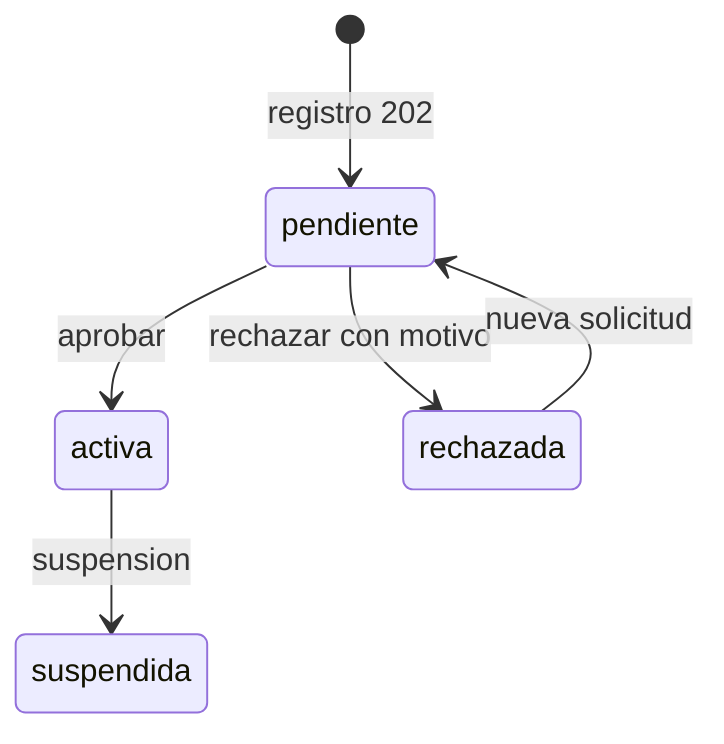

# Reglas de negocio

| Campo | Valor |
|---|---|
| ID documental | DOC-01-07 |
| Versión | 1.0 |
| Estado | BORRADOR — PENDIENTE DE VALIDACIÓN |
| Fecha de generación | 2026-10-16 |
| Responsable | PENDIENTE DE ASIGNACIÓN |
| Evidencia base | rama `feature/verificacion-seguridad`, commit `4742737` |

## Propósito

Enumerar las reglas de negocio (RN-001 a RN-023) que el código hace cumplir, con su ubicación, para que puedan validarse con el negocio y con jurídica.

## Alcance

Todas las reglas son **[OBS]** en el código. Que el código las aplique no significa que el negocio las haya aprobado formalmente (validación PENDIENTE).

| ID | Regla | Ubicación | REQ |
|---|---|---|---|
| RN-001 | Registrarse no habilita: `usuarios.estado_cuenta='pendiente'` hasta la aprobación de un administrador | `../backend/src/seguridad/registroVerificado.js`, `../backend/src/routes/auth.js` | REQ-F-001, REQ-F-004 |
| RN-002 | Se verifica la terna NIT + nombre + institución. NIT: solo dígitos, sin dígito de verificación. Nombre: sin tildes, mayúsculas, solo letras, palabras ordenadas, al menos dos palabras | `../backend/src/seguridad/normalizacion.js`, `../backend/src/seguridad/padron.js` | REQ-F-002 |
| RN-003 | Aprobar con resultado distinto de `coincide` exige `{confirmar:true}`; rechazar exige motivo de 5–500 caracteres; nunca se rechaza automáticamente | `../backend/src/routes/solicitudesRegistro.js` | REQ-F-004 |
| RN-004 | El registro responde 202 idéntico exista o no el correo; el titular del correo existente recibe un aviso | `../backend/src/routes/auth.js` | REQ-F-001 |
| RN-005 | MFA: 6 dígitos, solo HMAC almacenado, 5 min, 5 intentos, reenvío tras 60 s, máx. 5 reenvíos, máx. 5 retos/15 min por usuario. Límites por IP: login 10/15 min, verificar 15/15 min, reenviar 10/h, captcha 120/15 min, registro 10/h (configurable) | `../backend/src/routes/auth.js` | REQ-F-005, REQ-F-006 |
| RN-006 | Contraseña de 10 a 72 caracteres, sin contener el usuario del correo; hash bcrypt | `../backend/src/registroInstitucional.js`, `../backend/src/seguridad/contrasenas.js` | REQ-NF-002 |
| RN-007 | Visibilidad de productos según contexto: visitante/no habilitado → vitrina sin precio; restringidos y productos de otra institución → no existen (404) para no elegibles; staff → completo sin compra | `../backend/src/autorizacion.js` (`evaluarProducto`), `../docs/ARQUITECTURA_OBJETIVO.md` | REQ-F-014 |
| RN-008 | `revision_legal` en `pendiente` o `bloqueada` impide la venta; `bloqueada` además oculta | `../backend/src/autorizacion.js` (`REVISION_QUE_BLOQUEA_VENTA`) | REQ-F-017 |
| RN-009 | Cuenta activa con correo verificado compra uso general; restringidos exigen verificación vigente + autorización de restringidos + autorización por compra | `../backend/src/autorizacion.js`, `../backend/src/routes/checkout.js` | REQ-F-019, REQ-F-029 |
| RN-010 | Verificación vigente 365 días (`VERIFICACION_VIGENCIA_DIAS`, máx. 730); solicitud sin decisión expira a 30 días → `requiere_informacion`; máx. 3 reenvíos tras rechazo | `../backend/src/verificacionCompra.js`, `../backend/src/verificacion.js` | REQ-F-027, REQ-F-028 |
| RN-011 | Tabla de decisión: vínculo documental + canal independiente + entidad confirmados; vínculo y canal registrados por personas distintas | `../backend/src/verificacionCompra.js` (`decidirSolicitud`) | REQ-F-028 |
| RN-012 | n8n solo escribe el componente `entidad`; ausencia en un registro público = `datos_insuficientes`, nunca `no_coincide` | `../backend/src/verificacionCompra.js`, `../n8n/generar-w11.js` | REQ-F-028, REQ-F-035 |
| RN-013 | Precios e inventario siempre del servidor; el checkout exige `Idempotency-Key` de 16–128 caracteres y rechaza datos de tarjeta | `../backend/src/routes/checkout.js` | REQ-F-019 |
| RN-014 | Pago mock: centavos .01 rechaza, .02 pendiente, .03 timeout, resto aprueba; simulación deshabilitada con `NODE_ENV=production` o `PAYMENT_MODE` distinto de mock | `../backend/src/paymentProvider.js`, `../backend/src/routes/pagos.js` | REQ-F-021 |
| RN-015 | Comprobante no-DIAN solo con pago aprobado; correo al cliente solo con `enviarComprobante=true`; enlace HMAC de 24 h; reenvío máx. 3 por hora | `../backend/src/receiptService.js`, `../backend/src/receiptTokens.js`, `../backend/src/routes/comprobantes.js` | REQ-F-025 |
| RN-016 | Las reservas de pedidos vencidos se liberan (job cada 60 s, lotes de 25; W4 opcional) | `../backend/src/paymentJobs.js` | REQ-F-022 |
| RN-017 | 13 permisos de staff; `documentos.ver` e `identificadores.ver` no son implícitos ni para el superadmin; `staff.permisos` e `identificadores.ver` reservados al superadmin; nadie modifica sus propios permisos | `../backend/src/autorizacion.js`, `../backend/src/routes/verificacion.js` | REQ-F-030 |
| RN-018 | El superadministrador solo se crea por `scripts/crear-superadmin.js` con `--confirmar-base`; no hay endpoint HTTP | `../backend/scripts/crear-superadmin.js` | REQ-F-030 |
| RN-019 | Cuentas sintéticas (`es_cuenta_prueba`) no compran en producción; el script se niega con `NODE_ENV=production` o base sin test/dev/local/prueba | `../backend/scripts/crear-cuentas-prueba.js` | REQ-F-030 |
| RN-020 | Suspender cancela solicitudes de verificación, revoca autorizaciones de compra y cierra sesiones | `../backend/src/routes/verificacion.js` | REQ-F-028 |
| RN-021 | Perfil editable solo en `nombreFuncionario`, `telefono`, `direccionEntrega`, `direccionInstalacion`; cambiar correo/contraseña o cerrar sesiones incrementa `session_version` y revoca refresh tokens | `../backend/src/routes/miCuenta.js` | REQ-F-010 a REQ-F-012 |
| RN-022 | Avisos W12 solo `{evento, solicitud_id, resultado}`, firmados con HMAC sobre `timestamp.evento.solicitud_id` | `../backend/src/seguridad/avisosN8n.js` | REQ-F-035 |
| RN-023 | Estados de cuenta: `pendiente`, `activa`, `rechazada`, `suspendida`; una cuenta rechazada puede volver a solicitar con datos corregidos | `../backend/src/migraciones/003_registro_verificado.js`, `../docs/REGISTRO_VERIFICADO.md` §7 | REQ-F-001, REQ-F-005 |

## Ciclo de vida de la cuenta (RN-001, RN-023)

Nota [OBS]: el valor `suspendida` de `usuarios.estado_cuenta` existe en el ENUM y es respetado por el login y el middleware, pero **ningún archivo de `../backend/src/` ni `../backend/scripts/` lo asigna** (búsqueda del 2026-10-16). La suspensión implementada opera sobre `clientes.estado_verificacion = 'suspendido'` e incrementa `session_version` (RN-020). La transición `activa → suspendida` del diagrama es, por tanto, PARCIALMENTE IMPLEMENTADO (solo se podría fijar manualmente en la base). PENDIENTE DE VALIDACIÓN.

## Reglas que requieren validación externa

- RN-007, RN-008, RN-009: régimen legal de productos restringidos (INT-03).
- RN-010: plazos de vigencia y expiración (negocio).
- RN-015: alcance del comprobante no-DIAN frente a obligaciones tributarias (INT-03).

## Referencias

- [../docs/POLITICA_VERIFICACION_IDENTIDAD.md](../docs/POLITICA_VERIFICACION_IDENTIDAD.md), [../docs/ARQUITECTURA_OBJETIVO.md](../docs/ARQUITECTURA_OBJETIVO.md)
