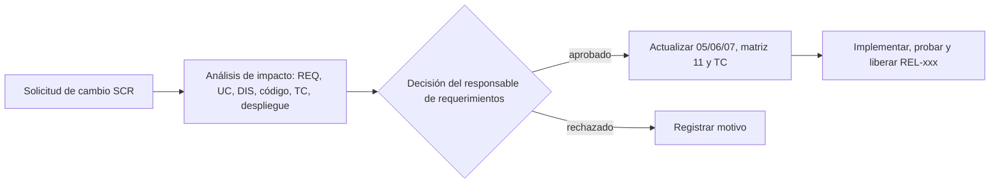

# Control de cambios de requerimientos

| Campo | Valor |
|---|---|
| ID documental | DOC-01-12 |
| Versión | 1.0 |
| Estado | BORRADOR — PENDIENTE DE VALIDACIÓN |
| Fecha de generación | 2026-10-16 |
| Responsable | PENDIENTE DE ASIGNACIÓN |
| Evidencia base | rama `feature/verificacion-seguridad`, commit `4742737` |

## Propósito

Definir cómo se solicitan, evalúan, aprueban y registran los cambios a los requerimientos, y dejar constancia de los cambios históricos deducibles del repositorio.

## Alcance

Todos los REQ-F, REQ-NF y RN. No existe evidencia de un comité de cambios ni de aprobaciones formales; el procedimiento siguiente es una **propuesta [REC]**.

## 1. Procedimiento propuesto [REC]

1. Cualquier interesado registra una solicitud **SCR-NNN** con la plantilla de §2.
2. Se analiza el impacto usando [11_MATRIZ_DE_TRAZABILIDAD.md](11_MATRIZ_DE_TRAZABILIDAD.md).
3. Decide el responsable (PENDIENTE DE ASIGNACIÓN); cambios que afecten datos personales o productos restringidos requieren además a cumplimiento (INT-03).
4. Se actualizan los documentos, los casos de prueba y el registro de cambios de [../00_GESTION_DEL_PROYECTO/08_REGISTRO_DE_CAMBIOS.md](../00_GESTION_DEL_PROYECTO/08_REGISTRO_DE_CAMBIOS.md).

## 2. Plantilla de solicitud de cambio

| Campo | Valor |
|---|---|
| ID | SCR-NNN |
| Fecha | AAAA-MM-DD |
| Solicitante | |
| REQ afectados | |
| Descripción del cambio | |
| Justificación | |
| Impacto (código, datos, pruebas, despliegue, seguridad, legal) | |
| Prioridad | Alta / Media / Baja |
| Decisión | Aprobado / Rechazado / Aplazado |
| Responsable de la decisión | |
| Fecha de decisión | |
| Liberación (REL) | |

## 3. Cambios históricos deducidos (sin aprobación formal registrada)

Fuente: [../docs/CHANGELOG.md](../docs/CHANGELOG.md), [../docs/AUDITORIA_TECNICA.md](../docs/AUDITORIA_TECNICA.md) e historial Git. Fechas según esos documentos; "Aprobado por": **NO DETERMINADO** (los documentos aluden a instrucciones del interesado, cuyo texto no está en el repositorio).

| ID | Fecha | Cambio | REQ afectados | Liberación | Evidencia |
|---|---|---|---|---|---|
| CR-H-001 | 2026-10-13 | Registro por pasos con tipo de institución y estados de verificación: registrarse deja de habilitar la compra; institución fijada por revisor, no por dominio del correo | REQ-F-001, REQ-F-014, REQ-F-028 | REL-002 | CHANGELOG "Verificación institucional de compradores"; migración 001 |
| CR-H-002 | 2026-10-13 | Visitantes y cuentas no aprobadas ven vitrina sin precios ni restringidos | REQ-F-014 | REL-002 | CHANGELOG; AUDITORIA_TECNICA H3 |
| CR-H-003 | 2026-10-13 (tarde) | **Registro mínimo**: se elimina la exigencia de 12+ campos (minimización) | REQ-F-001 | REL-003 | CHANGELOG; AUDITORIA_TECNICA A8 |
| CR-H-004 | 2026-10-13 (tarde) | **Verificación diferida a la compra**: cuenta con correo verificado compra uso general; restringidos exigen verificación con doble comprobación y autorización por compra | REQ-F-019, REQ-F-027, REQ-F-028, REQ-F-029 | REL-003 | CHANGELOG; migración 002; AUDITORIA_TECNICA A9 |
| CR-H-005 | 2026-10-13 (tarde) | Superadministrador, cambio obligatorio de contraseña inicial, permisos granulares para rutas heredadas | REQ-F-009, REQ-F-030 | REL-003 | CHANGELOG; AUDITORIA_TECNICA A6, A7 |
| CR-H-006 | 2026-10-15 | **Registro verificado**: solo personas del padrón; terna NIT + nombre + institución; aprobación del administrador; captcha | REQ-F-001 a REQ-F-005 | REL-004 | CHANGELOG 2026-10-15; migración 003; `../docs/REGISTRO_VERIFICADO.md` |
| CR-H-007 | 2026-10-15 | Códigos MFA, autorizaciones de compra, cambio de correo, comprobantes y avisos de seguridad por nodemailer en lugar de n8n (W5 y W9 sin uso) | REQ-F-006, REQ-F-011, REQ-F-025, REQ-NF-008 | REL-004 | CHANGELOG; `../docs/REGISTRO_VERIFICADO.md` §4 |
| CR-H-008 | 2026-10-15 | Metas de rendimiento (registro/login < 600 ms; aprobar/rechazar/contador < 300 ms) | REQ-NF-006 | REL-004 | `../docs/REGISTRO_VERIFICADO.md` §5 |

Nota: CR-H-003/004 relajan parcialmente CR-H-001 (de "aprobado para comprar" a "cuenta activa compra uso general"); CR-H-006 vuelve a exigir aprobación previa, esta vez para tener cuenta. La coexistencia de `usuarios.estado_cuenta` (registro) y `clientes.estado_verificacion` (verificación en compra) es consecuencia de estos cambios sucesivos [INF].

## 4. Cambios abiertos (pendientes de decisión)

| ID | Tema | Origen | Estado |
|---|---|---|---|
| CR-P-001 | ¿W11 debe dejar de enviar el NIT de la entidad a n8n? | `../docs/REGISTRO_VERIFICADO.md` §4 (BUG-014) | PENDIENTE de decisión del interesado |
| CR-P-002 | ¿Las cuentas existentes antes de la migración 003 (quedaron `activa`) deben pasar por revisión? | `../docs/REGISTRO_VERIFICADO.md` §7 | PENDIENTE |
| CR-P-003 | Proteger `GET /api/reportes/mensual` | BUG-001 (esta auditoría) | Propuesto [REC] |
| CR-P-004 | Pantalla "Mi cuenta" | BUG-004 (esta auditoría) | Propuesto [REC] |

## 5. Registro de versiones de este conjunto de requerimientos

| Versión | Fecha | Descripción | Autor |
|---|---|---|---|
| 1.0 | 2026-10-16 | Línea base reconstruida por la auditoría documental | PENDIENTE DE ASIGNACIÓN |

## Referencias

- [../00_GESTION_DEL_PROYECTO/07_REGISTRO_DE_DECISIONES.md](../00_GESTION_DEL_PROYECTO/07_REGISTRO_DE_DECISIONES.md)
- [../06_IMPLEMENTACION/16_REGISTRO_DE_VERSIONES_Y_LIBERACIONES.md](../06_IMPLEMENTACION/16_REGISTRO_DE_VERSIONES_Y_LIBERACIONES.md)
