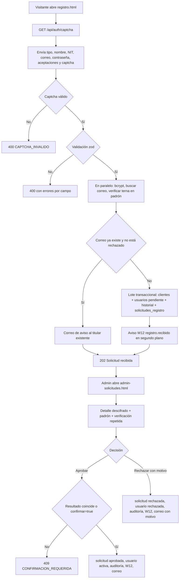
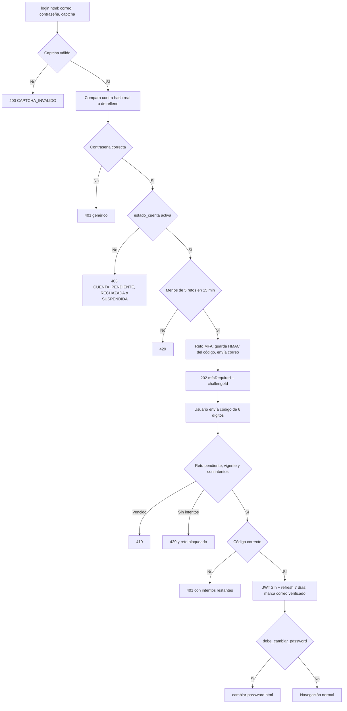
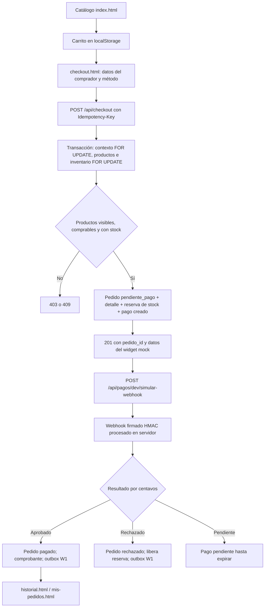
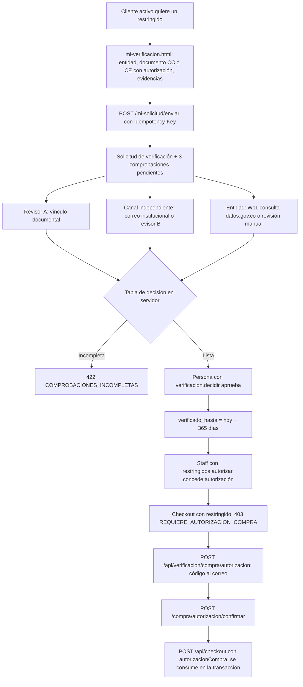
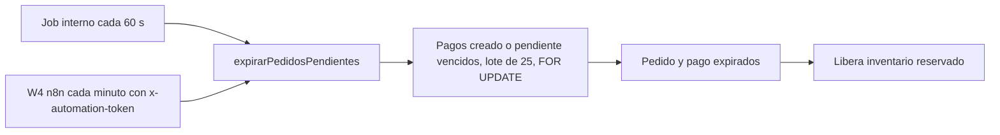
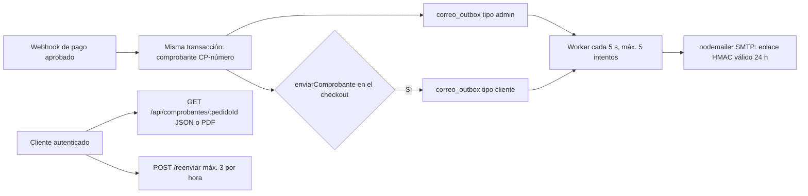

# Procesos del negocio

| Campo | Valor |
|---|---|
| ID documental | DOC-02-03 |
| Versión | 1.0 |
| Estado | BORRADOR — PENDIENTE DE VALIDACIÓN |
| Fecha de generación | 2026-10-16 |
| Responsable | PENDIENTE DE ASIGNACIÓN |
| Evidencia base | rama `feature/verificacion-seguridad`, commit `4742737` |

## Propósito

Describir los procesos de negocio que el sistema ejecuta realmente, con diagramas y la evidencia de código que los respalda.

## Alcance

Seis procesos principales (P-01 a P-06) y tres procesos de soporte (P-07 a P-09). Solo se modela lo que aparece en el código. Los procesos son **[OBS]** salvo indicación. No hay evidencia de procesos manuales fuera del sistema (despacho físico, facturación, cobro real): quedan **NO DETERMINADO**.

| ID | Proceso | Casos de uso | Evidencia principal |
|---|---|---|---|
| P-01 | Registro y aprobación de cuentas | UC-001, UC-002 | `routes/auth.js` `/registro`, `seguridad/registroVerificado.js`, `routes/solicitudesRegistro.js` |
| P-02 | Inicio de sesión con MFA | UC-003, UC-004, UC-005 | `routes/auth.js` |
| P-03 | Compra de uso general | UC-007 a UC-010 | `routes/checkout.js`, `routes/pagos.js` |
| P-04 | Compra con productos restringidos (verificación institucional) | UC-012, UC-013, UC-014 | `routes/verificacion.js`, `verificacionCompra.js`, `routes/checkout.js` |
| P-05 | Expiración de pedidos y liberación de inventario | UC-023 | `paymentJobs.js`, `routes/automatizaciones.js` |
| P-06 | Emisión y envío de comprobantes | UC-011 | `receiptService.js`, `emailOutbox.js`, `routes/comprobantes.js` |
| P-07 | Sincronización del padrón | UC-023 | `seguridad/padron.js` |
| P-08 | Atención: asistente, calificación, PQRS | UC-019, UC-020 | `routes/asistente.js`, `routes/atencion.js` |
| P-09 | Administración del catálogo y cumplimiento | UC-015 | `routes/productos.js`, `routes/verificacion.js` (`/admin/productos`) |

Todas las rutas de código de este documento son relativas a `../backend/src/`.

## P-01 Registro y aprobación de cuentas

**Regla central:** registrarse no habilita (RN-001). La respuesta al navegador es siempre la misma (RN-004).

- Resultados posibles de la verificación: `coincide`, `nit_no_existe`, `nombre_no_coincide`, `institucion_no_coincide`, `persona_inactiva`, `padron_no_disponible` (`seguridad/padron.js`).
- Una cuenta **rechazada** puede volver a solicitar: el lote `SQL_NUEVA_SOLICITUD` reactiva la cuenta como `pendiente` y crea una nueva solicitud (RN-023).
- Decisión concurrente: el `UPDATE` exige `estado = 'pendiente'`; si otro administrador ya decidió, responde 409 `YA_DECIDIDA`.

## P-02 Inicio de sesión con MFA

## P-03 Compra de uso general

**Condición:** cuenta activa (`estado_cuenta = 'activa'`, correo verificado, no suspendida) y producto elegible para la institución del catálogo (RN-009, `autorizacion.js`).

- El precio y el total se calculan con los valores de MySQL (RN-013).
- Las referencias institucionales con `cotizacion_requerida` no se pueden comprar; el motivo se informa como `cotizacion_requerida`.
- **[INF]** El cobro real no existe: el proceso termina en un pago simulado (REQ-F-040, RSK-015).

## P-04 Compra con productos restringidos

- Cuatro ojos: vínculo y canal deben registrarlos personas distintas (RN-011).
- La autorización se liga al usuario, al cliente y al hash del carrito; si el carrito cambia, el checkout responde 403 con motivo `carrito_distinto`.
- Una revisión legal `pendiente` o `bloqueada` del producto impide la venta (RN-008).

## P-05 Expiración de pedidos

**[OBS]** Ambos caminos son idempotentes; el job interno garantiza la expiración aunque n8n no esté activo (`paymentJobs.js`). Verificado por `paymentJobs.test` (REQ-F-022).

## P-06 Comprobantes

## P-07 Sincronización del padrón

**[OBS]** Al arrancar y cada `PADRON_SYNC_MINUTOS` (10 por defecto), el backend lee la fuente (solo `SELECT`), calcula `nit_hash` (HMAC), cifra nombre y entidad, compara una huella para no reescribir filas sin cambios y marca `inactiva` las filas que desaparecen (`seguridad/padron.js`). Estado: IMPLEMENTADO, NO VERIFICADO (REQ-F-003).

## P-08 Atención

- Asistente: reglas locales sobre el índice del catálogo filtrado por `evaluarProducto`; 20 mensajes por minuto por IP; preguntas sin respuesta se guardan en `asistente_pendientes`; escalamiento W6 sin datos personales.
- Calificación 1–5 (`/api/atencion/calificacion`) — sin autenticación ni límite (BUG-002).
- PQRS/soporte/cotización (`/api/atencion/solicitudes`): radicado `SI-00000000`, NIT y correo cifrados, 5 por IP cada 15 min. **[OBS]** No existe en el repositorio una pantalla para que el personal gestione estas solicitudes: su gestión posterior es **NO DETERMINADO**.

## P-09 Catálogo y cumplimiento

- Crear, editar y retirar productos y categorías exige `catalogo.gestionar`; cambiar la restricción o la institución de un producto exige además `productos.cumplimiento` (403 en `routes/productos.js`).
- Elegibilidad M:N y revisión legal se gestionan en `PUT /api/verificacion/admin/productos/:id/cumplimiento` con sustento obligatorio (mínimo 10 caracteres).

## Referencias

- [05_CASOS_DE_USO.md](05_CASOS_DE_USO.md), [07_FLUJOS_PRINCIPALES_Y_ALTERNATIVOS.md](07_FLUJOS_PRINCIPALES_Y_ALTERNATIVOS.md)
- [Reglas de negocio](../01_INGENIERIA_DE_REQUERIMIENTOS/07_REGLAS_DE_NEGOCIO.md)
- [docs/POLITICA_VERIFICACION_IDENTIDAD.md](../docs/POLITICA_VERIFICACION_IDENTIDAD.md), [docs/REGISTRO_VERIFICADO.md](../docs/REGISTRO_VERIFICADO.md)
