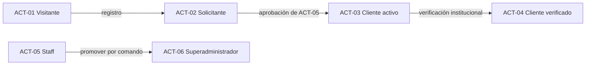

# Mapa de actores y permisos

| Campo | Valor |
|---|---|
| ID documental | DOC-02-04 |
| Versión | 1.0 |
| Estado | BORRADOR — PENDIENTE DE VALIDACIÓN |
| Fecha de generación | 2026-10-16 |
| Responsable | PENDIENTE DE ASIGNACIÓN |
| Evidencia base | rama `feature/verificacion-seguridad`, commit `4742737` |

## Propósito

Identificar los actores humanos y de sistema, cómo los reconoce el software y qué puede hacer cada uno, según el código de autorización.

## Alcance

Fuentes: `backend/src/autorizacion.js` (contexto, permisos, `evaluarProducto`), `backend/src/routes/auth.js` (`requiereAutenticacion`, `requiereAdmin`), `backend/src/routes/solicitudesRegistro.js`, middlewares de cada ruta y `backend/src/automationAuth.js`. Todo es **[OBS]** salvo indicación.

## 1. Actores

| ID | Actor | Cómo lo identifica el sistema | Tipo |
|---|---|---|---|
| ACT-01 | Visitante | Sin cabecera `Authorization` → `CONTEXTO_INVITADO` | Humano |
| ACT-02 | Solicitante | `usuarios.estado_cuenta = 'pendiente'` (o `rechazada`); el login responde 403 | Humano |
| ACT-03 | Cliente activo | `rol = 'cliente'`, `estado_cuenta = 'activa'`, `correo_verificado_en` no nulo, `estado_verificacion` ≠ `suspendido` → `cuentaActiva` | Humano |
| ACT-04 | Cliente verificado | ACT-03 + `estado_verificacion = 'aprobado'`, `institucion_aprobada`, `verificado_hasta` vigente; con `autorizacion_general = TRUE` → `autorizadoRestringidos` | Humano |
| ACT-05 | Administrador / staff | `usuarios.rol = 'admin'`; facultades = filas de `staff_permisos` | Humano |
| ACT-06 | Superadministrador | `rol = 'admin'` y `usuarios.es_superadmin = TRUE`; creado solo por `backend/scripts/crear-superadmin.js` (RN-018) | Humano |
| ACT-07 | n8n | Token `x-automation-token` (W2, W4, mantenimiento W11), HMAC + nonce (resultado W11); recibe eventos firmados | Sistema |
| ACT-08 | Proveedor de pago mock | Webhook `/api/pagos/webhook/mock` firmado con `PAYMENT_WEBHOOK_SECRET` | Sistema |
| ACT-09 | Fuente del padrón | Conexión de solo lectura `PADRON_DB_URI` / `MYSQL_ADDON_URI` | Sistema |
| ACT-10 | Servidor SMTP | `SMTP_*` (nodemailer); en laboratorio Mailpit o consola | Sistema |
| ACT-11 | Tareas programadas del backend | `setInterval` en `paymentJobs.js`, `verificacionJobs.js`, `emailOutbox.js`, `automationOutbox.js`, `seguridad/padron.js` | Sistema |

## 2. Permisos administrativos (13)

Definidos en `PERMISOS_STAFF` (`backend/src/autorizacion.js`) y almacenados en `staff_permisos`. `requierePermiso()` los lee de la base en cada petición, no del token.

| Permiso | Facultad | Categoría |
|---|---|---|
| `verificacion.ver` | Consultar solicitudes de verificación y sus datos | Normal |
| `verificacion.decidir` | Registrar revisión documental; aprobar, rechazar o pedir información | Normal |
| `verificacion.confirmar_institucion` | Registrar la confirmación institucional (segunda comprobación) | Normal |
| `documentos.ver` | Descargar documentos de acreditación | **Datos personales** |
| `identificadores.ver` | Ver el número completo del documento de identidad (con justificación de 20–500 caracteres) | **Datos personales** y **reservado al superadmin** |
| `cuentas.suspender` | Suspender y reactivar cuentas | Normal |
| `restringidos.autorizar` | Conceder o revocar productos restringidos | Normal |
| `productos.cumplimiento` | Elegibilidad, restricción y revisión legal de productos | Normal |
| `catalogo.gestionar` | Crear, editar y retirar productos y categorías | Normal |
| `pedidos.gestionar` | Consultar y actualizar pedidos de todos los clientes | Normal |
| `clientes.gestionar` | Fichas de clientes, solicitudes de cuenta y **solicitudes de registro** | Normal |
| `auditoria.ver` | Consultar la auditoría | Normal |
| `staff.permisos` | Crear personal y asignar permisos | **Reservado al superadmin** |

Reglas (RN-017):

- **Datos personales** (`PERMISOS_DATOS_PERSONALES`): ni el superadministrador los tiene implícitamente; deben concederse y su uso queda auditado.
- **Reservados** (`PERMISOS_RESERVADOS_SUPERADMIN`): solo un superadministrador los concede o retira.
- Un administrador con `staff.permisos` solo concede los permisos que tiene, no se modifica a sí mismo (409 al intentar quitarse `staff.permisos`) y no toca a un superadministrador (403).
- El superadministrador tiene implícitos todos los permisos excepto los de datos personales.
- El administrador sembrado desde `ADMIN_EMAIL`/`ADMIN_PASSWORD` recibe todos los permisos salvo `identificadores.ver` y queda con `debe_cambiar_password` (`backend/src/db.js`).

## 3. Matriz actor × capacidad

Leyenda: ✔ permitido · ✖ denegado (código) · P = requiere el permiso indicado · — no aplica.

| Capacidad (endpoint principal) | ACT-01 | ACT-02 | ACT-03 | ACT-04 | ACT-05 | ACT-06 |
|---|---|---|---|---|---|---|
| Ver catálogo vitrina (`GET /api/productos`) | ✔ vitrina | ✔ vitrina* | ✔ completo (su ámbito) | ✔ completo + restringidos elegibles | ✔ completo (no compra) | ✔ |
| Solicitar cuenta (`POST /api/auth/registro`) | ✔ | ✔ (si rechazada) | 202 genérico | 202 genérico | — | — |
| Iniciar sesión (`POST /api/auth/login`) | — | ✖ 403 `CUENTA_PENDIENTE`/`RECHAZADA` | ✔ | ✔ | ✔ | ✔ |
| Mi cuenta (`/api/mi-cuenta`) | ✖ 401 | ✖ | ✔ | ✔ | Solo cambio de contraseña sin perfil (403 "sin perfil de cliente") | idem |
| Comprar uso general (`POST /api/checkout`) | ✖ 401 | ✖ | ✔ | ✔ | ✖ 403 (staff no compra) | ✖ |
| Comprar restringidos | ✖ | ✖ | ✖ (producto oculto) | ✔ con autorización por compra | ✖ | ✖ |
| Mi verificación (`/api/verificacion/mi-solicitud`) | ✖ 401 | ✖ | ✔ | ✔ | ✖ 403 "sección para compradores" | ✖ |
| Comprobantes propios | ✖ (salvo enlace firmado) | ✖ | ✔ | ✔ | — | — |
| Reportes propios (`/api/mis-reportes`) | ✖ 401 | ✖ | ✔ | ✔ | — | — |
| Solicitudes de registro (`/api/admin/solicitudes`) | ✖ 401 | ✖ | ✖ 403 | ✖ 403 | P `clientes.gestionar` | ✔ |
| Clientes (`/api/clientes`) | ✖ | ✖ | ✖ 403 | ✖ 403 | P `clientes.gestionar` | ✔ |
| Productos/categorías (escritura) | ✖ | ✖ | ✖ | ✖ | P `catalogo.gestionar` (+ `productos.cumplimiento` para restricción/institución) | ✔ |
| Pedidos de todos (`/api/pedidos/todos`) | ✖ | ✖ | ✖ | ✖ | P `pedidos.gestionar` | ✔ |
| Verificaciones (`/api/verificacion/admin/*`) | ✖ | ✖ | ✖ | ✖ | P según acción | ✔ (salvo datos personales) |
| Descargar documentos / revelar identificador | ✖ | ✖ | ✖ | ✖ | P `documentos.ver` / `identificadores.ver` | Solo si se los concede |
| Personal y permisos | ✖ | ✖ | ✖ | ✖ | P `staff.permisos` (limitado) | ✔ |
| Diagnóstico (`/api/verificacion/admin/diagnostico`) | ✖ | ✖ | ✖ | ✖ | ✖ 403 | ✔ |
| Auditoría (`/api/auditoria`) | ✖ | ✖ | ✖ | ✖ | P `auditoria.ver` | ✔ |
| Reporte mensual (`GET /api/reportes/mensual`) | **✔ (BUG-001)** | ✔ | ✔ | ✔ | ✔ | ✔ |
| Calificar atención / PQRS | ✔ | ✔ | ✔ | ✔ | ✔ | ✔ |

\* Un solicitante no puede iniciar sesión, por lo que en la práctica navega como visitante.

Actores de sistema:

| Capacidad | ACT-07 n8n | ACT-08 Pago mock | ACT-11 Jobs |
|---|---|---|---|
| `GET /api/automatizaciones/resumen-diario` | Token `N8N_W2_DAILY_SUMMARY_TOKEN` | — | — |
| `POST /api/automatizaciones/pedidos/expirar` | Token `N8N_W4_EXPIRY_TOKEN` | — | Equivalente interno cada 60 s |
| `POST /api/automatizaciones/verificaciones/resultado` | HMAC `N8N_W11_CALLBACK_SECRET` + nonce; solo componente `entidad` (RN-012) | — | — |
| `POST /api/automatizaciones/verificaciones/mantenimiento` | Token `N8N_W11_MAINTENANCE_TOKEN` | — | Equivalente interno cada 5 min |
| `GET /api/asistente/pendientes/resumen-semanal` | Bearer `ASSISTANT_WEEKLY_SUMMARY_TOKEN` (W7) | — | — |
| `POST /api/pagos/webhook/mock` | — | HMAC `x-payment-signature` | — |

Si un token de automatización no está configurado (o tiene menos de 32 caracteres) la ruta responde 503; si no coincide, 401.

## 4. Visibilidad y compra de productos (`evaluarProducto`)

| Contexto | Producto de uso general | Producto de su institución | Producto de otra institución | Producto restringido elegible | Revisión legal `bloqueada` |
|---|---|---|---|---|---|
| Visitante | Vitrina, motivo `requiere_login` | Vitrina | Vitrina | Oculto (404) | Oculto |
| Sesión sin cuenta activa | Vitrina, `cuenta_no_activa` o `cuenta_suspendida` | Vitrina | Vitrina | Oculto | Oculto |
| Cliente activo (institución declarada) | Completo, comprable | Completo, comprable | Oculto | Oculto | Oculto |
| Cliente verificado | Completo | Completo | Oculto | Completo; compra si `autorizadoRestringidos`, si no motivo `requiere_autorizacion_restringidos`; siempre `requiereAutorizacionCompra` | Oculto |
| Staff | Completo, `puedeComprar=false` | idem | idem | idem | idem |

Motivos adicionales que impiden comprar un producto visible: `revision_legal_pendiente` (RN-008), `cotizacion_requerida` (metadatos), `cuenta_de_prueba` (RN-019, solo en producción).

**[INF]** La "vitrina" del visitante incluye productos de todas las instituciones (nombre e imagen, sin precio ni inventario), excepto restringidos y bloqueados. Coincide con la tabla de [docs/ARQUITECTURA_OBJETIVO.md](../docs/ARQUITECTURA_OBJETIVO.md), salvo que esa tabla describe el estado previo a la migración 002 (la cuenta activa ya compra uso general).

## 5. Observaciones

- **[OBS]** `requiereAdmin` de `routes/auth.js` usa el rol leído de la base en cada petición (no el del token).
- **[OBS]** El panel de solicitudes de registro autoriza en el mismo lote SQL de la operación (`CONDICION_ADMIN`): exige rol admin, cuenta activa, sin contraseña inicial pendiente y `clientes.gestionar` o superadmin.
- **[REC]** Corregir BUG-001 exigiendo autenticación y un permiso (p. ej. `auditoria.ver` o uno nuevo) en `/api/reportes/mensual`.

## Referencias

- [05_CASOS_DE_USO.md](05_CASOS_DE_USO.md)
- [Diseño de seguridad](../03_DISENO/10_DISENO_DE_SEGURIDAD.md)
- [docs/SUPERUSUARIO_Y_CUENTAS_PRUEBA.md](../docs/SUPERUSUARIO_Y_CUENTAS_PRUEBA.md)
