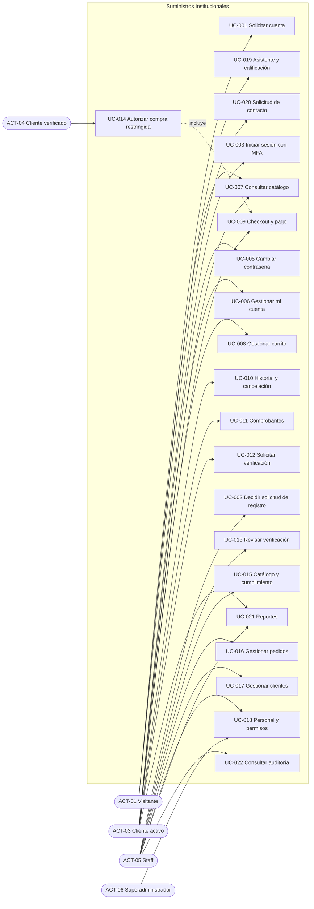
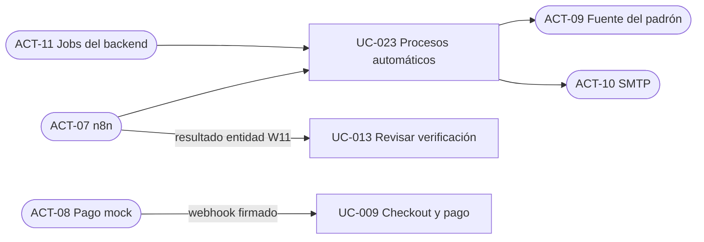

# Casos de uso

| Campo | Valor |
|---|---|
| ID documental | DOC-02-05 |
| Versión | 1.0 |
| Estado | BORRADOR — PENDIENTE DE VALIDACIÓN |
| Fecha de generación | 2026-10-16 |
| Responsable | PENDIENTE DE ASIGNACIÓN |
| Evidencia base | rama `feature/verificacion-seguridad`, commit `4742737` |

## Propósito

Listar los casos de uso del sistema, sus actores y su relación con los requerimientos funcionales.

## Alcance

23 casos de uso (UC-001 a UC-023) reconstruidos a partir de las rutas del backend y las páginas del frontend. Son **[OBS]** en cuanto a su existencia en el código; el nombre y la agrupación son **[INF]**. La especificación detallada está en [06_ESPECIFICACION_DE_CASOS_DE_USO.md](06_ESPECIFICACION_DE_CASOS_DE_USO.md).

## 1. Catálogo de casos de uso

| ID | Caso de uso | Actor principal | Actores secundarios | REQ-F | Pantalla | Estado del REQ |
|---|---|---|---|---|---|---|
| UC-001 | Solicitar cuenta | ACT-01 | ACT-09, ACT-10, ACT-07 | 001, 002 | `registro.html` | IMPLEMENTADO Y VERIFICADO |
| UC-002 | Revisar y decidir solicitud de registro | ACT-05 / ACT-06 | ACT-10, ACT-07 | 004 | `admin-solicitudes.html` | IMPLEMENTADO Y VERIFICADO |
| UC-003 | Iniciar sesión con MFA | ACT-03 / ACT-04 / ACT-05 / ACT-06 | ACT-10 | 005, 006 | `login.html` | IMPLEMENTADO Y VERIFICADO |
| UC-004 | Renovar y cerrar sesión | Usuario autenticado | — | 007, 008 | `js/auth.js` | 007 VERIFICADO; 008 NO VERIFICADO |
| UC-005 | Cambiar contraseña (incl. inicial obligatoria) | Usuario autenticado | ACT-10 | 009, 012 | `cambiar-password.html` | IMPLEMENTADO Y VERIFICADO |
| UC-006 | Gestionar mi cuenta | ACT-03 / ACT-04 | ACT-10, ACT-05 | 010, 011, 012, 013 | Pantalla `mi-cuenta.html` (2026-10-16) | IMPLEMENTADO Y VERIFICADO |
| UC-007 | Consultar catálogo y detalle | Todos | — | 014, 015 | `index.html`, `producto-detalle.html`, `landing.html` | 014 VERIFICADO; 015 NO VERIFICADO |
| UC-008 | Gestionar carrito | ACT-01 a ACT-04 | — | 018 | `js/cart.js` | IMPLEMENTADO, NO VERIFICADO |
| UC-009 | Realizar checkout y pago (mock) | ACT-03 / ACT-04 | ACT-08 | 019, 020, 021, 040 | `checkout.html` | Mixto (ver REQ) |
| UC-010 | Consultar historial y cancelar pedido | ACT-03 / ACT-04 | — | 023 | `historial.html`, `mis-pedidos.html` | IMPLEMENTADO, NO VERIFICADO |
| UC-011 | Obtener y reenviar comprobante | ACT-03 / ACT-04 | ACT-10 | 025 | `checkout.html`, `historial.html` | IMPLEMENTADO Y VERIFICADO |
| UC-012 | Solicitar verificación institucional | ACT-03 | ACT-07 | 027 | `mi-verificacion.html` | IMPLEMENTADO, NO VERIFICADO |
| UC-013 | Revisar verificación y decidir | ACT-05 | ACT-07, ACT-10 | 028 | `admin-verificaciones.html` | IMPLEMENTADO Y VERIFICADO (tabla de decisión) |
| UC-014 | Autorizar compra con restringidos | ACT-04 | ACT-10 | 029 | `checkout.html` | IMPLEMENTADO, NO VERIFICADO |
| UC-015 | Administrar catálogo y cumplimiento | ACT-05 | — | 016, 017 | `admin-productos.html`, `admin-verificaciones.html` | IMPLEMENTADO, NO VERIFICADO |
| UC-016 | Gestionar pedidos (admin) | ACT-05 | — | 024 | `admin-pedidos.html`, `admin-dashboard.html` | IMPLEMENTADO, NO VERIFICADO |
| UC-017 | Gestionar clientes (admin) | ACT-05 | — | 026 | `admin-clientes.html`, `registro.html` (modo edición) | IMPLEMENTADO Y VERIFICADO |
| UC-018 | Gestionar personal, permisos y diagnóstico | ACT-05 (`staff.permisos`) / ACT-06 | — | 030 | `admin-verificaciones.html` | IMPLEMENTADO, NO VERIFICADO |
| UC-019 | Consultar asistente y calificar atención | Todos | ACT-07 (W6) | 031, 032 | `js/chatbot.js` en varias páginas | 031 VERIFICADO; 032 NO VERIFICADO |
| UC-020 | Radicar solicitud de contacto | ACT-01 y otros | — | 032 | `contacto.html` | IMPLEMENTADO, NO VERIFICADO |
| UC-021 | Consultar reportes y registrar reporte de cliente | ACT-05 / ACT-03 | — | 033 | `reportes.html`, `mis-reportes.html` | IMPLEMENTADO, NO VERIFICADO (BUG-001) |
| UC-022 | Consultar auditoría | ACT-05 (`auditoria.ver`) | — | 034 | Sin pantalla dedicada identificada **[INF]** | IMPLEMENTADO, NO VERIFICADO |
| UC-023 | Procesos automáticos | ACT-11 / ACT-07 | ACT-09, ACT-10 | 003, 022, 035, 036, 037 | — | Mixto |

**[OBS]** Ninguna página del frontend llama a `/api/auditoria`; la consulta de auditoría solo es posible por API (ver la búsqueda de rutas `/api/` en `frontend/`).

## 2. Diagrama de casos de uso (vista de actores humanos)

## 3. Diagrama de casos de uso (actores de sistema)

## 4. Relaciones entre casos de uso

| Relación | Descripción | Evidencia |
|---|---|---|
| UC-003 incluye UC-005 | Si `debe_cambiar_password`, el usuario solo puede cambiar la contraseña | `requiereAutenticacion` (`RUTAS_CON_CAMBIO_PENDIENTE`) |
| UC-009 extiende con UC-014 | Si el carrito tiene restringidos, el checkout exige autorización por compra | `routes/checkout.js` (`REQUIERE_AUTORIZACION_COMPRA`) |
| UC-014 requiere UC-012 y UC-013 | La autorización exige verificación aprobada y vigente | `routes/verificacion.js` `/compra/autorizacion` |
| UC-009 dispara UC-011 | Un pago aprobado crea el comprobante | `routes/pagos.js`, `receiptService.js` |
| UC-001 precede a UC-002 y UC-003 | Sin aprobación no hay inicio de sesión | RN-001 |

## Referencias

- [06_ESPECIFICACION_DE_CASOS_DE_USO.md](06_ESPECIFICACION_DE_CASOS_DE_USO.md)
- [Matriz de trazabilidad](../01_INGENIERIA_DE_REQUERIMIENTOS/11_MATRIZ_DE_TRAZABILIDAD.md)
- [04_MAPA_DE_ACTORES_Y_PERMISOS.md](04_MAPA_DE_ACTORES_Y_PERMISOS.md)
