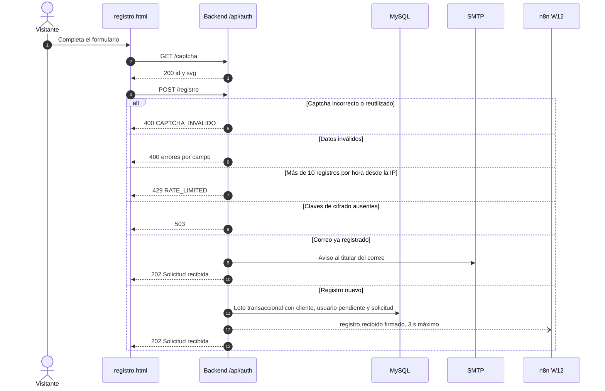
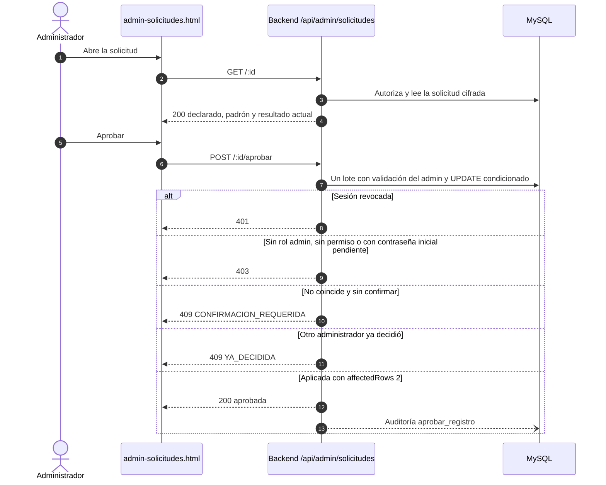
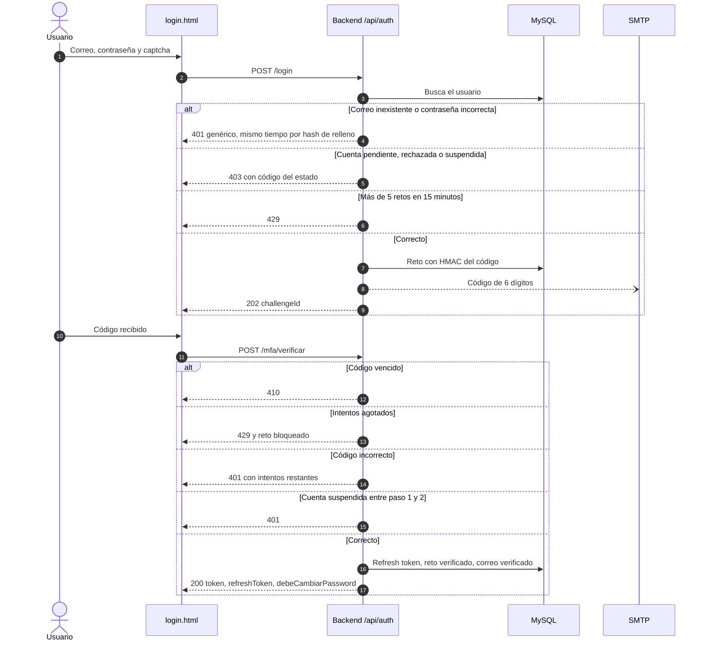
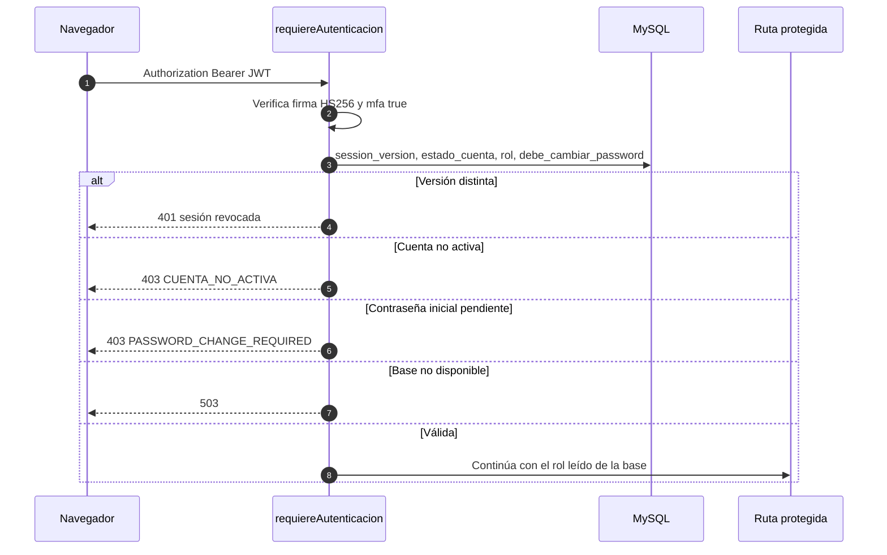
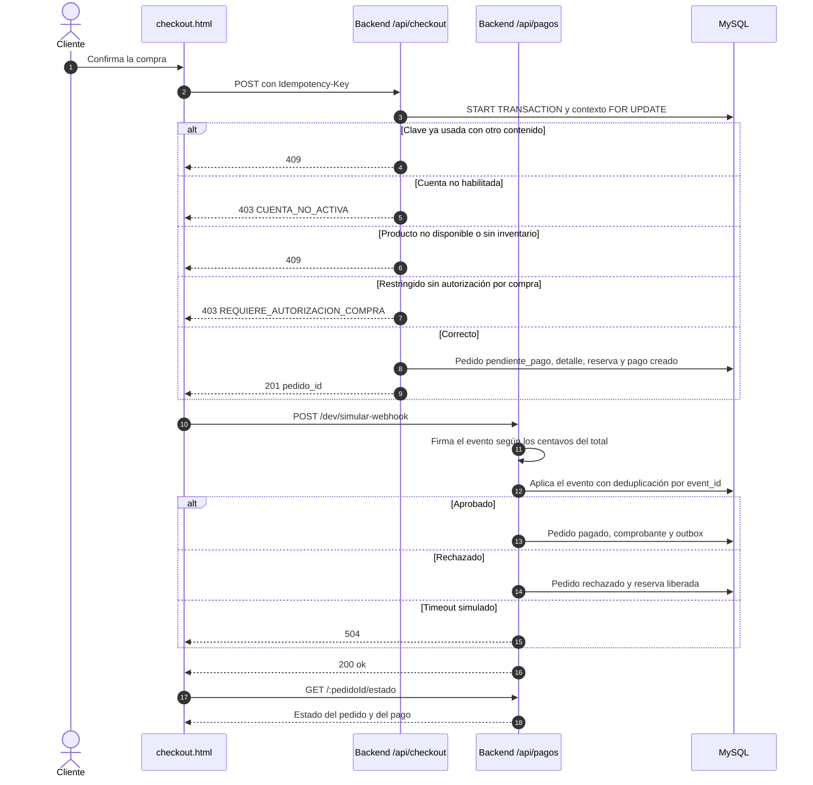
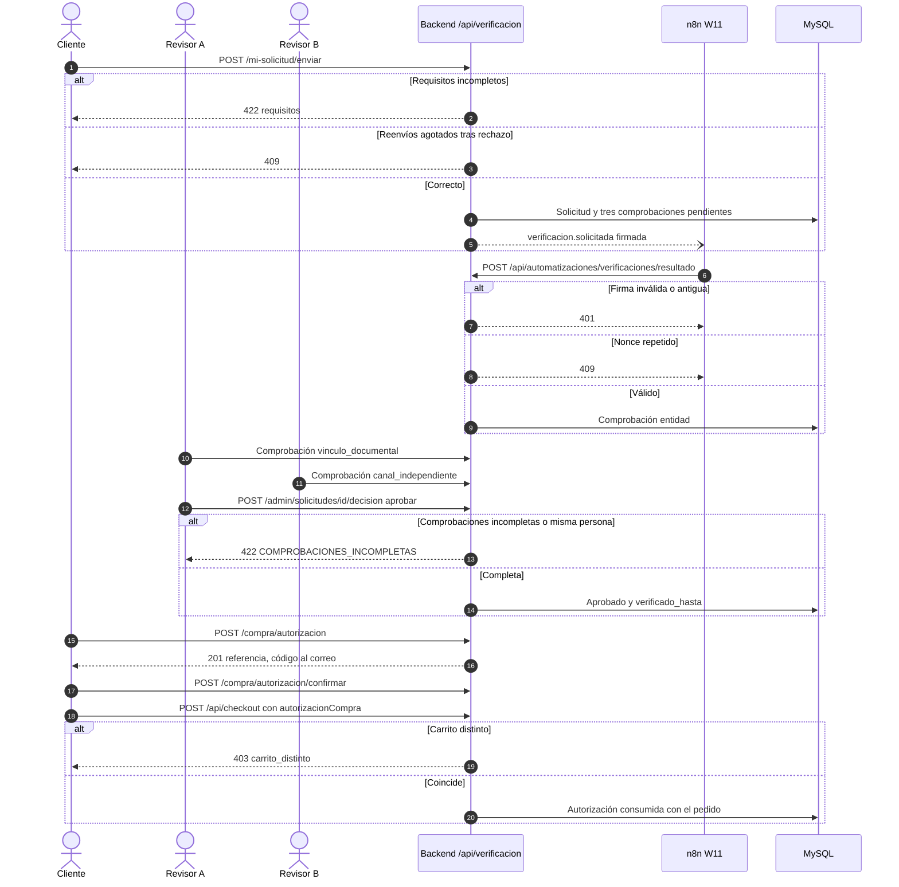
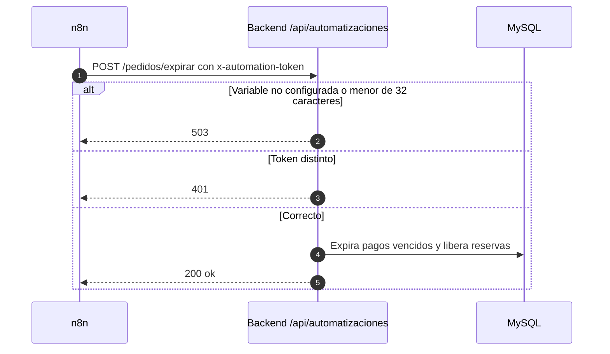
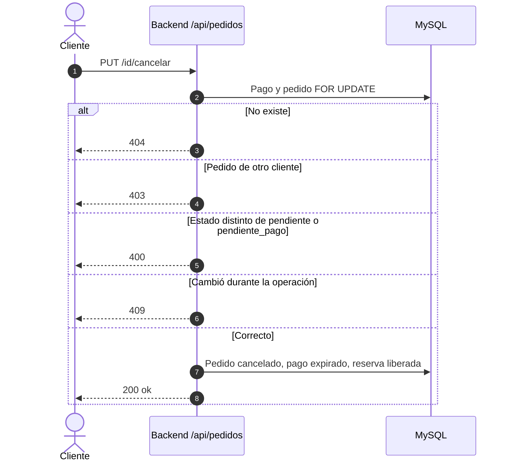

# Flujos principales y alternativos

| Campo | Valor |
|---|---|
| ID documental | DOC-02-07 |
| Versión | 1.0 |
| Estado | BORRADOR — PENDIENTE DE VALIDACIÓN |
| Fecha de generación | 2026-10-16 |
| Responsable | PENDIENTE DE ASIGNACIÓN |
| Evidencia base | rama `feature/verificacion-seguridad`, commit `4742737` |

## Propósito

Representar con diagramas de secuencia los flujos críticos, incluidos los caminos de error, los permisos insuficientes y los casos límite que el código maneja explícitamente.

## Alcance

Ocho flujos (FL-01 a FL-08) y una tabla de casos límite. Los códigos HTTP y las condiciones son **[OBS]** en `backend/src/routes/*.js`. Se complementa con [06_ESPECIFICACION_DE_CASOS_DE_USO.md](06_ESPECIFICACION_DE_CASOS_DE_USO.md).

## FL-01 Registro (UC-001)

**Caso límite:** la respuesta `202` es idéntica para correos nuevos y existentes (RN-004); el aviso a n8n nunca bloquea la respuesta y un fallo solo queda en el log.

## FL-02 Aprobación de la solicitud (UC-002)

## FL-03 Inicio de sesión con MFA (UC-003)

## FL-04 Petición autenticada y revocación (UC-004)

## FL-05 Checkout y pago mock (UC-009)

**Casos límite:** un reintento con la misma `Idempotency-Key` y el mismo contenido devuelve `200` con el pedido existente; en producción o con `PAYMENT_MODE≠mock` la simulación responde `404`.

## FL-06 Verificación y autorización de compra restringida (UC-012 a UC-014)

## FL-07 Automatizaciones con token (UC-023)

## FL-08 Cancelación de pedido (UC-010)

## Tabla de casos límite y códigos

| Situación | Código | Ruta | Fundamento |
|---|---|---|---|
| Endpoint retirado de creación de pedidos | 410 | `POST /api/pedidos`, `POST /api/pagos/procesar` | Pedidos solo por checkout |
| Código MFA o de cambio de correo vencido | 410 | `/api/auth/mfa/verificar`, `/api/mi-cuenta/correo/confirmar` | Vigencia de 5 min |
| Reto de reenvío vencido | 410 | `/api/auth/mfa/reenviar` | — |
| Producto oculto, restringido no elegible o de otra institución | 404 | `GET /api/productos/:id` | Respuesta idéntica a inexistente (no revela) |
| Documento de otro titular | 404 | `/api/verificacion/mi-solicitud/documentos/:id` | Limitado al `cliente_id` |
| Admin intenta comprar | 403 | `POST /api/checkout` | Staff no compra |
| Cambio de restricción sin `productos.cumplimiento` | 403 | `PUT /api/productos/:id` | Escalada vertical |
| Quitarse `staff.permisos` | 409 | `PUT /api/verificacion/admin/permisos/:usuarioId` | RN-017 |
| Cambio de estado de pago manual | 409 | `PUT /api/pedidos/:id` | Solo por evento verificado |
| JSON mal formado | 400 | Todas | Manejador de errores de `app.js` |
| Cuerpo demasiado grande | 413 | `/api/auth`, `/api/admin/solicitudes` (10 kb), resto (100 kb) | `app.js` |
| Base de datos no disponible al validar sesión o permisos | 503 | Middlewares | Fallo cerrado |
| Automatización sin configurar | 503 | `/api/automatizaciones/*`, resumen semanal | Fallo cerrado |
| Reporte mensual sin sesión | **200** | `GET /api/reportes/mensual` | **BUG-001** |

## Referencias

- [03_PROCESOS_DEL_NEGOCIO.md](03_PROCESOS_DEL_NEGOCIO.md)
- [Pruebas funcionales](../05_PRUEBAS/04_PRUEBAS_FUNCIONALES.md)
- [Diseño de API](../03_DISENO/08_DISENO_DE_API.md)
