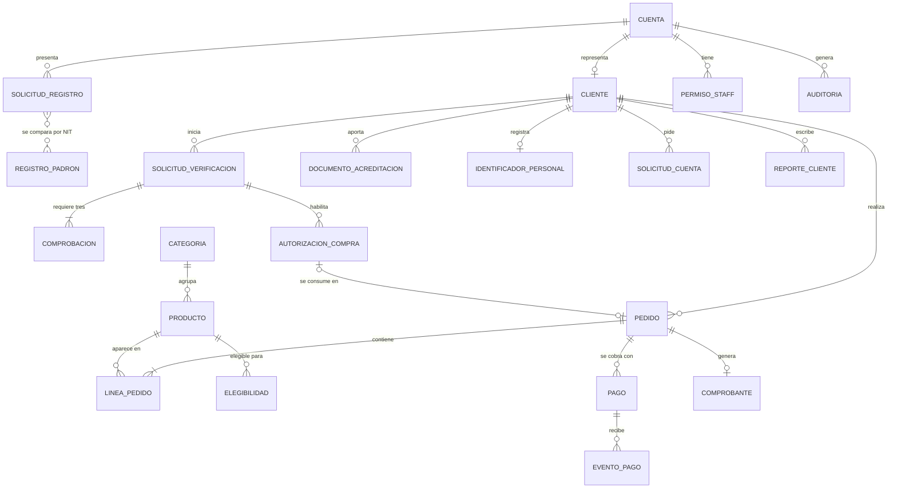
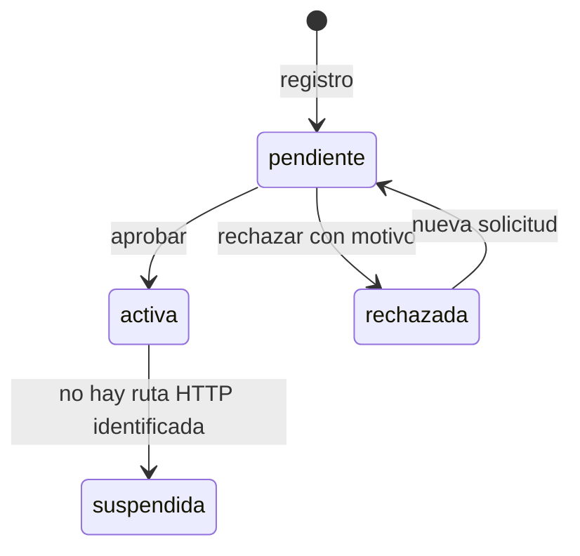
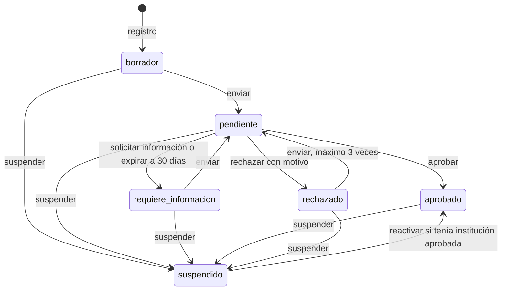
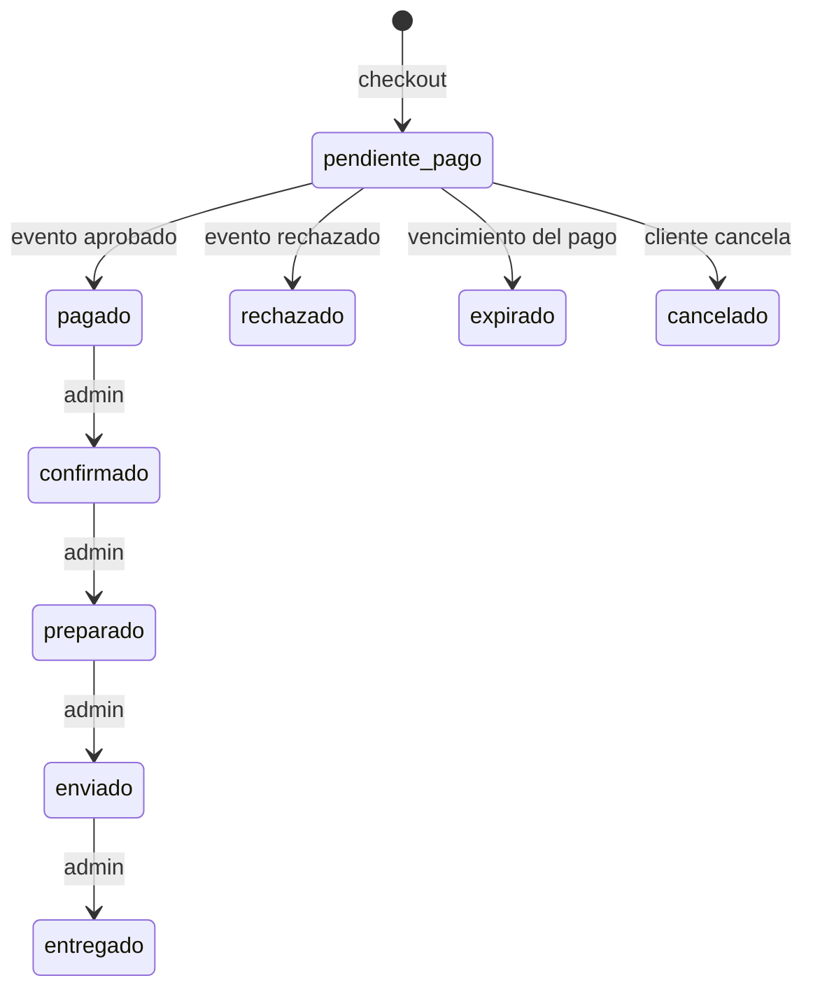

# Modelo conceptual de datos

| Campo | Valor |
|---|---|
| ID documental | DOC-02-08 |
| Versión | 1.0 |
| Estado | BORRADOR — PENDIENTE DE VALIDACIÓN |
| Fecha de generación | 2026-10-16 |
| Responsable | PENDIENTE DE ASIGNACIÓN |
| Evidencia base | rama `feature/verificacion-seguridad`, commit `4742737` |

## Propósito

Presentar las entidades de negocio, sus relaciones y sus ciclos de vida, independientemente de los detalles físicos de MySQL.

## Alcance

Derivado de `backend/src/db.js` y de las migraciones `backend/src/migraciones/001_*.js`, `002_*.js` y `003_*.js` **[OBS]**. La agrupación en entidades de negocio es **[INF]**. El modelo físico (tablas, columnas, tipos, índices) está en [03_DISENO/05_DISENO_DE_BASE_DE_DATOS.md](../03_DISENO/05_DISENO_DE_BASE_DE_DATOS.md) y [03_DISENO/06_MODELO_ENTIDAD_RELACION.md](../03_DISENO/06_MODELO_ENTIDAD_RELACION.md).

## 1. Entidades de negocio

| Entidad conceptual | Significado | Tablas que la materializan |
|---|---|---|
| Cuenta de usuario | Credencial de acceso, rol y estado | `usuarios`, `refresh_tokens`, `retos_mfa` |
| Cliente (comprador institucional) | Persona/unidad compradora con datos privados cifrados y estado de verificación | `clientes`, `datos_sensibles` |
| Solicitud de registro | Petición de cuenta comparada contra el padrón | `solicitudes_registro` |
| Registro del padrón | Copia cifrada de una persona habilitada de una entidad | `padron_institucional` |
| Personal administrativo | Cuenta admin con permisos | `usuarios` (rol admin), `staff_permisos` |
| Solicitud de verificación | Proceso de acreditación institucional para restringidos | `solicitudes_verificacion`, `verificacion_comprobaciones`, `verificacion_historial` |
| Documento de acreditación | Evidencia cifrada en disco | `documentos_verificacion` |
| Identificador personal | Documento de identidad CC/CE cifrado con índice HMAC | `identificadores_personales` |
| Autorización de compra | Permiso de un solo uso para comprar un carrito con restringidos | `autorizaciones_compra` |
| Categoría | Agrupación del catálogo | `categorias` |
| Producto | Artículo con precio, inventario, institución, restricción y revisión legal | `productos`, `productos_elegibilidad` |
| Pedido | Compra de un cliente con sus líneas | `pedidos`, `detalle_pedido` |
| Pago | Intento de cobro y eventos del proveedor | `pagos`, `eventos_pago` |
| Comprobante | Constancia no-DIAN de un pedido pagado | `comprobantes`, `correo_outbox`, `solicitudes_reenvio_comprobante` |
| Solicitud de cuenta (privacidad) | Corrección o eliminación pedida por el titular | `solicitudes_cuenta` |
| Solicitud de contacto | PQRS, soporte o cotización | `solicitudes_contacto` |
| Atención y asistente | Calificaciones, FAQ, preguntas pendientes | `atenciones`, `faq_asistente`, `asistente_pendientes` |
| Reporte de cliente | Comentario y calificación del cliente | `reportes_cliente` |
| Auditoría | Registro de acciones administrativas y de seguridad | `auditoria` |
| Evento de automatización | Mensaje firmado pendiente hacia n8n; nonces recibidos | `automation_outbox`, `automation_nonces` |
| Control de esquema | Migraciones aplicadas | `schema_migraciones` |

## 2. Diagrama conceptual

Notas **[OBS]**:

- Una cuenta de cliente tiene como máximo un cliente (`usuarios.cliente_id`); las cuentas admin no tienen cliente.
- `identificadores_personales.cliente_id` es único: un documento por cliente.
- `verificacion_comprobaciones` tiene clave única `(solicitud_id, componente)`: exactamente tres componentes posibles (`vinculo_documental`, `canal_independiente`, `entidad`).
- La relación solicitud de registro ↔ padrón no es una llave foránea: se resuelve comparando `nit_hash` (índice ciego) y los nombres descifrados en memoria.
- `pedidos.items` guarda además una copia JSON de las líneas; `detalle_pedido` alimenta los reportes.
- `productos.institucion_id` es la institución principal; `productos_elegibilidad` añade instituciones (M:N). `general` hace al producto común a todos.

## 3. Ciclos de vida

### 3.1 Cuenta (`usuarios.estado_cuenta`)

**[OBS]** El valor `suspendida` existe en el ENUM y en los mensajes de login, pero no se encontró una ruta que lo asigne; la suspensión operativa se hace sobre `clientes.estado_verificacion = 'suspendido'` (UC-013). Cuentas anteriores a la migración 003 quedaron `activa` por defecto.

### 3.2 Verificación institucional (`clientes.estado_verificacion`, `TRANSICIONES` en `verificacion.js`)

**[INF]** La reactivación de una cuenta sin institución aprobada vuelve a un estado no aprobado; el destino exacto se calcula en `verificacion.js` (`hacia: null`).

### 3.3 Solicitud de verificación (`solicitudes_verificacion.estado`)

`en_curso` → `requiere_revision` | `fuente_no_disponible` → `aprobada` | `rechazada`; además `expirada` (30 días) y `cancelada` (suspensión). Resultados por comprobación: `pendiente`, `confirmado`, `no_coincide`, `datos_insuficientes`, `fuente_no_disponible`, `respuesta_invalida`, `ambiguo`.

### 3.4 Pedido y pago

**[OBS]** `PUT /api/pedidos/:id` acepta `pendiente`, `confirmado`, `preparado`, `enviado`, `entregado`, `cancelado` sin imponer un orden estricto; el diagrama muestra la secuencia esperada **[INF]**. El valor histórico `pendiente` se conserva por compatibilidad. Estados de pago: `creado`, `pendiente`, `aprobado`, `rechazado`, `expirado`, `reembolsado` (este último sin ruta que lo asigne **[OBS]**).

### 3.5 Otras entidades

| Entidad | Estados |
|---|---|
| Solicitud de registro | `pendiente`, `aprobada`, `rechazada` |
| Reto MFA | `pendiente`, `verificado`, `expirado`, `cancelado`, `bloqueado`; propósito `inicio_sesion` o `cambio_correo` |
| Autorización de compra | `pendiente_codigo`, `vigente`, `consumida`, `expirada`, `revocada`, `bloqueada` |
| Producto | `activo`, `inactivo`; revisión legal `no_requerida`, `pendiente`, `aprobada`, `bloqueada` |
| Registro del padrón | `activa`, `inactiva` |
| Correo y automatización (outbox) | `pendiente`, `procesando`, `enviado`, `fallido` |
| Solicitud de cuenta | `pendiente`, `aprobada`, `rechazada` |
| Solicitud de contacto | `recibida`, `en_gestion`, `cerrada` (sin ruta que cambie el estado **[OBS]**) |
| Documento de acreditación | `vigente`, `eliminado` |

## Referencias

- [09_DICCIONARIO_DE_DATOS.md](09_DICCIONARIO_DE_DATOS.md)
- [docs/MODELO_DATOS.md](../docs/MODELO_DATOS.md), [docs/ARQUITECTURA_VERIFICACION.md](../docs/ARQUITECTURA_VERIFICACION.md)
