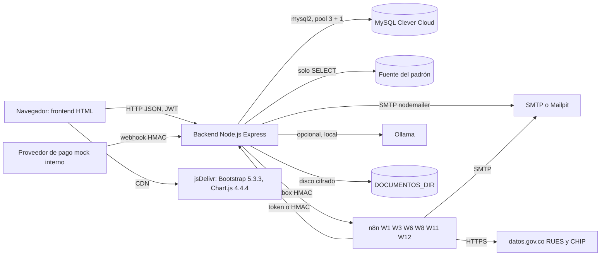

# Análisis de dependencias e integraciones

| Campo | Valor |
|---|---|
| ID documental | DOC-02-10 |
| Versión | 1.0 |
| Estado | BORRADOR — PENDIENTE DE VALIDACIÓN |
| Fecha de generación | 2026-10-16 |
| Responsable | PENDIENTE DE ASIGNACIÓN |
| Evidencia base | rama `feature/verificacion-seguridad`, commit `4742737` |

## Propósito

Identificar los sistemas externos y librerías de los que depende la plataforma, cómo se integran, qué datos intercambian, cómo se autentican y qué pasa si fallan.

## Alcance

Integraciones de ejecución y dependencias de software. La configuración paso a paso está en [04_DESARROLLO/10_INTEGRACIONES_Y_AUTOMATIZACIONES.md](../04_DESARROLLO/10_INTEGRACIONES_Y_AUTOMATIZACIONES.md) y [06_IMPLEMENTACION/07_CONFIGURACION_DE_INTEGRACIONES.md](../06_IMPLEMENTACION/07_CONFIGURACION_DE_INTEGRACIONES.md). Ninguna integración externa se invocó durante esta auditoría.

## 1. Mapa de integraciones

## 2. Integraciones de ejecución

| ID | Sistema | Dirección y protocolo | Datos | Autenticación | Si falla | Evidencia | Estado |
|---|---|---|---|---|---|---|---|
| INT-01 | MySQL (Clever Cloud según docs) | Backend → MySQL, `mysql2/promise` | Todo el estado | Usuario/contraseña `DB_*` | Arranque falla; peticiones 500/503 | `backend/src/db.js`, `server.js` | IMPLEMENTADO, NO VERIFICADO (no se conectó en la auditoría) |
| INT-02 | Fuente del padrón | Backend → MySQL de solo lectura (`PADRON_DB_URI` o `MYSQL_ADDON_URI`), tabla `personas_institucionales_prueba` | NIT, nombre, entidad, tipo, estado | Credencial en la URI | Verificación `padron_no_disponible`; el arranque no se bloquea | `backend/src/seguridad/padron.js` | IMPLEMENTADO, NO VERIFICADO |
| INT-03 | SMTP (nodemailer) | Backend → SMTP | Códigos MFA, autorización de compra y cambio de correo, avisos, comprobantes | `SMTP_USER`/`SMTP_PASSWORD` opcionales | Laboratorio: imprime en consola `[correo-laboratorio]`; producción sin `SMTP_HOST`: el servidor no arranca; outbox reintenta comprobantes | `backend/src/seguridad/correo.js`, `email.js`, `emailOutbox.js` | IMPLEMENTADO Y VERIFICADO con transporte simulado (receiptEmail, mi-cuenta) |
| INT-04 | Mailpit | SMTP 1025, buzón web 8025 (laboratorio) | Igual que INT-03 | Ninguna | — | `.env.example`, docs | NO DETERMINADO (no se inspeccionó un contenedor) |
| INT-05 | n8n (salida) | Backend → webhooks n8n por `automation_outbox` | W1 `{evento,pedido_id,estado,total,moneda,fecha}`; W3 `{evento,fecha}`; W6 escalamiento sin PII; W8 solo `admin.solicitud_cuenta` (id y tipo); W11 eventos con `ref` y NIT de persona jurídica | HMAC-SHA256 por workflow (`x-automation-timestamp`, `x-automation-signature`), ventana 5 min | Reintentos (8, backoff); no bloquea checkout ni pagos | `backend/src/automationOutbox.js`, `automationSignatures.js` | IMPLEMENTADO Y VERIFICADO (automation.test) |
| INT-06 | n8n W12 | Backend → webhook `registro-avisos` | `{evento, solicitud_id, resultado}` | HMAC sobre `timestamp.evento.solicitud_id` (`X-Timestamp`, `X-Signature`) | Solo log; timeout 3 s | `backend/src/seguridad/avisosN8n.js`, `n8n/generar-w12.js` | IMPLEMENTADO Y VERIFICADO (registro-verificado) |
| INT-07 | n8n (entrada) | n8n → `/api/automatizaciones/*`, `/api/asistente/pendientes/resumen-semanal` | Totales agregados, conteos, resultado de entidad | `x-automation-token` (W2, W4, mantenimiento W11), Bearer (W7), HMAC + nonce (resultado W11) | Jobs internos cubren expiración y mantenimiento | `backend/src/routes/automatizaciones.js`, `automationAuth.js` | IMPLEMENTADO Y VERIFICADO (tokens) |
| INT-08 | datos.gov.co (RUES `c82u-588k`, CHIP `5c7g-ptic`) | n8n W11 → API Socrata | NIT de persona jurídica; columnas limitadas | `X-App-Token` opcional | Resultado `fuente_no_disponible` y reintento hasta 5 veces | `n8n/workflows/W11-verificacion-compra.json`, [docs/FLUJO_N8N_VERIFICACION.md](../docs/FLUJO_N8N_VERIFICACION.md) | NO DETERMINADO (W11 inactivo, no importado) |
| INT-09 | Ollama (opcional) | Backend → URL local `OLLAMA_URL` | Texto de la consulta para inferir intención | Ninguna; solo URL local aceptada | Modo `rules` por defecto | `backend/src/assistant/llmAdapter.js` | IMPLEMENTADO Y VERIFICADO (validación de URL y plan, assistant.spec) |
| INT-10 | Proveedor de pago mock | Interno → `/api/pagos/webhook/mock` | Evento con referencia, monto, moneda | HMAC `PAYMENT_WEBHOOK_SECRET` (aleatorio en memoria si falta) | — | `backend/src/paymentProvider.js` | IMPLEMENTADO, NO VERIFICADO |
| INT-11 | Pasarela real | — | — | — | `PAYMENT_MODE=sandbox|prod` falla de forma segura | `backend/src/paymentProviderInstance.js` | DOCUMENTADO, NO IMPLEMENTADO |
| INT-12 | CDN jsDelivr | Navegador → CDN | Bootstrap 5.3.3, Chart.js 4.4.4 | — | Interfaz sin estilos/gráficos | `frontend/*.html` | IMPLEMENTADO, NO VERIFICADO (ninguna página usa el atributo `integrity` **[OBS]**) |
| INT-13 | Almacenamiento de documentos | Backend → disco `DOCUMENTOS_DIR` (por defecto `backend/storage/documentos`) | Evidencias cifradas | Clave AES | Documento irrecuperable si se pierde el disco o la clave | `backend/src/verificacion.js` | IMPLEMENTADO, NO VERIFICADO |

## 3. Workflows n8n del repositorio

Todos con `active: false` **[OBS]**. La API local de n8n rechazó la credencial disponible en la auditoría previa ([docs/AUDITORIA_TECNICA.md](../docs/AUDITORIA_TECNICA.md) A10): lo desplegado es **NO DETERMINADO**.

| WF | Disparador | Función | Situación |
|---|---|---|---|
| W1 | Webhook `empresa-alerta-pago` | Aviso de pago aprobado/rechazado al administrador | Vigente en el backend (outbox) |
| W2 | Programado | Resumen diario de recaudo (08:00 America/Bogota) | Vigente |
| W3 | Webhook `empresa-stock-bajo` | Alerta genérica de stock bajo | Vigente |
| W4 | Programado cada minuto | Expirar pedidos | Vigente; redundante con el job interno |
| W5 | Webhook `mfa-login-code` | Enviar código MFA | **Sin uso** desde 2026-10-15 (nodemailer) |
| W6 | Webhook `asistente-escalado` | Escalamiento del asistente | Vigente |
| W7 | Programado | Resumen semanal de preguntas pendientes | Vigente |
| W8 | Webhook `account-events` | Avisos de cuenta | Solo `admin.solicitud_cuenta` sigue viajando |
| W9 | Webhook `receipt-email` | Comprobantes por correo | **Sin uso** desde 2026-10-15 |
| W10 | Subflujo | Contexto institucional | Inactivo y no conectado |
| W11 | Webhook `verification-events` + programado | Verificación de entidad y avisos | Vigente en el backend; NIT a n8n en decisión (BUG-014) |
| W12 | Webhook `registro-avisos` | Avisos de solicitudes de registro | Vigente, opcional |

## 4. Dependencias de software (backend)

Versiones instaladas el 2026-10-16 (`npm ls --depth=0`) **[OBS]**:

| Paquete | Versión | Uso | Observación |
|---|---|---|---|
| express | 4.22.3 | Servidor HTTP | — |
| mysql2 | 3.24.2 | Acceso a MySQL | Lotes `multipleStatements` solo en el pool transaccional |
| jsonwebtoken | 9.0.3 | JWT HS256 | — |
| bcrypt / bcryptjs | 6.0.0 / 2.4.3 | Hash de contraseñas | Dos librerías (BUG-017) |
| express-rate-limit | 7.5.1 | Limitadores por IP | Memoria del proceso (BUG-010) |
| nodemailer | 6.10.1 | Correo SMTP | **Vulnerabilidad alta** (BUG-006) |
| pdfkit | 0.17.2 | PDF del comprobante | — |
| zod | 4.6.5 | Validación de esquemas | — |
| cors | 2.8.6 | CORS | Orígenes desde `CORS_ORIGINS` |
| dotenv | 16.6.1 | Carga de `.env` | — |
| jest, jest-environment-jsdom, supertest | 30.5.2, 30.5.2, 7.3.1 | Pruebas (desarrollo) | — |

Entorno: Node.js 24.19.0 (probado); n8n `n8nio/n8n:1.110.1` (Docker).

## 5. Análisis de acoplamiento

- **[OBS]** El backend no depende de n8n para operar: checkout, pagos, expiración y mantenimiento funcionan sin n8n (outbox + jobs internos).
- **[OBS]** El backend depende fuertemente de MySQL: si no está disponible, la validación de sesión responde 503 (fallo cerrado).
- **[INF]** Punto único de falla: la instancia única del backend (captcha y limitadores en memoria) y las claves de cifrado (RSK-001).
- **[REC]** Añadir integridad de subrecursos (SRI) a los scripts de CDN o servirlos localmente.

## Referencias

- [11_ANALISIS_DE_RIESGOS_TECNICOS.md](11_ANALISIS_DE_RIESGOS_TECNICOS.md)
- [Dependencias y versiones](../04_DESARROLLO/07_DEPENDENCIAS_Y_VERSIONES.md)
- [backend/README.md](../backend/README.md), [docs/ARQUITECTURA_ACTUAL.md](../docs/ARQUITECTURA_ACTUAL.md)
