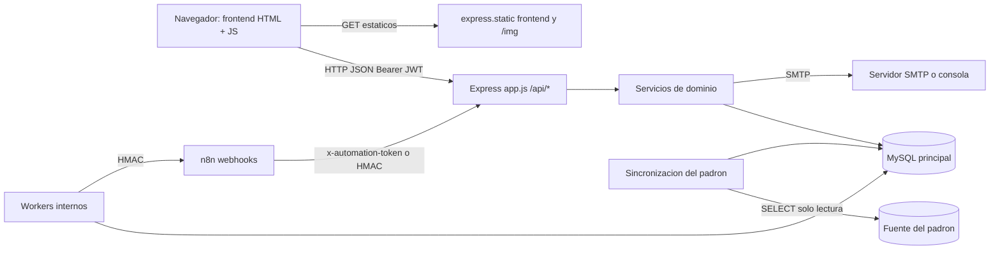
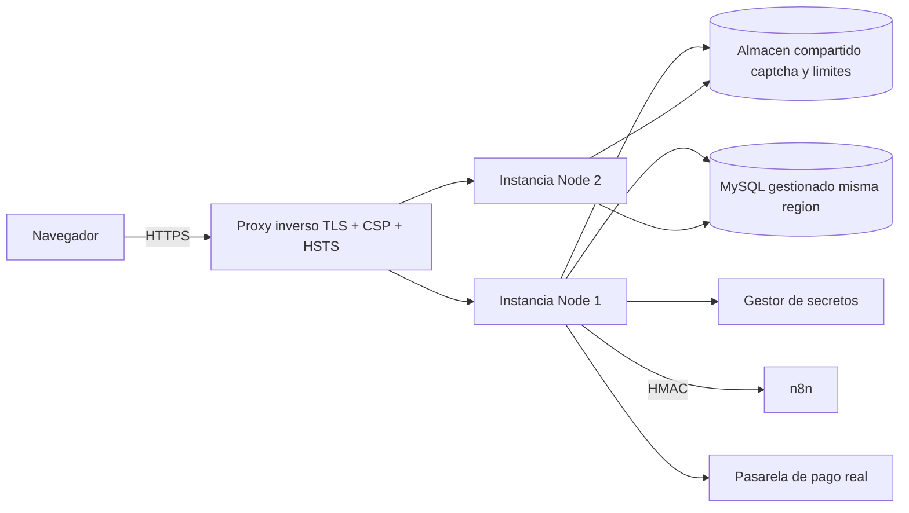

# Arquitectura actual

| Campo | Valor |
|---|---|
| ID documental | DOC-03-02 |
| Versión | 1.0 |
| Estado | BORRADOR — PENDIENTE DE VALIDACIÓN |
| Fecha de generación | 2026-10-16 |
| Responsable | PENDIENTE DE ASIGNACIÓN |
| Evidencia base | rama `feature/verificacion-seguridad`, commit `4742737` |

## Propósito

Describir la arquitectura **tal como está implementada** (DIS-001) y, en una sección separada, la arquitectura objetivo propuesta.

## Alcance

Backend, frontend, base de datos, integraciones (SMTP, n8n, fuente del padrón) y trabajos en segundo plano. Este documento actualiza, sin reemplazarla, la descripción previa de [../docs/ARQUITECTURA_ACTUAL.md](../docs/ARQUITECTURA_ACTUAL.md) (que describe el estado del 2026-10-13, anterior al registro verificado).

## 1. Estilo arquitectónico

**[OBS]** Monolito en capas dentro de un solo proceso Node.js:

| Capa | Responsabilidad | Ubicación |
|---|---|---|
| Presentación | Páginas HTML estáticas, Bootstrap 5.3.3, JS sin framework; sesión en `localStorage` | `frontend/` |
| Entrada HTTP | Express: CORS, cabeceras de seguridad, parseo JSON con límites, estáticos, manejador de errores | `backend/src/app.js` |
| Rutas / controladores | 17 routers bajo `/api/*` | `backend/src/routes/*.js` |
| Servicios de dominio | Autorización, verificación, pagos, comprobantes, asistente, padrón | `backend/src/*.js`, `backend/src/seguridad/`, `backend/src/assistant/` |
| Persistencia | Pools `mysql2` (3 + 1 transaccional), migraciones | `backend/src/db.js`, `backend/src/migraciones/` |
| Trabajos en segundo plano | Colas (outbox), expiración, mantenimiento, sincronización | iniciados en `backend/server.js` |
| Integraciones | SMTP (nodemailer), n8n (HTTP firmado), fuente del padrón (MySQL de solo lectura), Ollama opcional | `seguridad/correo.js`, `automationOutbox.js`, `seguridad/padron.js`, `assistant/llmAdapter.js` |

## 2. Secuencia de arranque (`backend/server.js`) [OBS]

1. Carga `backend/.env` con `dotenv`.
2. Valida `ASSISTANT_MODE` (`rules` o `llm`).
3. `validarConfiguracionSegura()` — falla si `JWT_SECRET`, `ENC_KEY`/`HMAC_KEY` son inválidos (en cualquier entorno) y si otros secretos son débiles en producción.
4. `getPaymentProvider()` — solo `mock` disponible; `sandbox`/`prod` fallan de forma segura.
5. `validarConfiguracionCorreo()` — en producción exige `SMTP_HOST`.
6. `migrar()` — DDL tolerante, columnas faltantes, siembra de categorías/productos, migraciones versionadas 001–003, administrador inicial si hay `ADMIN_EMAIL`/`ADMIN_PASSWORD`.
7. Inicia: refresco del índice del asistente, worker de correo, worker de automatizaciones, job de expiración de pedidos (60 s), job de verificaciones (5 min), sincronización del padrón (al arrancar y cada `PADRON_SYNC_MINUTOS`, 10 por defecto), precálculo del hash de relleno.
8. Escucha en `PORT` (8080 por defecto en código; 8081 en `.env.example`).

## 3. Flujos arquitectónicos principales

| Flujo | Componentes | Detalle |
|---|---|---|
| Registro verificado | `auth.js` → `registroVerificado.js` → `padron.js` → lote SQL transaccional → correo / W12 | [../docs/REGISTRO_VERIFICADO.md](../docs/REGISTRO_VERIFICADO.md) |
| Inicio de sesión + MFA | `auth.js` → `retos_mfa` → nodemailer → JWT + refresh | [10_DISENO_DE_SEGURIDAD.md](10_DISENO_DE_SEGURIDAD.md) |
| Compra | `cart.js` → `checkout.js` (transacción, `FOR UPDATE`) → `pagos` mock → webhook → comprobante → `correo_outbox` | [08_DISENO_DE_API.md](08_DISENO_DE_API.md) |
| Verificación en la compra | `routes/verificacion.js` → `verificacionCompra.js` → `automation_outbox` W11 → n8n → `/api/automatizaciones/verificaciones/resultado` | [../docs/ARQUITECTURA_VERIFICACION.md](../docs/ARQUITECTURA_VERIFICACION.md) |

## 4. Atributos de calidad observados

| Atributo | Mecanismo [OBS] | Estado |
|---|---|---|
| Seguridad | MFA, cifrado por campo, permisos, rate limits, cabeceras | Parcial: sin TLS/CSP/HSTS (BUG-012) |
| Disponibilidad | Outbox con reintentos; jobs internos que no dependen de n8n | IMPLEMENTADO, NO VERIFICADO en despliegue |
| Rendimiento | Lotes SQL de un viaje, índices, pool limitado | Medición histórica 2026-10-15 (REQ-NF-006) |
| Escalabilidad | Captcha y limitadores en memoria | Un solo proceso (BUG-010) |
| Portabilidad | `API_BASE` fijo `http://localhost:8081` | Limitada (BUG-003) |

## 5. Lo que no se pudo verificar

- **NO DETERMINADO:** configuración real del servidor MySQL en Clever Cloud, la instancia n8n en ejecución (los 12 workflows del repositorio están `active: false`) y cualquier despliegue del backend fuera del equipo de laboratorio.

---

## Arquitectura objetivo propuesta [REC]

> Esta sección es una **propuesta** derivada de la deuda técnica; no ha sido solicitada ni aprobada por el cliente.

| # | Cambio propuesto | Motivo | Relación |
|---|---|---|---|
| 1 | Proxy inverso con TLS (HTTPS), HSTS y CSP estricta delante de Express | Confidencialidad en tránsito | BUG-012, REQ-NF-016 |
| 2 | Sesión en cookie `HttpOnly; Secure; SameSite` + token CSRF | Mitigar robo de sesión por XSS | BUG-011, REQ-NF-015 |
| 3 | Almacén compartido (p. ej. Redis o tabla MySQL) para captcha y limitadores, o captcha gestionado | Permitir varias instancias | BUG-010 |
| 4 | `API_BASE` relativo o configurable por entorno | Desplegar en cualquier dominio | BUG-003 |
| 5 | Backend desplegado junto a la base (misma región) | Reducir ~150 ms por viaje a MySQL | REQ-NF-006 |
| 6 | Gestor de secretos y respaldo custodiado de claves | Evitar pérdida de datos cifrados | RSK-001 |
| 7 | Adaptador de pasarela de pago real | Operación comercial | REQ-F-040 |

## Referencias

- [01_DOCUMENTO_DE_DISENO_DEL_SOFTWARE.md](01_DOCUMENTO_DE_DISENO_DEL_SOFTWARE.md) · [03_DIAGRAMA_DE_COMPONENTES.md](03_DIAGRAMA_DE_COMPONENTES.md) · [04_DIAGRAMA_DE_DESPLIEGUE.md](04_DIAGRAMA_DE_DESPLIEGUE.md)
- [../backend/server.js](../backend/server.js) · [../backend/src/app.js](../backend/src/app.js)
- [../docs/ARQUITECTURA_OBJETIVO.md](../docs/ARQUITECTURA_OBJETIVO.md)
