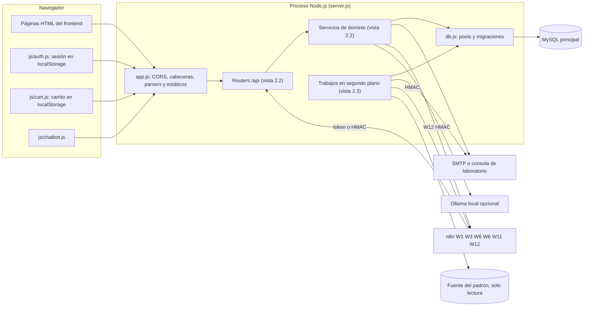
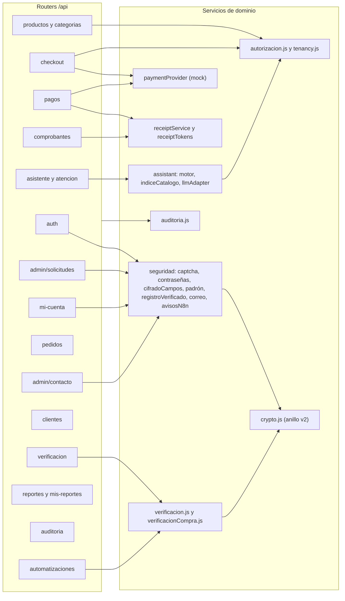
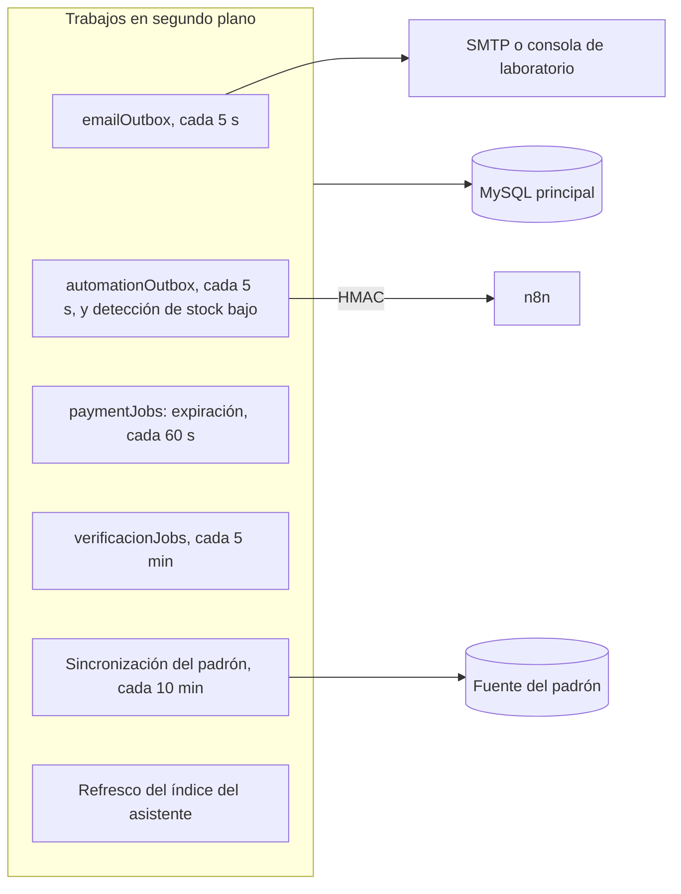

# Diagrama de componentes

| Campo | Valor |
|---|---|
| ID documental | DOC-03-03 |
| Versión | 1.0 |
| Estado | BORRADOR — PENDIENTE DE VALIDACIÓN |
| Fecha de generación | 2026-10-16 |
| Responsable | PENDIENTE DE ASIGNACIÓN |
| Evidencia base | rama `feature/verificacion-seguridad`, commit `4742737` |

## Propósito

Representar los componentes reales del sistema y sus dependencias, fieles a `backend/server.js` y `backend/src/app.js`.

## Alcance

Routers montados, servicios de dominio, workers en segundo plano e integraciones externas.

## 1. Routers montados en `app.js` [OBS]

| Prefijo | Archivo | Módulo |
|---|---|---|
| `/api/clientes` | `routes/clientes.js` | MOD-10 |
| `/api/atencion` | `routes/atencion.js` | MOD-11 |
| `/api/asistente` | `routes/asistente.js` | MOD-11 |
| `/api/checkout` | `routes/checkout.js` | MOD-07 |
| `/api/pagos` | `routes/pagos.js` (raw body en `/api/pagos/webhook`) | MOD-07 |
| `/api/comprobantes` | `routes/comprobantes.js` | MOD-09 |
| `/api/automatizaciones` | `routes/automatizaciones.js` | MOD-14 |
| `/api/mi-cuenta` | `routes/miCuenta.js` | MOD-03 |
| `/api/reportes` | `routes/reportes.js` | MOD-12 |
| `/api/auth` | `routes/auth.js` (JSON ≤ 10 kb) | MOD-01/02 |
| `/api/admin/solicitudes` | `routes/solicitudesRegistro.js` (JSON ≤ 10 kb) | MOD-02 |
| `/api/admin/contacto` | `routes/adminContacto.js` (agregado el 2026-10-16) | MOD-11 |
| `/api/verificacion` | `routes/verificacion.js` | MOD-04 |
| `/api/pedidos` | `routes/pedidos.js` | MOD-08 |
| `/api/productos` | `routes/productos.js` | MOD-06 |
| `/api/categorias` | `routes/categorias.js` | MOD-06 |
| `/api/mis-reportes` | `routes/misreportes.js` | MOD-12 |
| `/api/auditoria` | `routes/auditoria.js` | MOD-13 |
| `/img` y `/` estáticos | `backend/img/`, `frontend/` (sin índice; `/` redirige a `/landing.html`) | MOD-17 |

## 2. Diagrama de componentes

El sistema se muestra en tres vistas para que cada diagrama sea legible: la general, la de los routers con los servicios que usan y la de los trabajos en segundo plano. **[OBS]**

### 2.1 Vista general

### 2.2 Routers y servicios que usan

Todos los routers y servicios usan `db.js` para llegar a MySQL (vista 2.1). `admin/contacto` se agregó el 2026-10-16.

### 2.3 Trabajos en segundo plano

## 3. Responsabilidades de los workers [OBS]

| Worker | Archivo | Intervalo | Función | Tabla |
|---|---|---|---|---|
| Correo de comprobantes | `src/emailOutbox.js` | 5 s, máx. 5 intentos | Envía enlace al cliente y aviso al admin; recupera tareas `procesando` atascadas > 10 min | `correo_outbox` |
| Automatizaciones | `src/automationOutbox.js` | 5 s, máx. 8 intentos, timeout 8 s | Entrega eventos firmados a W1, W3, W6, W8, W11; detecta stock bajo (`AUTOMATION_STOCK_LOW_THRESHOLD`) | `automation_outbox` |
| Expiración de pedidos | `src/paymentJobs.js` | 60 s, lotes de 25 | Marca pagos/pedidos vencidos y libera reservas | `pagos`, `pedidos`, `productos` |
| Mantenimiento de verificación | `src/verificacionJobs.js` | 5 min (no en `test`) | Reintentos de entidad, expiración de solicitudes y autorizaciones, purga de nonces | `solicitudes_verificacion`, `autorizaciones_compra`, `automation_nonces` |
| Sincronización del padrón | `src/seguridad/padron.js` | al arrancar y cada `PADRON_SYNC_MINUTOS` | Copia cifrada de la fuente; filas ausentes → `inactiva` | `padron_institucional` |
| Índice del asistente | `src/assistant/indiceCatalogo.js` | caché de 60 s (según prueba) | Índice de productos y FAQ | `productos`, `faq_asistente` |

## 4. Dependencias entre módulos (resumen)

- Todo router protegido depende de `routes/auth.js` (`requiereAutenticacion`, `requiereAdmin`, `autenticacionOpcional`) y, en su mayoría, de `autorizacion.js` (`requierePermiso`). Excepción: `solicitudesRegistro.js` implementa su propia validación en un solo viaje a MySQL.
- `configSegura.js` depende de `crypto.js` y `seguridad/cifradoCampos.js`.

## Referencias

- [../backend/src/app.js](../backend/src/app.js) · [../backend/server.js](../backend/server.js)
- [04_DIAGRAMA_DE_DESPLIEGUE.md](04_DIAGRAMA_DE_DESPLIEGUE.md) · [08_DISENO_DE_API.md](08_DISENO_DE_API.md)
- [../04_DESARROLLO/03_MODULOS_Y_RESPONSABILIDADES.md](../04_DESARROLLO/03_MODULOS_Y_RESPONSABILIDADES.md)
