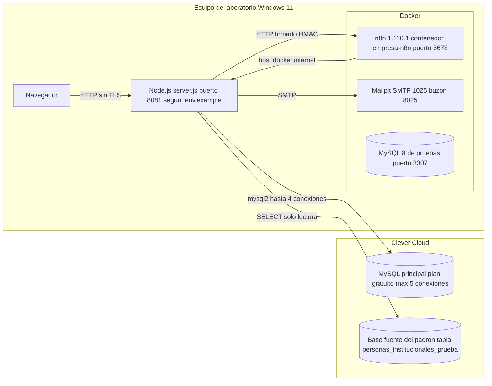

# Diagrama de despliegue

| Campo | Valor |
|---|---|
| ID documental | DOC-03-04 |
| Versión | 1.0 |
| Estado | BORRADOR — PENDIENTE DE VALIDACIÓN |
| Fecha de generación | 2026-10-16 |
| Responsable | PENDIENTE DE ASIGNACIÓN |
| Evidencia base | rama `feature/verificacion-seguridad`, commit `4742737` |

## Propósito

Describir los nodos físicos/lógicos donde se ejecuta el sistema (DIS-010), diferenciando lo observado de lo no verificado.

## Alcance

Entorno de **laboratorio** documentado. No existe en el repositorio evidencia de un entorno de producción desplegado (no hay Dockerfile del backend, CI/CD ni configuración de proxy).

## 1. Despliegue de laboratorio observado

## 2. Nodos y estado de la evidencia

| Nodo | Detalle [OBS] | Evidencia | Estado |
|---|---|---|---|
| Backend Node.js | Proceso único, sirve API y frontend; `PORT` (8080 en código, 8081 en `.env.example`) | `backend/server.js`, `backend/.env.example` | IMPLEMENTADO, NO VERIFICADO en esta auditoría (no se arrancó) |
| Navegador | Accede a `http://localhost:8081/`; `API_BASE` fijo a ese origen | `frontend/js/auth.js` | Observado en código |
| MySQL principal | Clever Cloud según documentación y memoria del proyecto; ~150 ms por viaje medidos el 2026-10-15 | `docs/REGISTRO_VERIFICADO.md` §5, `docs/AUDITORIA_TECNICA.md` | NO DETERMINADO (no se accedió) |
| Fuente del padrón | `PADRON_DB_URI` o `MYSQL_ADDON_URI`; tabla `personas_institucionales_prueba` | `backend/src/seguridad/padron.js` | NO DETERMINADO |
| n8n | Imagen `n8nio/n8n:1.110.1`, contenedor `empresa-n8n`, puerto 5678, volumen `n8n_data`, monta `./workflows` solo lectura, `env_file: .env` | `n8n/docker-compose.yml` | NO DETERMINADO (workflows `active: false`; la API respondió 401 el 2026-10-13 según docs) |
| Mailpit | SMTP 1025 / web 8025; sin SMTP el correo se imprime en consola fuera de producción | `backend/.env.example`, `seguridad/correo.js` | NO DETERMINADO |
| MySQL de pruebas | Docker `mysql:8.0`, puerto 3307, base que contenga `test` | `docs/PLAN_PRUEBAS.md` | NO DETERMINADO (no se ejecutó la integración) |
| Ollama | `OLLAMA_URL` solo si `ASSISTANT_MODE=llm` | `assistant/llmAdapter.js` | Opcional, no configurado por defecto |

## 3. Puertos y protocolos

| Origen → destino | Puerto | Protocolo | Autenticación |
|---|---|---|---|
| Navegador → backend | 8081 | HTTP (sin TLS en laboratorio) | JWT Bearer |
| Backend → MySQL | 3306 (por defecto) | MySQL | usuario/contraseña de `.env` |
| Backend → SMTP | `SMTP_PORT` (587 por defecto) | SMTP/STARTTLS o TLS | `SMTP_USER` opcional |
| Backend → n8n | 5678 (webhooks) | HTTP(S); HTTPS exigido fuera de localhost | HMAC por workflow |
| n8n → backend | 8081 | HTTP(S) | `x-automation-token` o HMAC + nonce |

## 4. Despliegue de producción

**PENDIENTE.** No hay evidencia de un despliegue productivo. Requisitos mínimos identificados en el código para `NODE_ENV=production`: `CORS_ORIGINS` obligatorio, `SMTP_HOST` obligatorio, secretos fuertes, `TRUST_PROXY_HOPS` si hay proxy, `PAYMENT_MODE` distinto de `mock` no soportado. La propuesta está en [02_ARQUITECTURA_ACTUAL.md §Arquitectura objetivo propuesta](02_ARQUITECTURA_ACTUAL.md) y el procedimiento en [../06_IMPLEMENTACION/05_GUIA_DE_DESPLIEGUE.md](../06_IMPLEMENTACION/05_GUIA_DE_DESPLIEGUE.md).

## Referencias

- [../n8n/docker-compose.yml](../n8n/docker-compose.yml) · [../backend/.env.example](../backend/.env.example) · [../backend/src/db.js](../backend/src/db.js)
- [../docs/GUIA_INSTALACION_Y_DESPLIEGUE.md](../docs/GUIA_INSTALACION_Y_DESPLIEGUE.md)
