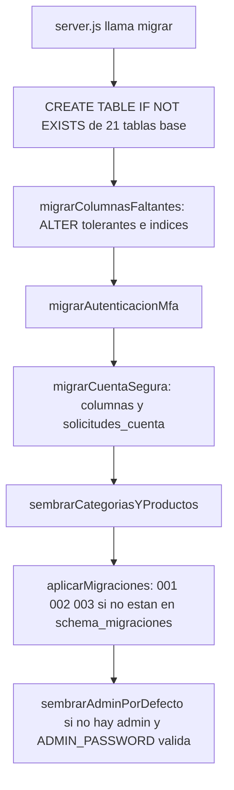

# Diseño de base de datos

| Campo | Valor |
|---|---|
| ID documental | DOC-03-05 |
| Versión | 1.0 |
| Estado | BORRADOR — PENDIENTE DE VALIDACIÓN |
| Fecha de generación | 2026-10-16 |
| Responsable | PENDIENTE DE ASIGNACIÓN |
| Evidencia base | rama `feature/verificacion-seguridad`, commit `4742737` |

## Propósito

Describir el diseño lógico y físico de la base MySQL (DIS-002) y el mecanismo de migraciones (DIS-011), derivado exclusivamente de `backend/src/db.js`, `backend/src/migraciones/*.js` y `backend/sql/003_registro_verificado.sql`.

## Alcance

34 tablas de la base principal. No incluye la base fuente del padrón (externa, solo lectura) ni la base de n8n. La estructura **real desplegada** en Clever Cloud es NO DETERMINADA: no se accedió a ninguna base.

## 1. Características generales [OBS]

- Motor InnoDB, juego de caracteres `utf8mb4` en todas las tablas.
- Claves primarias sustitutas `AUTO_INCREMENT` (INT o BIGINT UNSIGNED), salvo `retos_mfa` (CHAR(64)), `staff_permisos` y `productos_elegibilidad` (compuestas), `schema_migraciones` (VARCHAR) y `automation_nonces` (CHAR(64)).
- Integridad referencial con `ON DELETE CASCADE` para datos dependientes y `ON DELETE SET NULL` para referencias a actores (`usuarios`).
- Sin triggers, vistas ni procedimientos almacenados: las reglas de negocio están en el backend.
- Consultas parametrizadas con `mysql2` (placeholders `?`). El pool transaccional habilita `multipleStatements` con sentencias fijas.

## 2. Agrupación por dominio

| Dominio | Tablas | Origen |
|---|---|---|
| Identidad y sesión | `usuarios`, `refresh_tokens`, `retos_mfa` | db.js (+ columnas 001, 002, 003) |
| Clientes y datos personales | `clientes`, `datos_sensibles`, `solicitudes_cuenta` | db.js (+ 001, 002) |
| Registro verificado | `padron_institucional`, `solicitudes_registro` | 003 |
| Verificación institucional | `verificacion_historial`, `documentos_verificacion`, `solicitudes_verificacion`, `verificacion_comprobaciones`, `identificadores_personales`, `autorizaciones_compra` | 001, 002 |
| Permisos | `staff_permisos` | 001 |
| Catálogo | `categorias`, `productos`, `productos_elegibilidad` | db.js, 001 |
| Comercio | `pedidos`, `detalle_pedido`, `pagos`, `eventos_pago`, `comprobantes`, `solicitudes_reenvio_comprobante` | db.js |
| Colas | `correo_outbox`, `automation_outbox`, `automation_nonces` | db.js, 002 |
| Atención y asistente | `atenciones`, `solicitudes_contacto`, `faq_asistente`, `asistente_pendientes`, `reportes_cliente` | db.js |
| Auditoría y control | `auditoria`, `schema_migraciones` | db.js, `migraciones/index.js` |

## 3. Mecanismo de migraciones (DIS-011) [OBS]

| Migración | Descripción (literal del código) | Reversión |
|---|---|---|
| `001_verificacion_institucional` | Estados de verificación, documentos, elegibilidad M:N, revisión legal y permisos de staff | `node scripts/migraciones.js revertir 001_verificacion_institucional --confirmo-perdida-de-datos` |
| `002_verificacion_en_compra` | Solicitudes y comprobaciones de verificación, identificadores cifrados, autorizaciones de compra, superadministrador | ídem con `002_…` |
| `003_registro_verificado` | Estado de cuenta, padrón institucional cifrado y solicitudes de registro con aprobación | ídem con `003_…`; SQL equivalente idempotente en `backend/sql/003_registro_verificado.sql` |

Efectos de datos relevantes:
- 001: clientes sin `tipo_institucion` → `borrador` + historial `migracion_cuenta_heredada`; productos restringidos → `revision_legal='pendiente'`; `auditoria.accion` pasa de ENUM a VARCHAR(40); administradores existentes reciben 7 permisos.
- 002: administradores reciben `catalogo.gestionar`, `pedidos.gestionar`, `clientes.gestionar`, `auditoria.ver`, `verificacion.confirmar_institucion`; cuentas aprobadas reciben `verificado_hasta`.
- 003: `usuarios.estado_cuenta` con valor por defecto `activa` (las cuentas existentes quedan activas; las nuevas se insertan `pendiente`).

**Riesgo [OBS]:** las migraciones se aplican automáticamente contra la base configurada en `.env`; ya ocurrió una aplicación no intencional sobre la base real (RSK-003, [../docs/AUDITORIA_TECNICA.md](../docs/AUDITORIA_TECNICA.md) §7).

## 4. Índices destacados

| Tabla | Índice | Uso |
|---|---|---|
| `usuarios` | UNIQUE `correo` | Login, unicidad de cuenta |
| `padron_institucional` | `idx_padron_nit (nit_hash)` (no único), UNIQUE `uq_padron_fuente` | Verificación de terna |
| `solicitudes_registro` | `idx_solreg_estado (estado, creado_en, id)` | Lista y contador del panel |
| `retos_mfa` | `idx_retos_mfa_usuario_estado` | Límite de retos por usuario |
| `pagos` | UNIQUE `idempotency_key`, UNIQUE `referencia_externa` | Idempotencia del checkout y del webhook |
| `eventos_pago` | UNIQUE `evento_id` | Deduplicación de eventos |
| `automation_outbox` | UNIQUE `dedupe_key`, `idx_automation_outbox_pendiente` | Cola sin duplicados |
| `productos` | `idx_productos_institucion_estado`, `idx_productos_estado_stock` | Catálogo y stock bajo |
| `identificadores_personales` | UNIQUE `cliente_id`, `idx_identificadores_indice (indice_hmac)` | Duplicidad de documentos |

## 5. Datos cifrados y sensibles

Resumen (detalle por columna en [07_DICCIONARIO_TECNICO_DE_DATOS.md](07_DICCIONARIO_TECNICO_DE_DATOS.md)):

| Mecanismo | Módulo | Columnas |
|---|---|---|
| AES-256-GCM heredado / anillo v2 (`cifrar`) | `src/crypto.js` | `clientes.nombre_funcionario`, `correo`, `telefono`, `direccion_entrega`, `datos_registro_cifrados`, `datos_cambio_cifrados`; `datos_sensibles.numero_consulta_antecedentes`; `pedidos.datos_comprador_cifrados`, `direccion_entrega_cifrada`; `retos_mfa.correo_destino_cifrado`; `solicitudes_contacto.nit_cifrado`, `correo_cifrado`; `documentos_verificacion.nombre_original_cifrado` (+ archivo cifrado en disco); `identificadores_personales.numero_cifrado`; `automation_outbox.payload` cuando `payload_cifrado=TRUE` |
| AES-256-GCM con AAD por campo (`cifrarCampo`) | `src/seguridad/cifradoCampos.js` | `padron_institucional.nombre_cifrado` (AAD `padron.nombre`), `entidad_cifrada` (`padron.entidad`); `solicitudes_registro.nit_cifrado` (`solicitud.nit`), `nombre_cifrado` (`solicitud.nombre`) |
| HMAC-SHA256 (índice ciego) | `cifradoCampos.indiceCiego`, `crypto.js` | `padron_institucional.nit_hash`, `solicitudes_registro.nit_hash`, `identificadores_personales.indice_hmac` |
| Hash | bcrypt / SHA-256 / HMAC | `usuarios.password_hash` (bcrypt), `refresh_tokens.token_hash` (SHA-256), `retos_mfa.codigo_hash` y `autorizaciones_compra.codigo_hash` (HMAC con `MFA_TOKEN_PEPPER`), `comprobantes.token_hash` |

**[OBS] En claro:** `usuarios.correo` (identificador de acceso), `clientes.nit`, `clientes.nombre_unidad`, `solicitudes_contacto.entidad` y `mensaje`, `atenciones.comentario`, `reportes_cliente.comentario`, `auditoria.correo`.

## 6. Observaciones de diseño

- **[OBS]** `pedidos.items` (JSON) duplica la información de `detalle_pedido`; ambos se mantienen.
- **[OBS]** `productos.institucion_id` es VARCHAR sin FK: la lista de instituciones vive en código (`tenancy.js`, `registroInstitucional.js`).
- **[OBS]** No existe política de retención ni purga automática salvo `automation_nonces` (24 h) — BUG-015.
- **[REC]** Considerar un usuario MySQL de solo lectura para reportes y otro sin privilegios DDL para la operación una vez estabilizado el esquema.

## Referencias

- [06_MODELO_ENTIDAD_RELACION.md](06_MODELO_ENTIDAD_RELACION.md) · [07_DICCIONARIO_TECNICO_DE_DATOS.md](07_DICCIONARIO_TECNICO_DE_DATOS.md)
- [../backend/src/db.js](../backend/src/db.js) · [../backend/src/migraciones/index.js](../backend/src/migraciones/index.js) · [../backend/sql/003_registro_verificado.sql](../backend/sql/003_registro_verificado.sql)
- [../docs/MODELO_DATOS.md](../docs/MODELO_DATOS.md) · [../04_DESARROLLO/09_GUIA_DE_BASE_DE_DATOS.md](../04_DESARROLLO/09_GUIA_DE_BASE_DE_DATOS.md)
