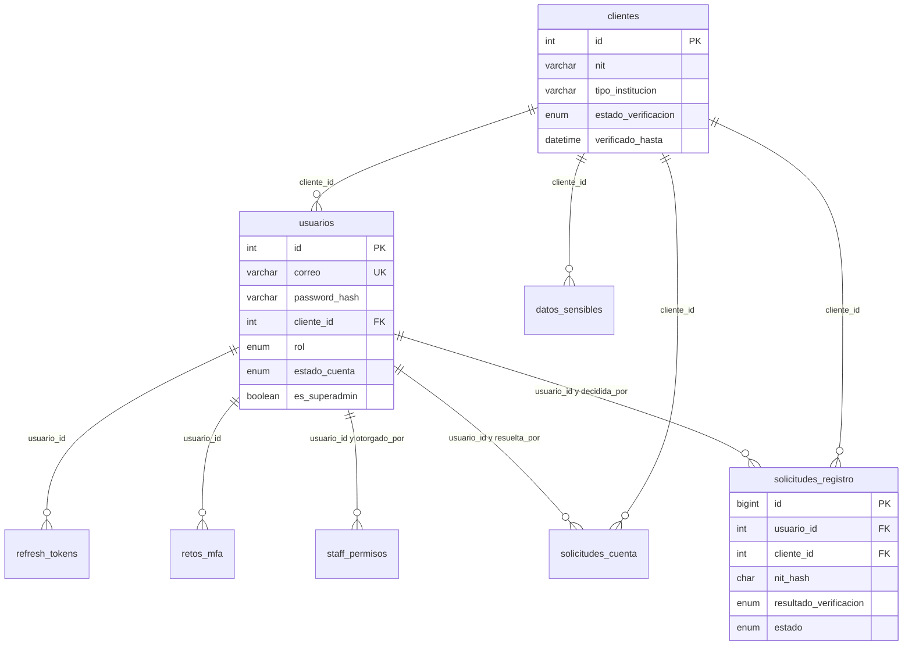
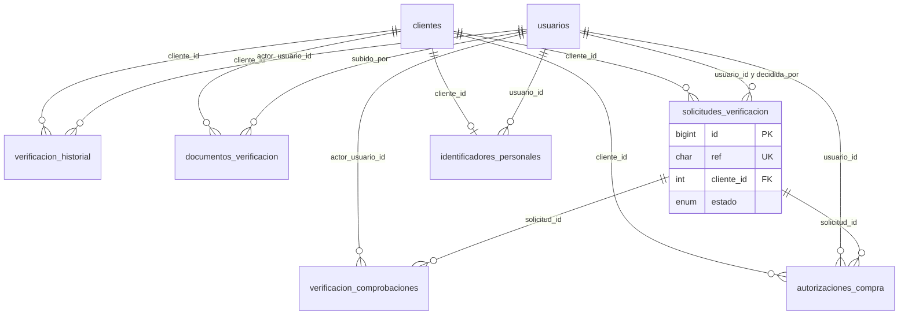
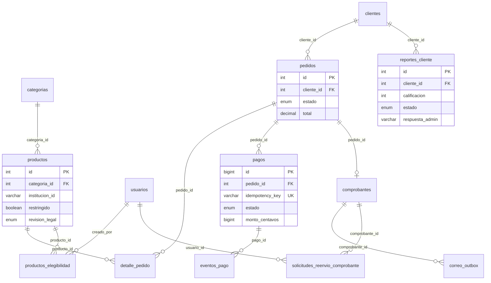

# Modelo entidad-relación

| Campo | Valor |
|---|---|
| ID documental | DOC-03-06 |
| Versión | 1.0 |
| Estado | BORRADOR — PENDIENTE DE VALIDACIÓN |
| Fecha de generación | 2026-10-16 |
| Responsable | PENDIENTE DE ASIGNACIÓN |
| Evidencia base | rama `feature/verificacion-seguridad`, commit `4742737` |

## Propósito

Representar las 34 tablas y sus claves foráneas reales (DIS-002).

## Alcance

Solo relaciones declaradas como `FOREIGN KEY` en `backend/src/db.js` y `backend/src/migraciones/00*.js`. Las relaciones lógicas sin FK se listan aparte. Para legibilidad se muestran solo las columnas clave; el detalle completo está en [07_DICCIONARIO_TECNICO_DE_DATOS.md](07_DICCIONARIO_TECNICO_DE_DATOS.md).

## 1. Diagramas por área

Las 35 relaciones con `FOREIGN KEY` se reparten en tres diagramas para que se puedan leer; `clientes` y `usuarios` aparecen en varios porque son el eje del modelo. **[OBS]**

### 1.1 Cuentas, sesión y registro

### 1.2 Verificación institucional y autorización de compra

### 1.3 Catálogo, pedidos, pagos, comprobantes y reportes

`reportes_cliente.estado` y `respuesta_admin` los agregó la migración `004_seguimiento_reportes_contacto` (2026-10-16).

## 2. Tablas sin claves foráneas

| Tabla | Columnas clave | Propósito |
|---|---|---|
| `padron_institucional` | `id` PK, `fuente_id` UK, `nit_hash`, `nombre_cifrado`, `tipo_institucion`, `estado` | Copia cifrada del padrón |
| `automation_outbox` | `id` PK, `workflow`, `dedupe_key` UK, `payload` | Eventos firmados hacia n8n |
| `automation_nonces` | `nonce` PK, `recibido_en` | Anti-repetición de respuestas de n8n |
| `atenciones` | `id` PK, `conversacion_id`, `calificacion` | Calificaciones del asistente |
| `solicitudes_contacto` | `id` PK, `tipo_solicitud`, `nit_cifrado`, `estado`, `respuesta_admin` | PQRS, soporte y cotizaciones |
| `faq_asistente` | `id` PK, `pregunta` UK | Preguntas frecuentes del asistente |
| `asistente_pendientes` | `id` PK, `conversacion_id` | Preguntas que el asistente no resolvió |
| `auditoria` | `id` PK, `usuario_id`, `accion`, `entidad` | Registro de acciones administrativas |
| `schema_migraciones` | `version` PK, `aplicada_en` | Control de migraciones versionadas |

## 3. Relaciones lógicas sin FK [OBS]

| Origen | Destino lógico | Observación |
|---|---|---|
| `auditoria.usuario_id` | `usuarios.id` | Sin FK: la auditoría sobrevive al borrado del usuario |
| `clientes.decidido_por` | `usuarios.id` | Sin FK (migración 001) |
| `autorizaciones_compra.pedido_id` | `pedidos.id` | Sin FK (migración 002) |
| `productos.institucion_id`, `productos_elegibilidad.institucion_id`, `*.tipo_institucion` | Lista en código (`tenancy.js`, `registroInstitucional.js`) | Catálogo cerrado no persistido |
| `padron_institucional.nit_hash` ↔ `solicitudes_registro.nit_hash` | Coincidencia por índice ciego | No es FK; varios funcionarios comparten NIT |
| `automation_outbox.payload` | Pedidos, solicitudes | Referencias dentro del JSON |

## 4. Cardinalidades notables

- Un `cliente` tiene normalmente un `usuario` (no hay restricción UNIQUE en `usuarios.cliente_id`) [OBS].
- Un `pedido` tiene a lo sumo un `comprobante` (UNIQUE `pedido_id`).
- Un `cliente` tiene a lo sumo un `identificador_personal` (UNIQUE `cliente_id`).
- Una `solicitud_verificacion` tiene a lo sumo una comprobación por componente (UNIQUE `solicitud_id, componente`).

## Referencias

- [05_DISENO_DE_BASE_DE_DATOS.md](05_DISENO_DE_BASE_DE_DATOS.md) · [07_DICCIONARIO_TECNICO_DE_DATOS.md](07_DICCIONARIO_TECNICO_DE_DATOS.md)
- [../backend/src/db.js](../backend/src/db.js) · [../backend/src/migraciones/](../backend/src/migraciones/)
- [../02_ANALISIS/08_MODELO_CONCEPTUAL_DE_DATOS.md](../02_ANALISIS/08_MODELO_CONCEPTUAL_DE_DATOS.md)
