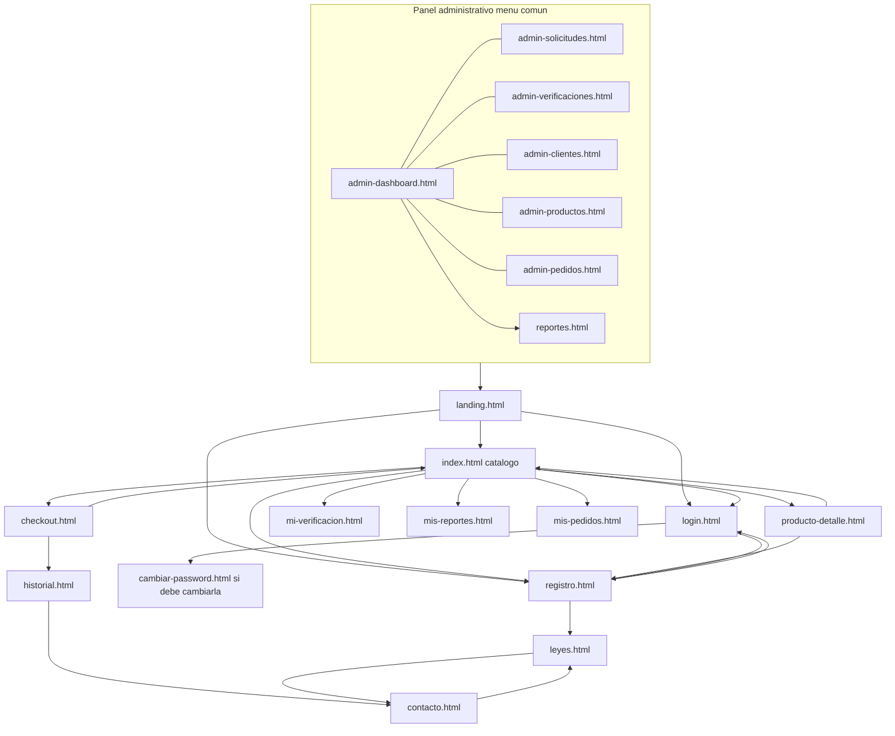

# Diseño de interfaces y navegación

| Campo | Valor |
|---|---|
| ID documental | DOC-03-09 |
| Versión | 1.0 |
| Estado | BORRADOR — PENDIENTE DE VALIDACIÓN |
| Fecha de generación | 2026-10-16 |
| Responsable | PENDIENTE DE ASIGNACIÓN |
| Evidencia base | rama `feature/verificacion-seguridad`, commit `4742737` |

## Propósito

Describir las pantallas reales del frontend, sus scripts, dependencias de CDN, llamadas a la API y la navegación entre ellas (DIS-009).

## Alcance

Las 20 páginas HTML de `frontend/`, los 13 scripts de `frontend/js/` y las 8 hojas de estilo de `frontend/css/`. No se tomaron capturas en esta auditoría (no se arrancó la aplicación).

## 1. Tecnología de interfaz [OBS]

- HTML estático + Bootstrap 5.3.3 (`cdn.jsdelivr.net`), Chart.js 4.4.4 en `admin-dashboard.html` y `reportes.html`; JS sin framework ni empaquetador.
- Hojas: `style.css`, `theme-modern.css`, `global-ui.css`, `admin-console.css`, `catalogo.css`, `registro-premium.css`, `tenant-ui.css` (paleta por institución), `verificacion.css`.
- Scripts comunes: `global-layout.js` (estructura y menú), `auth.js` (sesión en `localStorage`, `API_BASE` fijo `http://localhost:8081` — BUG-003, renovación con refresh), `i18n.js` (traducción parcial — BUG-016), `chatbot.js` (asistente), `cart.js` (carrito en `localStorage`), `navbar.js`, `imagenes.js`.
- Se sirve desde el backend en el mismo origen (`express.static`); `/` redirige a `/landing.html`.

## 2. Inventario de pantallas

| Página | Título (`<title>`) | Actor | Scripts propios / CDN | Endpoints que consume [OBS] | REQ |
|---|---|---|---|---|---|
| `landing.html` | (sin título) | ACT-01 | imagenes, cart, chatbot | `/api/productos` | REQ-F-039 |
| `index.html` | Suministros Institucionales — Catálogo | ACT-01/03 | imagenes, cart, chatbot | `/api/productos`, `/api/categorias` | REQ-F-014 |
| `producto-detalle.html` | (sin título) | ACT-01/03 | cart, navbar, chatbot | `/api/productos/:id`, `/api/categorias` | REQ-F-015 |
| `registro.html` | (sin título) | ACT-01 | captcha, registro-wizard | `/api/auth/registro/tipos`, `/api/auth/registro`, captcha; modo heredado de edición: `/api/clientes` | REQ-F-001 |
| `login.html` | (sin título) | ACT-02/03/05 | captcha, cart, navbar, chatbot | `/api/auth/login`, `/api/auth/mfa/{verificar,reenviar,cancelar}`, captcha | REQ-F-005, 006 |
| `cambiar-password.html` | Cambiar contraseña — Suministros Institucionales | ACT-03/05/06 | auth | `/api/mi-cuenta/password` | REQ-F-009, 012 |
| `checkout.html` | Checkout — Suministros Institucionales | ACT-03/04 | cart, checkout-autofill | `/api/checkout`, `/api/checkout/perfil`, `/api/pagos/dev/simular-webhook`, `/api/pagos/:id/estado`, `/api/comprobantes/:id[?format=pdf]`, `/reenviar`, `/api/verificacion/compra/autorizacion[/confirmar]` | REQ-F-019…021, 025, 029 |
| `historial.html` | (sin título) | ACT-03 | cart, navbar, chatbot | `/api/pedidos`, `/api/comprobantes/:id` | REQ-F-023, 025 |
| `mis-pedidos.html` | (sin título) | ACT-03 | cart, chatbot | `/api/pedidos` | REQ-F-023 |
| `mis-reportes.html` | (sin título) | ACT-03 | cart, navbar, chatbot | `/api/mis-reportes` | REQ-F-033 |
| `mi-verificacion.html` | Mi verificación — Suministros Institucionales | ACT-03/04 | cart, navbar | `/api/verificacion/mi-solicitud*`, `/api/auth/registro/tipos` | REQ-F-027 |
| `contacto.html` | Contacto institucional — Suministros Institucionales | ACT-01 | auth (sin Bootstrap JS) | `/api/atencion/solicitudes` | REQ-F-032 |
| `leyes.html` | Normatividad — Suministros Institucionales | ACT-01 | auth | — | REQ-F-039 |
| `admin-dashboard.html` | Dashboard — Panel administrativo | ACT-05 | Chart.js, admin-solicitudes-contador, chatbot | `/api/clientes`, `/api/pedidos/todos`, `/api/productos`, `/api/categorias`, `/api/verificacion/admin/solicitudes` | REQ-F-024, 026 |
| `admin-solicitudes.html` | Solicitudes de cuenta — Panel administrativo | ACT-05/06 | admin-solicitudes-contador | `/api/admin/solicitudes*` | REQ-F-004 |
| `admin-verificaciones.html` | Verificación institucional — Panel administrativo | ACT-05/06 | admin-solicitudes-contador | `/api/verificacion/admin/*`, `/api/auth/registro/tipos` | REQ-F-017, 028, 030 |
| `admin-clientes.html` | Clientes registrados — Panel administrativo | ACT-05 | contador, chatbot | `/api/clientes*`, `/api/pedidos/:clienteId` | REQ-F-026 |
| `admin-productos.html` | Productos — Panel administrativo | ACT-05 | contador, imagenes, chatbot | `/api/productos*`, `/api/categorias` | REQ-F-016 |
| `admin-pedidos.html` | (sin título) | ACT-05 | contador, chatbot | `/api/pedidos/todos`, `/api/pedidos/:id` | REQ-F-024 |
| `reportes.html` | (sin título) | ACT-05 [INF] | Chart.js, reportes.js (sin global-layout) | `/api/reportes/mensual` | REQ-F-033 |

**Pantallas agregadas el 2026-10-16 [OBS]:** `mi-cuenta.html` (perfil, cambio de correo, enlace al cambio de contraseña, cerrar todas las sesiones y solicitudes de corrección o eliminación; corrige BUG-004), `admin-contacto.html` (PQRS y, en la pestaña "Datos de cuenta", la resolución de esas solicitudes; corrige BUG-005), `admin-auditoria.html` (auditoría con filtros) y `admin-reportes-clientes.html` (reportes de los clientes). Se abren desde el menú de la cuenta.

## 3. Mapa de navegación (enlaces `href` y redirecciones observadas)

Notas: los enlaces de menú de usuario (historial, mis-reportes, mi-verificación, panel) se construyen dinámicamente en `global-layout.js`/`auth.js` según la sesión [INF]; `checkout` exige sesión y redirige a `login.html?redirect=…` (documentado en `README.md`). El paso exacto desde el catálogo a `mis-pedidos.html` es NO DETERMINADO (no se encontró `href` estático).

## 4. Patrones de interacción [OBS]

- Registro por asistente de pasos (`registro-wizard.js`) construido con `GET /api/auth/registro/tipos`; captcha SVG renderizado por `captcha.js`.
- Login en dos pasos (credenciales + código de 6 dígitos con reenviar/cancelar).
- Panel de solicitudes con actualización optimista: aprobar/rechazar quita la fila y baja el contador; restaura si el servidor falla; contador cada 12 s con la pestaña visible (`admin-solicitudes-contador.js`, según docs/REGISTRO_VERIFICADO.md §5).
- Checkout en 3 pasos (carrito, datos/método, modal de resultado); diálogo de código para compras con restringidos.
- Asistente flotante (`chatbot.js`) con tarjetas de producto y calificación por estrellas.

## 5. Referencias visuales existentes

Imágenes en el repositorio que muestran pantallas; **no se afirma que correspondan a la versión actual** (no se comprobó su fecha ni contenido frente al código vigente):

- [../backend/img/admin-dashboard.jpg](../backend/img/admin-dashboard.jpg)
- [../backend/img/admin-clientes.jpg](../backend/img/admin-clientes.jpg)
- [../backend/img/admin-productos.jpg](../backend/img/admin-productos.jpg)
- [../backend/img/catalogo.jpg](../backend/img/catalogo.jpg)

## 6. Accesibilidad, idioma y diseño adaptable

- Widget del asistente con pruebas de accesibilidad (assistant.spec "widget accesible") — REQ-NF-014.
- Diseño adaptable sin barra horizontal (commit `2c44b40`) — IMPLEMENTADO, NO VERIFICADO (REQ-NF-013).
- Traducción: número de atributos `data-i18n` por página va de 0 (checkout, contacto, leyes, cambiar-password, mi-verificacion) a 49 (registro) — BUG-016.

## Referencias

- [../frontend/](../frontend/) · [../frontend/js/auth.js](../frontend/js/auth.js) · [../frontend/js/global-layout.js](../frontend/js/global-layout.js)
- [../README.md](../README.md) (flujo de navegación previo) · [08_DISENO_DE_API.md](08_DISENO_DE_API.md)
- [../06_IMPLEMENTACION/11_MANUAL_DE_USUARIO.md](../06_IMPLEMENTACION/11_MANUAL_DE_USUARIO.md)
