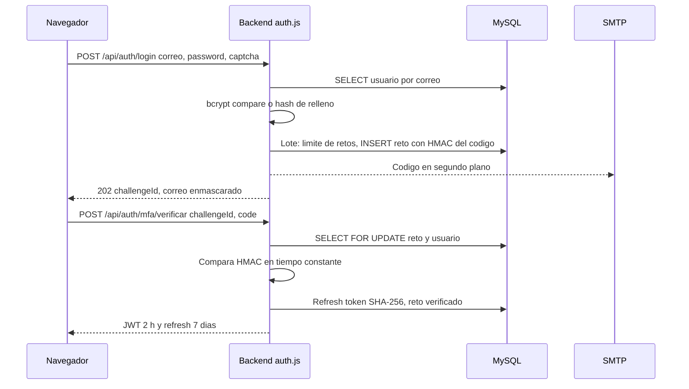

# Diseño de seguridad

| Campo | Valor |
|---|---|
| ID documental | DOC-03-10 |
| Versión | 1.0 |
| Estado | BORRADOR — PENDIENTE DE VALIDACIÓN |
| Fecha de generación | 2026-10-16 |
| Responsable | PENDIENTE DE ASIGNACIÓN |
| Evidencia base | rama `feature/verificacion-seguridad`, commit `4742737` |

## Propósito

Documentar los controles de seguridad implementados (DIS-004, DIS-005, DIS-006, DIS-007), su evidencia y los controles faltantes.

## Alcance

Autenticación, MFA, sesiones, autorización, cifrado, firmas HMAC, captcha, límites de tasa, cabeceras HTTP, gestión de secretos y registros. **No es una certificación de seguridad**: las pruebas cubren escenarios definidos, no todos los posibles. El modelo de amenazas previo está en [../docs/MODELO_AMENAZAS.md](../docs/MODELO_AMENAZAS.md).

## 1. Autenticación (MOD-01)

| Control | Diseño [OBS] | Evidencia | Estado |
|---|---|---|---|
| Contraseñas | bcrypt nativo (respaldo bcryptjs); costo `BCRYPT_COST` (10 lab / 12 prod); 10–72 caracteres; no puede contener el usuario del correo (≥4 caracteres) | `seguridad/contrasenas.js`, `registroInstitucional.js` | IMPLEMENTADO Y VERIFICADO (REQ-NF-002) |
| Anti-enumeración | Hash de relleno cuando el correo no existe; 401 idéntico; registro 202 idéntico; estado de cuenta solo tras contraseña válida | `routes/auth.js` | IMPLEMENTADO Y VERIFICADO |
| Captcha | Suma dibujada como trazos SVG, un intento, 5 min, máx. 5000 retos en memoria | `seguridad/captcha.js` | IMPLEMENTADO Y VERIFICADO (BUG-010: en memoria) |
| MFA | Código de 6 dígitos (`crypto.randomInt`), solo HMAC con `MFA_TOKEN_PEPPER` en `retos_mfa`; 5 min; 5 intentos; reenvío ≥60 s, máx. 5; máx. 5 retos/15 min/usuario; envío por nodemailer en segundo plano (nunca por n8n) | `routes/auth.js`, `mfaCodes.js`, `seguridad/registroVerificado.js` | IMPLEMENTADO Y VERIFICADO |
| Primer MFA | Marca `usuarios.correo_verificado_en` | `routes/auth.js` | Observado |

## 2. Sesiones

| Control | Diseño [OBS] | Estado |
|---|---|---|
| Access token | JWT HS256 (`algorithms: ['HS256']`), 2 h (`JWT_EXPIRES_IN`), claims `uid`, `correo`, `rol`, `clienteId`, `institucionId`, `sv`, `mfa:true` | IMPLEMENTADO Y VERIFICADO |
| Validación por petición | Lee `session_version`, `estado_cuenta`, `rol`, `debe_cambiar_password` de MySQL: revocación inmediata | IMPLEMENTADO Y VERIFICADO (REQ-F-007) |
| Refresh token | 40 bytes aleatorios; solo SHA-256 en BD; rotativo; 7 días; requiere `mfa_verificado_en` | IMPLEMENTADO, NO VERIFICADO (REQ-F-008) |
| Revocación masiva | Cambio de correo/contraseña, cerrar sesiones o suspensión incrementan `session_version` y revocan refresh | IMPLEMENTADO Y VERIFICADO |
| Contraseña inicial | `debe_cambiar_password` bloquea todo salvo `GET /api/mi-cuenta` y `POST /api/mi-cuenta/password` (`PASSWORD_CHANGE_REQUIRED`) | IMPLEMENTADO Y VERIFICADO |
| Almacenamiento cliente | `localStorage['si_auth']` | **Control faltante** (BUG-011, REQ-NF-015) |
| Secreto JWT | Sin valor por defecto; fuera de producción, si falta, secreto efímero por proceso; arranque exige ≥32 caracteres no de ejemplo | IMPLEMENTADO Y VERIFICADO |

## 3. Autorización (MOD-05)

- **[OBS]** `autorizacion.obtenerContexto()` reconstruye desde MySQL rol, estado, institución aprobada, verificación vigente y autorización de restringidos; `evaluarProducto()` decide `visible`, `nivel` (vitrina/completo), `puedeComprar` y `motivo` en listado, detalle, asistente y checkout (con `FOR UPDATE`).
- **[OBS]** 13 permisos de staff (`PERMISOS_STAFF`). Datos personales (`documentos.ver`, `identificadores.ver`) nunca implícitos, ni para el superadministrador. Reservados al superadministrador: `staff.permisos`, `identificadores.ver`. Nadie modifica sus propios permisos (RN-017).
- **[OBS]** Superadministrador solo por `backend/scripts/crear-superadmin.js` con `--confirmar-base` (RN-018).
- **[OBS]** Respuesta 404 para recursos de otra institución o restringidos (no revela existencia).

| Permiso | Rutas protegidas (ejemplos) |
|---|---|
| `catalogo.gestionar` | POST/PUT/DELETE productos y categorías, `/api/productos/bajo-inventario` |
| `pedidos.gestionar` | `/api/pedidos/todos`, `PUT /api/pedidos/:id`, `/api/pedidos/:clienteId` |
| `clientes.gestionar` | `/api/clientes/*`, `/api/admin/solicitudes/*`, `/api/mi-cuenta/solicitudes*` |
| `auditoria.ver` | `/api/auditoria` |
| `verificacion.ver` / `verificacion.decidir` | `/api/verificacion/admin/solicitudes*`, decisión, cambio de tipo |
| `documentos.ver` / `identificadores.ver` | Descarga de documentos / revelar identificador (con justificación ≥20 caracteres) |
| `cuentas.suspender`, `restringidos.autorizar`, `productos.cumplimiento`, `staff.permisos` | Suspensión, restringidos, cumplimiento, permisos y personal |

## 4. Criptografía (DIS-006)

| Uso | Algoritmo | Clave (variable) | Detalle |
|---|---|---|---|
| Datos personales generales (clientes, pedidos, contacto, documentos) | AES-256-GCM | `CRYPTO_KEY` heredada (texto rellenado a 32 bytes) o anillo `CRYPTO_KEYS` + `CRYPTO_KEY_ACTIVA` (formato `v2:<id>:…`) | `src/crypto.js`; `DECRYPT_FAILED` en vez de devolver el cifrado |
| Padrón y solicitudes de registro | AES-256-GCM, IV 12 bytes, AAD = nombre del campo | `ENC_KEY` (32 bytes hex), versión `ENC_KEY_VERSION`, anteriores `ENC_KEY_V<n>` | `seguridad/cifradoCampos.js`, formato `v<n>:<iv>:<tag>:<cifrado>` |
| Índices ciegos | HMAC-SHA256 | `HMAC_KEY` (NIT); `IDENT_HMAC_KEY` (documento de identidad) | Búsqueda por igualdad sin descifrar |
| Códigos MFA y de compra | HMAC-SHA256 | `MFA_TOKEN_PEPPER` | Comparación en tiempo constante |
| Enlace de comprobante | HMAC-SHA256, 24 h | `RECEIPT_LINK_SECRET` | `receiptTokens.js` |
| Webhook de pago | HMAC-SHA256 sobre `timestamp.` + cuerpo raw, ventana 5 min, dedupe por `evento_id` | `PAYMENT_WEBHOOK_SECRET` (aleatorio en memoria si falta, solo mock) | `paymentProvider.js` |
| Backend → n8n | HMAC-SHA256 (`x-automation-timestamp`, `x-automation-signature`); W12: `X-Timestamp`, `X-Signature` sobre `timestamp.evento.solicitud_id` | `N8N_W1_SECRET`, `N8N_W3_SECRET`, `N8N_W6_…`, `N8N_W8_…`, `N8N_W11_SECRET`, `N8N_REGISTRO_SECRET` | `automationSignatures.js`, `avisosN8n.js` |
| n8n → backend | Token en tiempo constante (`x-automation-token`) o HMAC + nonce (W11, secreto distinto `N8N_W11_CALLBACK_SECRET`) | ver variables | `automationAuth.js`, `verificacionCompra.js` |

Nota: la firma W12 no cubre `resultado` (decisión documentada en `docs/REGISTRO_VERIFICADO.md` §4).

## 5. Protección perimetral y de la aplicación

| Control | Estado [OBS] |
|---|---|
| Cabeceras: `X-Content-Type-Options: nosniff`, `X-Frame-Options: DENY`, `Referrer-Policy: same-origin`, `Cross-Origin-Opener-Policy: same-origin`, `Permissions-Policy` (cámara, micrófono, geolocalización deshabilitados); `x-powered-by` deshabilitado | IMPLEMENTADO |
| CSP global y HSTS | **No implementado** (BUG-012). Las descargas de documentos usan `attachment` + `nosniff` + CSP `sandbox` según docs/MODELO_AMENAZAS.md |
| TLS | **No** en laboratorio (BUG-012, REQ-NF-016); HTTPS exigido para URLs de webhooks fuera de localhost |
| CORS | Lista blanca; obligatoria en producción |
| Límite de cuerpo | 10 kb (auth, panel), 100 kb (general), 64 kb (webhook) |
| Validación de entrada | `zod` estricto en registro; validaciones manuales en rutas; consultas parametrizadas |
| Archivos | Validación por firma (PDF/PNG/JPEG), rechazo de PDF con contenido activo, 5 MB, 10 por cliente, cifrado en disco fuera de carpetas estáticas (según docs/MODELO_AMENAZAS.md); sin antivirus |
| Errores | Respuestas genéricas sin trazas; logs con códigos de error, no valores |

### Límites de tasa (por IP, `express-rate-limit`, en memoria)

| Endpoint | Límite |
|---|---|
| `POST /api/auth/login` | 10 / 15 min |
| `POST /api/auth/mfa/verificar` | 15 / 15 min |
| `POST /api/auth/mfa/reenviar` | 10 / hora |
| `GET /api/auth/captcha` | 120 / 15 min |
| `POST /api/auth/registro` | `REGISTRO_LIMITE_POR_HORA` (10) / hora |
| `POST /api/atencion/solicitudes` | 5 / 15 min |
| Asistente (`/mensaje`) | 20 / min (según prueba) |
| `POST /api/automatizaciones/verificaciones/resultado` | 60 / min |
| Mi cuenta, checkout perfil, subidas, autorización de compra | Limitadores propios por ruta (ver código) |
| `POST /api/atencion/calificacion` | **Sin límite** (BUG-002) |

## 6. Gestión de secretos

- **[OBS]** Secretos solo en `backend/.env` (excluido por `.gitignore`) y `n8n/.env`; plantilla sin valores reales en `backend/.env.example`.
- **[OBS]** `validarConfiguracionSegura()` impide arrancar sin `JWT_SECRET` fuerte y sin `ENC_KEY`/`HMAC_KEY` válidas y distintas; en producción también bloquea secretos débiles (`MFA_TOKEN_PEPPER`, `CRYPTO_KEY`, anillo inválido).
- **[OBS]** `scripts/generar-claves.js --escribir` agrega solo las claves faltantes y respalda el `.env` previo.
- **Pendientes:** gestor de secretos, respaldo custodiado de claves (RSK-001), rotación de secretos señalados en auditorías previas y de la contraseña de la base del padrón (RSK-002), recifrado de datos heredados (BUG-013).

## 7. Privacidad y minimización

- n8n recibe únicamente referencias opacas y eventos sin datos personales (REQ-NF-008); excepción W11: NIT de persona jurídica (BUG-014, decisión pendiente).
- El panel de solicitudes no descifra nada en la lista; el detalle se audita (`ver_solicitud_registro`); el motivo de rechazo no se guarda en auditoría.
- Cumplimiento de la Ley 1581/2012: PARCIALMENTE IMPLEMENTADO, validación jurídica pendiente (REQ-NF-017, [../docs/TRATAMIENTO_DATOS_PERSONALES.md](../docs/TRATAMIENTO_DATOS_PERSONALES.md)).

## 8. Controles faltantes o débiles (resumen)

| ID | Hallazgo | Impacto |
|---|---|---|
| BUG-001 | `GET /api/reportes/mensual` sin autenticación expone métricas y comentarios | Fuga de información |
| BUG-002 | Calificaciones sin autenticación ni límite | Alteración de indicadores |
| BUG-006 | nodemailer 6.10.1 vulnerable | Inyección SMTP / DoS según avisos |
| BUG-010 | Captcha y limitadores en memoria | No escala; se reinician |
| BUG-011 | Tokens en `localStorage` | Robo por XSS |
| BUG-012 | Sin TLS, CSP ni HSTS | Interceptación, XSS |
| BUG-013 | Datos heredados con clave débil | Confidencialidad reducida |

## Referencias

- [../backend/src/routes/auth.js](../backend/src/routes/auth.js) · [../backend/src/autorizacion.js](../backend/src/autorizacion.js) · [../backend/src/crypto.js](../backend/src/crypto.js) · [../backend/src/seguridad/](../backend/src/seguridad/) · [../backend/src/configSegura.js](../backend/src/configSegura.js) · [../backend/src/app.js](../backend/src/app.js)
- [../docs/MODELO_AMENAZAS.md](../docs/MODELO_AMENAZAS.md) · [../docs/ARQUITECTURA_VERIFICACION.md](../docs/ARQUITECTURA_VERIFICACION.md) · [../docs/REGISTRO_VERIFICADO.md](../docs/REGISTRO_VERIFICADO.md)
- [../05_PRUEBAS/06_PRUEBAS_DE_SEGURIDAD.md](../05_PRUEBAS/06_PRUEBAS_DE_SEGURIDAD.md) · [../06_IMPLEMENTACION/08_CONFIGURACION_DE_SEGURIDAD.md](../06_IMPLEMENTACION/08_CONFIGURACION_DE_SEGURIDAD.md)
