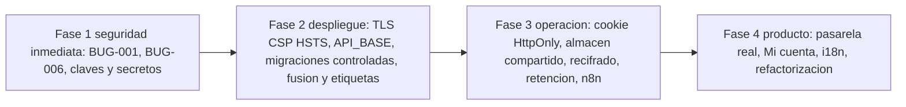

# Deuda técnica y mejoras propuestas

| Campo | Valor |
|---|---|
| ID documental | DOC-03-12 |
| Versión | 1.0 |
| Estado | BORRADOR — PENDIENTE DE VALIDACIÓN |
| Fecha de generación | 2026-10-16 |
| Responsable | PENDIENTE DE ASIGNACIÓN |
| Evidencia base | rama `feature/verificacion-seguridad`, commit `4742737` |

## Propósito

Inventariar la deuda técnica observada y proponer mejoras priorizadas. **Todas las mejoras son [REC]**: no han sido solicitadas ni aprobadas por el cliente; requieren decisión del responsable del producto (PENDIENTE DE ASIGNACIÓN).

## Alcance

Código, configuración, dependencias y documentación del repositorio. Las prioridades y esfuerzos son estimaciones [INF].

## 1. Criterios de priorización

- **P1** — riesgo de seguridad o de pérdida de datos; corregir antes de cualquier exposición fuera del laboratorio.
- **P2** — bloquea el despliegue o la operación real.
- **P3** — mantenibilidad, coherencia y experiencia de usuario.

## 2. Deuda y mejoras priorizadas

| Prioridad | Defecto / deuda | Mejora propuesta [REC] | Esfuerzo [INF] | Relación |
|---|---|---|---|---|
| P1 | BUG-001 Reporte mensual sin autenticación | Añadir `requiereAutenticacion`, `requiereAdmin` y un permiso (p. ej. `auditoria.ver` o uno nuevo) a `GET /api/reportes/mensual`; dejar de exponer comentarios en claro | Bajo | RSK-008 |
| P1 | BUG-006 nodemailer vulnerable | Actualizar a la versión corregida (cambio mayor) y repetir las pruebas de correo (`receiptEmail.test`, `mi-cuenta`) | Medio | RSK-005 |
| P1 | RSK-001 / RSK-002 Gestión de claves y secretos | Respaldo custodiado de `ENC_KEY`, `HMAC_KEY`, `CRYPTO_KEYS`, `IDENT_HMAC_KEY`; rotación de secretos señalados; gestor de secretos | Medio | ADR-005 |
| P1 | BUG-012 Sin TLS/CSP/HSTS | Proxy inverso con HTTPS, HSTS y CSP estricta | Medio | REQ-NF-016 |
| P1 | BUG-011 Tokens en `localStorage` | Cookie `HttpOnly; Secure; SameSite=Strict` + CSRF | Alto | REQ-NF-015 |
| P2 | BUG-003 `API_BASE` fijo | Usar rutas relativas (`''`) o configuración inyectada por el servidor | Bajo | DIS-009 |
| P2 | BUG-010 Estado en memoria | Almacén compartido para captcha y limitadores, o captcha gestionado | Medio | ADR-010, RSK-014 |
| P2 | BUG-013 Datos heredados con clave débil | Script de recifrado en segundo plano hacia el anillo v2 con ventana de mantenimiento | Medio | ADR-005 |
| P2 | BUG-015 Sin retención/borrado | Definir plazos con validación jurídica y job de depuración | Medio | REQ-NF-017 |
| P2 | REQ-F-040 Sin pasarela real | Adaptador de proveedor con sandbox y pruebas | Alto | ADR-009, RSK-015 |
| P2 | RSK-003 Migraciones automáticas sobre la base configurada | Bandera para desactivar migraciones al arrancar en producción y ejecutarlas por comando con respaldo previo | Bajo | ADR-002 |
| P2 | BUG-018 Sin etiquetas y sin fusionar | Fusionar `feature/verificacion-seguridad` mediante revisión y etiquetar versiones | Bajo | RSK-017 |
| P2 | REQ-F-036 Workflows no desplegados | Importar y probar W8, W11, W12 en una instancia controlada; retirar W5 y W9 si se confirma que no se usan | Medio | ADR-006 |
| P3 | BUG-002 Calificaciones sin límite | Limitador por IP y validación de `conversacionId` | Bajo | — |
| P3 | ~~BUG-004 / BUG-005 Mi cuenta sin pantallas~~ **Atendida el 2026-10-16** | Página "Mi cuenta" (perfil, correo, sesiones, solicitudes) y pantalla de resolución para staff | Medio | REQ-F-010…013 |
| P3 | BUG-007 Código muerto con hash | Eliminar `USUARIOS_SEED` de `db.js` | Bajo | — |
| P3 | BUG-008 Documentación previa inconsistente | Actualizar `README.md`, `backend/README.md`, `docs/VARIABLES_ENTORNO.md` y referencias a `mfaCourier.js` | Bajo | RSK-016 |
| P3 | BUG-009 Archivos residuales | Retirar `file.md`, `backend/scratch_detalle.js`, `backend/probar-mfa-n8n.js` previa confirmación | Bajo | — |
| P3 | BUG-016 i18n incompleto | Completar claves de las páginas nuevas | Medio | REQ-F-038 |
| P3 | BUG-017 Dos librerías bcrypt | Unificar en `bcrypt` (mantener compatibilidad de hashes) | Bajo | — |
| P3 | API sin versionado | Prefijo `/api/v1` y especificación OpenAPI | Medio | DIS-003 |
| P3 | `db.js` de 1296 líneas mezcla DDL y datos semilla | Separar semillas a archivos de datos y DDL base a una migración `000` | Medio | DIS-011 |
| P3 | `routes/verificacion.js` de 1544 líneas | Dividir en routers de titular, staff y compra | Medio | MOD-04 |
| P3 | Sin CI | Ejecutar `npm test` y `npm audit` en cada cambio | Bajo | REQ-NF-012 |

## 3. Hoja de ruta sugerida [REC]

## Referencias

- [../05_PRUEBAS/09_REGISTRO_DE_DEFECTOS.md](../05_PRUEBAS/09_REGISTRO_DE_DEFECTOS.md) · [../00_GESTION_DEL_PROYECTO/06_MATRIZ_DE_RIESGOS.md](../00_GESTION_DEL_PROYECTO/06_MATRIZ_DE_RIESGOS.md)
- [10_DISENO_DE_SEGURIDAD.md](10_DISENO_DE_SEGURIDAD.md) · [02_ARQUITECTURA_ACTUAL.md](02_ARQUITECTURA_ACTUAL.md)
- [../docs/AUDITORIA_TECNICA.md](../docs/AUDITORIA_TECNICA.md) §5 · [../docs/REGISTRO_VERIFICADO.md](../docs/REGISTRO_VERIFICADO.md) §8
