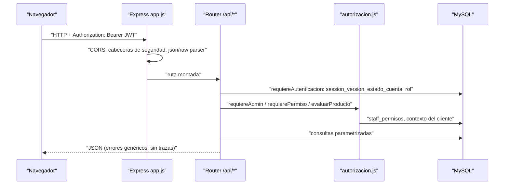

# Guía técnica del proyecto

| Campo | Valor |
|---|---|
| ID documental | DOC-04-01 |
| Versión | 1.0 |
| Estado | BORRADOR — PENDIENTE DE VALIDACIÓN |
| Fecha de generación | 2026-10-16 |
| Responsable | PENDIENTE DE ASIGNACIÓN |
| Evidencia base | rama `feature/verificacion-seguridad`, commit `4742737` |

## Propósito

Dar a un desarrollador nuevo una visión técnica completa y verificable del sistema antes de tocar el código.

## Alcance

Backend (`../backend/`), frontend (`../frontend/`), automatizaciones (`../n8n/`) y documentación previa (`../docs/`). No cubre infraestructura de producción (no existe evidencia de un despliegue productivo).

## 1. Qué es el sistema

**[OBS]** Plataforma web de suministros para entidades públicas e institucionales colombianas (Policía, Defensa, Bomberos, Socorro, Penitenciario, Corporativo). Funciones principales: registro verificado contra un padrón institucional con aprobación humana, inicio de sesión con captcha y MFA por correo, catálogo segmentado por institución, carrito, checkout con pago simulado (mock), pedidos, comprobantes no-DIAN, verificación institucional para productos restringidos, asistente de catálogo, reportes, auditoría y automatizaciones n8n. Entorno declarado: **laboratorio, costo cero** (`../docs/REGISTRO_VERIFICADO.md`).

## 2. Pila tecnológica

| Capa | Tecnología | Evidencia |
|---|---|---|
| Ejecución | Node.js (README pide ≥18; pruebas del 2026-10-16 en v24.19.0) | `../backend/README.md`, ejecución local |
| Servidor HTTP | Express 4 (CommonJS) | `../backend/package.json`, `../backend/src/app.js` |
| Base de datos | MySQL 8 vía `mysql2/promise` (Clever Cloud según documentación previa) | `../backend/src/db.js` |
| Validación | `zod` 4 | `../backend/src/routes/miCuenta.js`, `../backend/src/registroInstitucional.js` |
| Autenticación | `jsonwebtoken` (HS256), `bcrypt`/`bcryptjs`, MFA propio | `../backend/src/routes/auth.js` |
| Limitación de tasa | `express-rate-limit` 7 (memoria del proceso) | rutas |
| Correo | `nodemailer` 6 (Mailpit en laboratorio; consola si no hay SMTP fuera de producción) | `../backend/src/seguridad/correo.js` |
| PDF | `pdfkit` | `../backend/src/routes/comprobantes.js` |
| Frontend | HTML estático + Bootstrap 5.3.3 y Chart.js 4.4.4 por CDN, JS sin framework | `../frontend/*.html` |
| Automatización | n8n 1.110.1 en Docker | `../n8n/docker-compose.yml` |
| Pruebas | Jest 30 + supertest + jsdom; `node:test` | `../backend/test/` |

## 3. Arranque del servidor

**[OBS]** `../backend/server.js` ejecuta en orden:

1. Carga `backend/.env` con `dotenv`.
2. Valida `ASSISTANT_MODE` (`rules`|`llm`).
3. `validarConfiguracionSegura()` (`src/configSegura.js`): sin `JWT_SECRET` ≥32 caracteres o sin `ENC_KEY`/`HMAC_KEY` válidas **el servidor no arranca** en ningún entorno.
4. `getPaymentProvider()` (falla si `PAYMENT_MODE` es `sandbox`/`prod`, no implementados).
5. `validarConfiguracionCorreo()` (en producción exige `SMTP_HOST`).
6. `migrar()` (`src/db.js`): crea/actualiza tablas y aplica migraciones versionadas 001–003; siembra categorías, productos y, si hay `ADMIN_PASSWORD` ≥12, el primer administrador.
7. Inicia: refresco del índice del asistente, worker de correo (`emailOutbox`), worker de automatizaciones (`automationOutbox`), job de expiración de pedidos (60 s), job de verificaciones (5 min), sincronización del padrón (al arrancar y cada `PADRON_SYNC_MINUTOS`).
8. Escucha en `PORT` (código: 8080 por defecto; `.env.example`: 8081).

## 4. Recorrido de una petición

**[OBS]** Puntos clave:

- El JWT solo identifica (uid, sv, mfa). Estado de cuenta, rol, permisos y elegibilidad se **leen de MySQL en cada petición**.
- `app.js` aplica límites de cuerpo: 10 kb en `/api/auth` y `/api/admin/solicitudes`, 100 kb en el resto, `express.raw` 64 kb para `/api/pagos/webhook`.
- El mismo proceso sirve `../frontend/` como estáticos (sin `index` automático; `/` redirige a `landing.html`) y `../backend/img/` en `/img`.
- Manejador final de errores: 400 JSON inválido, 413 cuerpo grande, 500 genérico.

## 5. Conceptos de seguridad que todo desarrollador debe conocer

| Concepto | Dónde | Regla |
|---|---|---|
| Cifrado por campo v1 (registro verificado) | `src/seguridad/cifradoCampos.js` | AES-256-GCM, AAD = nombre del campo, `ENC_KEY`/`HMAC_KEY` hex de 32 bytes |
| Cifrado v2 / heredado | `src/crypto.js` | Anillo `CRYPTO_KEYS` + `CRYPTO_KEY_ACTIVA`; `CRYPTO_KEY` heredada solo compatible |
| Índices ciegos | `cifradoCampos.indiceCiego`, `IDENT_HMAC_KEY` | Búsqueda por igualdad sin descifrar |
| Firmas hacia n8n | `src/automationSignatures.js`, `src/seguridad/avisosN8n.js` | HMAC-SHA256 + ventana de 5 min |
| Webhook de pago | `src/paymentProvider.js` | HMAC sobre `timestamp.cuerpo-raw` |
| Permisos | `src/autorizacion.js` | 13 permisos; superadmin sin datos personales implícitos |

## 6. Estado general

| Aspecto | Estado |
|---|---|
| Suites unitarias (`npm test`) | IMPLEMENTADO Y VERIFICADO — 107/107 Jest y 51/51 `node:test` el 2026-10-16 |
| Integración MySQL y UI jsdom | IMPLEMENTADO, NO VERIFICADO (evidencia histórica no reproducida) |
| Pasarela de pago real | DOCUMENTADO, NO IMPLEMENTADO (REQ-F-040) |
| Workflows n8n desplegados | NO DETERMINADO (REQ-F-036; todos `active: false`) |
| HTTPS/CSP/HSTS | PENDIENTE (BUG-012) |

## Referencias

- [02_ESTRUCTURA_REAL_DEL_CODIGO.md](02_ESTRUCTURA_REAL_DEL_CODIGO.md) · [03_MODULOS_Y_RESPONSABILIDADES.md](03_MODULOS_Y_RESPONSABILIDADES.md) · [08_CONTRATOS_Y_ENDPOINTS_DE_API.md](08_CONTRATOS_Y_ENDPOINTS_DE_API.md)
- [../03_DISENO/02_ARQUITECTURA_ACTUAL.md](../03_DISENO/02_ARQUITECTURA_ACTUAL.md)
- [../docs/ARQUITECTURA_OBJETIVO.md](../docs/ARQUITECTURA_OBJETIVO.md) · [../docs/REGISTRO_VERIFICADO.md](../docs/REGISTRO_VERIFICADO.md)
