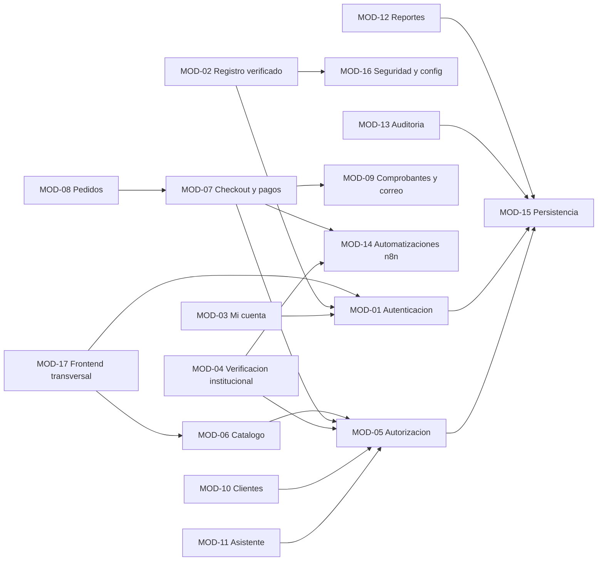

# Módulos y responsabilidades

| Campo | Valor |
|---|---|
| ID documental | DOC-04-03 |
| Versión | 1.0 |
| Estado | BORRADOR — PENDIENTE DE VALIDACIÓN |
| Fecha de generación | 2026-10-16 |
| Responsable | PENDIENTE DE ASIGNACIÓN |
| Evidencia base | rama `feature/verificacion-seguridad`, commit `4742737` |

## Propósito

Describir los 17 módulos lógicos (MOD-01…MOD-17) identificados en el código, su responsabilidad, sus archivos y sus dependencias.

## Alcance

**[INF]** Los módulos no existen como paquetes separados: es una agrupación lógica hecha en esta auditoría a partir de rutas, archivos y tablas. Rutas relativas desde la raíz del repositorio.

## 1. Mapa de módulos

## 2. Detalle por módulo

| ID | Módulo | Responsabilidad | Archivos principales | Tablas | Depende de | Estado (catálogo) |
|---|---|---|---|---|---|---|
| MOD-01 | Autenticación y sesión | Captcha, login con hash de relleno, MFA por correo, JWT + refresh rotativo, revocación por `session_version`, middleware `requiereAutenticacion`/`requiereAdmin` | `backend/src/routes/auth.js`, `backend/src/mfaCodes.js`, `backend/src/seguridad/captcha.js`, `backend/src/seguridad/contrasenas.js`, `backend/src/configSegura.js`, `frontend/login.html`, `frontend/js/auth.js`, `frontend/js/captcha.js` | usuarios, retos_mfa, refresh_tokens | MOD-15, MOD-16, MOD-09 (correo) | REQ-F-005–009: verificados salvo REQ-F-008 |
| MOD-02 | Registro verificado y padrón | Formulario por tipo de institución, verificación de la terna contra el padrón cifrado, solicitudes pendientes, panel de aprobación | `backend/src/registroInstitucional.js`, `backend/src/seguridad/registroVerificado.js`, `backend/src/seguridad/padron.js`, `backend/src/seguridad/normalizacion.js`, `backend/src/routes/solicitudesRegistro.js`, `frontend/registro.html`, `frontend/js/registro-wizard.js`, `frontend/admin-solicitudes.html`, `frontend/js/admin-solicitudes-contador.js`, `backend/scripts/importar-padron.js` | padron_institucional, solicitudes_registro, clientes, usuarios | MOD-16, MOD-01, MOD-13, MOD-14 (W12) | REQ-F-001, 002, 004 verificados; REQ-F-003 no verificado |
| MOD-03 | Mi cuenta | Perfil propio, cambio de correo con código, cambio de contraseña con MFA reciente, cerrar sesiones, solicitudes de corrección/eliminación | `backend/src/routes/miCuenta.js`, `frontend/cambiar-password.html` | clientes, usuarios, retos_mfa, solicitudes_cuenta | MOD-01, MOD-13 | PARCIALMENTE IMPLEMENTADO (sin pantallas; BUG-004/005) |
| MOD-04 | Verificación institucional y en la compra | Documentos cifrados, identificador CC/CE, solicitudes con doble comprobación, decisiones, suspensión, restringidos, autorización por compra, mantenimiento | `backend/src/verificacion.js`, `backend/src/verificacionCompra.js`, `backend/src/verificacionJobs.js`, `backend/src/routes/verificacion.js`, `frontend/mi-verificacion.html`, `frontend/admin-verificaciones.html` | documentos_verificacion, verificacion_historial, solicitudes_verificacion, verificacion_comprobaciones, identificadores_personales, autorizaciones_compra, automation_nonces | MOD-05, MOD-14 (W11), MOD-16 | REQ-F-027–030 |
| MOD-05 | Autorización y segmentación | Contexto del solicitante desde BD, `evaluarProducto`, `requierePermiso`, `requiereSuperadmin`, catálogo de 13 permisos, instituciones | `backend/src/autorizacion.js`, `backend/src/tenancy.js` | staff_permisos, usuarios, clientes, productos_elegibilidad | MOD-15 | REQ-F-014 verificado (unitario) |
| MOD-06 | Catálogo | Listado con caché de 5 s, detalle (404 si no visible), CRUD de productos (multipart con imagen ≤5 MB) y categorías, inventario bajo | `backend/src/routes/productos.js`, `backend/src/routes/categorias.js`, `frontend/index.html`, `frontend/producto-detalle.html`, `frontend/admin-productos.html`, `frontend/js/imagenes.js` | productos, categorias, productos_elegibilidad | MOD-05, MOD-11 (invalida índice) | REQ-F-015–017 no verificados |
| MOD-07 | Carrito, checkout y pagos | Carrito en `localStorage`, checkout idempotente con reserva `FOR UPDATE`, proveedor mock, webhook firmado, expiración de reservas | `frontend/js/cart.js`, `frontend/checkout.html`, `frontend/js/checkout-autofill.js`, `backend/src/routes/checkout.js`, `backend/src/routes/pagos.js`, `backend/src/paymentProvider.js`, `backend/src/paymentProviderInstance.js`, `backend/src/paymentJobs.js`, `backend/src/inventoryReservations.js` | pedidos, detalle_pedido, pagos, eventos_pago, productos | MOD-05, MOD-04, MOD-09, MOD-14 (W1, W3) | REQ-F-019/021 no verificados; 020/022 verificados |
| MOD-08 | Pedidos | Historial propio, cancelación, gestión administrativa de estados (excepto estados de pago) | `backend/src/routes/pedidos.js`, `frontend/mis-pedidos.html`, `frontend/historial.html`, `frontend/admin-pedidos.html` | pedidos, pagos | MOD-07, MOD-13 | REQ-F-023/024 no verificados |
| MOD-09 | Comprobantes y correo | Comprobante JSON/PDF, enlace firmado 24 h, reenvío, cola de correos, envío SMTP | `backend/src/routes/comprobantes.js`, `backend/src/receiptService.js`, `backend/src/receiptTokens.js`, `backend/src/emailOutbox.js`, `backend/src/email.js`, `backend/src/seguridad/correo.js` | comprobantes, correo_outbox, solicitudes_reenvio_comprobante | MOD-15, SMTP | REQ-F-025 verificado |
| MOD-10 | Clientes | CRUD de fichas de clientes (datos cifrados), dato sensible con consentimiento | `backend/src/routes/clientes.js`, `frontend/admin-clientes.html` | clientes, datos_sensibles | MOD-05, MOD-13 | REQ-F-026 verificado (controles) |
| MOD-11 | Asistente y atención | Asistente por reglas (Ollama opcional), sugerencias, pendientes, resumen semanal; calificación y solicitudes de contacto | `backend/src/routes/asistente.js`, `backend/src/assistant/*`, `backend/src/routes/atencion.js`, `frontend/js/chatbot.js`, `frontend/contacto.html` | faq_asistente, asistente_pendientes, atenciones, solicitudes_contacto | MOD-05, MOD-14 (W6) | REQ-F-031 verificado; 032 no |
| MOD-12 | Reportes | Reporte mensual agregado, reportes/sugerencias del cliente | `backend/src/routes/reportes.js`, `backend/src/routes/misreportes.js`, `frontend/reportes.html`, `frontend/mis-reportes.html`, `frontend/js/reportes.js`, `frontend/admin-dashboard.html` | atenciones, pedidos, detalle_pedido, reportes_cliente | MOD-15 | REQ-F-033 no verificado; **BUG-001** |
| MOD-13 | Auditoría | Registro de acciones administrativas y consulta con `auditoria.ver` | `backend/src/auditoria.js`, `backend/src/routes/auditoria.js` | auditoria | MOD-15 | REQ-F-034 no verificado |
| MOD-14 | Automatizaciones n8n | Outbox firmado (W1, W3, W6, W8, W11), endpoints con token (W2, W4, W11, W7), avisos W12, workflows importables | `backend/src/automationOutbox.js`, `backend/src/automationSignatures.js`, `backend/src/automationAuth.js`, `backend/src/seguridad/avisosN8n.js`, `backend/src/routes/automatizaciones.js`, `n8n/workflows/*.json`, `n8n/generar-w11.js`, `n8n/generar-w12.js`, `n8n/docker-compose.yml` | automation_outbox, automation_nonces | MOD-15, n8n | REQ-F-035 verificado; REQ-F-036 NO DETERMINADO |
| MOD-15 | Persistencia y migraciones | Pools (3 + 1), DDL tolerante, migraciones versionadas, semillas, reversión | `backend/src/db.js`, `backend/src/migraciones/*`, `backend/sql/003_registro_verificado.sql`, `backend/scripts/migraciones.js` | todas, schema_migraciones | MySQL | REQ-F-037 verificado (idempotencia) |
| MOD-16 | Seguridad transversal y configuración | App Express, CORS, cabeceras, cifrado, validación de secretos, generación de claves | `backend/src/app.js`, `backend/server.js`, `backend/src/crypto.js`, `backend/src/seguridad/cifradoCampos.js`, `backend/src/configSegura.js`, `backend/scripts/generar-claves.js`, `backend/.env.example` | — | — | REQ-NF-001/003 verificados; 005 parcial |
| MOD-17 | Frontend transversal | Plantilla común, menú, i18n, estilos, portada, normatividad | `frontend/js/global-layout.js`, `frontend/js/navbar.js`, `frontend/js/i18n.js`, `frontend/css/*`, `frontend/landing.html`, `frontend/leyes.html` | — | Bootstrap/Chart.js CDN | REQ-F-038 parcial; 039 no verificado |

## 3. Responsabilidades que NO están en el código

**[OBS]** No hay: pasarela de pago real (REQ-F-040), facturación DIAN, despliegue automatizado/CI, contenedor del backend, borrado automático por plazos (BUG-015), pantalla de Mi cuenta (BUG-004).

## Referencias

- [04_INVENTARIO_DE_ARCHIVOS_RELEVANTES.md](04_INVENTARIO_DE_ARCHIVOS_RELEVANTES.md) · [08_CONTRATOS_Y_ENDPOINTS_DE_API.md](08_CONTRATOS_Y_ENDPOINTS_DE_API.md)
- [../01_INGENIERIA_DE_REQUERIMIENTOS/11_MATRIZ_DE_TRAZABILIDAD.md](../01_INGENIERIA_DE_REQUERIMIENTOS/11_MATRIZ_DE_TRAZABILIDAD.md)
- [../03_DISENO/03_DIAGRAMA_DE_COMPONENTES.md](../03_DISENO/03_DIAGRAMA_DE_COMPONENTES.md)
