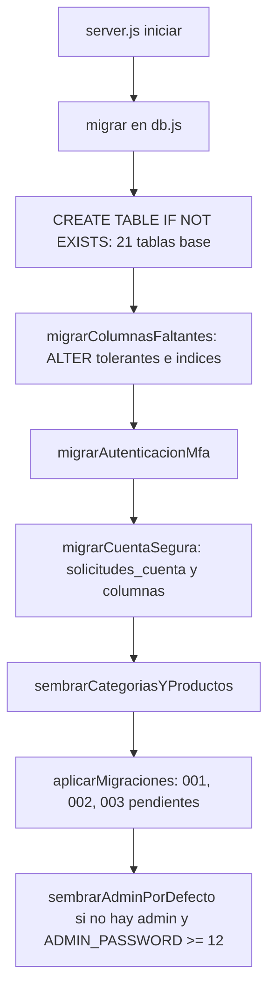

# Guía de base de datos

| Campo | Valor |
|---|---|
| ID documental | DOC-04-09 |
| Versión | 1.0 |
| Estado | BORRADOR — PENDIENTE DE VALIDACIÓN |
| Fecha de generación | 2026-10-16 |
| Responsable | PENDIENTE DE ASIGNACIÓN |
| Evidencia base | rama `feature/verificacion-seguridad`, commit `4742737` |

## Propósito

Explicar al desarrollador cómo se crea, evoluciona y revierte el esquema MySQL, y qué precauciones tomar.

## Alcance

`../backend/src/db.js`, `../backend/src/migraciones/`, `../backend/sql/003_registro_verificado.sql`, `../backend/scripts/migraciones.js`. El diseño detallado (columnas, relaciones) está en [../03_DISENO/05_DISENO_DE_BASE_DE_DATOS.md](../03_DISENO/05_DISENO_DE_BASE_DE_DATOS.md) y [../03_DISENO/07_DICCIONARIO_TECNICO_DE_DATOS.md](../03_DISENO/07_DICCIONARIO_TECNICO_DE_DATOS.md). **[OBS]** No se conectó a ninguna base durante la auditoría: el esquema se documenta a partir del DDL del código.

## 1. Conexión

| Pool | Conexiones | Uso | Archivo |
|---|---|---|---|
| `pool` | `min(DB_CONNECTION_LIMIT, 4)`, por defecto 3 | Consultas normales y transacciones con `getConnection()` | db.js:9 |
| `poolTransacciones` | 1, `multipleStatements: true` | Lotes `START TRANSACTION … COMMIT` del registro, login y panel de solicitudes (un viaje a MySQL) | db.js:29 |
| Fuente del padrón | Conexión aparte con `PADRON_DB_URI` o `MYSQL_ADDON_URI` (solo `SELECT`) | Sincronización | seguridad/padron.js |

**[OBS]** El plan gratuito de MySQL en Clever Cloud admite 5 conexiones por usuario; el servidor usa hasta 4. Detenga el servidor antes de ejecutar scripts contra la misma base.

## 2. Ciclo de migración al arrancar



- **[OBS]** El DDL heredado ignora errores de "columna duplicada"; las migraciones versionadas se registran en `schema_migraciones (version, descripcion, aplicada_en)` y se aplican **una sola vez**.
- **[OBS]** El DDL de MySQL no es transaccional: cada paso es idempotente para que un arranque posterior complete una migración interrumpida.
- **[OBS]** Las semillas insertan 17 categorías, 47 productos de ejemplo (solo si la tabla de categorías estaba vacía) y referencias institucionales para cotización (precio 0, `metadatos.cotizacion_requerida`), sin duplicar por `institucion_id + nombre`.

## 3. Tablas (34)

| Origen | Tablas |
|---|---|
| `db.js` (base) | clientes, datos_sensibles, categorias, productos, solicitudes_contacto, atenciones, usuarios, refresh_tokens, retos_mfa, pedidos, pagos, eventos_pago, comprobantes, correo_outbox, solicitudes_reenvio_comprobante, automation_outbox, faq_asistente, asistente_pendientes, detalle_pedido, reportes_cliente, auditoria |
| `db.js` (`migrarCuentaSegura`) | solicitudes_cuenta |
| `migraciones/index.js` | schema_migraciones |
| Migración 001 | productos_elegibilidad, verificacion_historial, documentos_verificacion, staff_permisos (+ columnas en clientes, usuarios, productos; `auditoria.accion` → VARCHAR(40)) |
| Migración 002 | solicitudes_verificacion, verificacion_comprobaciones, identificadores_personales, autorizaciones_compra, automation_nonces (+ columnas en usuarios y clientes) |
| Migración 003 | padron_institucional, solicitudes_registro (+ `usuarios.estado_cuenta`) |

Orden de creación y consultas de solo lectura: [Base_de_Datos/](Base_de_Datos/README.md).

## 4. Comandos de mantenimiento del esquema

```bash
cd backend
node scripts/migraciones.js estado
node scripts/migraciones.js revertir 003_registro_verificado --confirmo-perdida-de-datos
```

| Acción | Efecto | Riesgo |
|---|---|---|
| `estado` | Lista 001–003 y si están aplicadas | Ninguno (lectura) |
| `revertir 001…` | Elimina staff_permisos, documentos_verificacion, verificacion_historial, productos_elegibilidad y columnas añadidas | **Pérdida de decisiones, historial, documentos y permisos** |
| `revertir 002…` | Elimina solicitudes, comprobaciones, identificadores, autorizaciones, nonces, columnas de superadmin y permisos heredados | **Pérdida de datos de verificación** |
| `revertir 003…` | Elimina solicitudes_registro, padron_institucional y `usuarios.estado_cuenta` | **Pérdida de solicitudes**; las cuentas vuelven a no tener estado |

**[OBS]** `revertir` no restaura el código anterior: hay que volver a desplegar la versión correspondiente. Probado históricamente en MySQL 8 para la 001 (`../docs/MODELO_DATOS.md`) — evidencia histórica no reproducida.

## 5. SQL manual de la migración 003

`../backend/sql/003_registro_verificado.sql` es idempotente (usa `information_schema` + `PREPARE` para la columna) e inserta su registro en `schema_migraciones`. Úselo solo para revisión o aplicación controlada por un DBA: `mysql <base> < backend/sql/003_registro_verificado.sql`. *PENDIENTE DE VALIDACIÓN*.

## 6. Precauciones obligatorias

1. **Nunca** apunte el `.env` de desarrollo ni los scripts de prueba a la base de Clever Cloud (incidente del 2026-10-13, `../docs/AUDITORIA_TECNICA.md` §7).
2. Respalde (`mysqldump`) y respalde `DOCUMENTOS_DIR` antes de cualquier despliegue o reversión.
3. Las claves `ENC_KEY`, `HMAC_KEY`, `CRYPTO_KEY(S)` e `IDENT_HMAC_KEY` son necesarias para leer los datos cifrados: sin ellas un respaldo de la base no sirve (RSK-001).
4. La suite de integración **borra todas las tablas** de la base indicada (se niega si no es local o su nombre no contiene `test`).
5. Datos cifrados: no modifique a mano columnas `*_cifrado`/`*_cifrada` ni `nit_hash`; el AAD impide moverlos entre columnas.

## Referencias

- [Base_de_Datos/README.md](Base_de_Datos/README.md) · [Diagramas/mer-resumido.mmd](Diagramas/mer-resumido.mmd)
- [../06_IMPLEMENTACION/06_CONFIGURACION_DE_BASE_DE_DATOS.md](../06_IMPLEMENTACION/06_CONFIGURACION_DE_BASE_DE_DATOS.md)
- [../docs/MODELO_DATOS.md](../docs/MODELO_DATOS.md)
