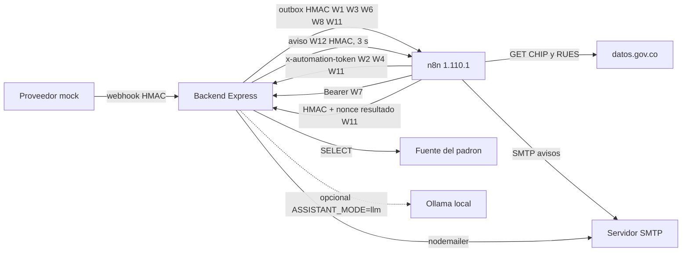

# Integraciones y automatizaciones

| Campo | Valor |
|---|---|
| ID documental | DOC-04-10 |
| Versión | 1.0 |
| Estado | BORRADOR — PENDIENTE DE VALIDACIÓN |
| Fecha de generación | 2026-10-16 |
| Responsable | PENDIENTE DE ASIGNACIÓN |
| Evidencia base | rama `feature/verificacion-seguridad`, commit `4742737` |

## Propósito

Describir cada integración externa y cada proceso automático del sistema, con su mecanismo de autenticación, sus datos y su estado.

## Alcance

n8n (W1–W12), SMTP, padrón institucional, proveedor de pago mock, datos.gov.co (vía W11), Ollama opcional y jobs internos del backend. Fichas detalladas por workflow en [Integraciones/](Integraciones/README.md).

## 1. Vista general

## 2. Integraciones

| Integración | Dirección | Autenticación | Datos que viajan | Estado |
|---|---|---|---|---|
| SMTP (nodemailer) | Backend → SMTP | `SMTP_USER`/`SMTP_PASSWORD` | Códigos MFA y de compra, avisos de cuenta, comprobantes (enlace firmado), decisiones de registro | IMPLEMENTADO Y VERIFICADO con transporte simulado (receiptEmail, mi-cuenta, registro-verificado); SMTP real NO VERIFICADO |
| Padrón institucional | Backend ← fuente MySQL (`PADRON_DB_URI`/`MYSQL_ADDON_URI`, tabla `personas_institucionales_prueba`) | Credenciales en la URI | NIT, nombre, entidad, tipo; se copian cifrados a `padron_institucional` | REQ-F-003 IMPLEMENTADO, NO VERIFICADO |
| Proveedor de pago | Mock interno → `POST /api/pagos/webhook/mock` | HMAC-SHA256 (`PAYMENT_WEBHOOK_SECRET`) sobre `timestamp.cuerpo` | `event_id`, referencia, importe, moneda, estado | REQ-F-021 IMPLEMENTADO, NO VERIFICADO; real DOCUMENTADO, NO IMPLEMENTADO |
| n8n (eventos salientes) | Backend → n8n | HMAC con secreto por workflow, cabeceras `x-automation-timestamp`/`x-automation-signature`; ventana 5 min | Ver §3 (sin datos personales salvo excepciones) | REQ-F-035 IMPLEMENTADO Y VERIFICADO (lado backend) |
| n8n (llamadas entrantes) | n8n → backend | `x-automation-token` (≥32, tiempo constante), Bearer, HMAC + nonce | Resumen agregado, expiración, mantenimiento, resultado de entidad | Verificado en `automation.test` (tokens) |
| datos.gov.co | n8n W11 → API Socrata | `X-App-Token` opcional (`DATOS_GOV_APP_TOKEN`) | NIT de persona jurídica | NO DETERMINADO (W11 nunca importado) |
| Ollama | Backend → `OLLAMA_URL` (solo local) | — | Texto de la consulta | IMPLEMENTADO Y VERIFICADO (validación del plan, assistant.spec); uso real NO DETERMINADO |
| CDN jsdelivr | Navegador → CDN | — | — | Bootstrap 5.3.3, Chart.js 4.4.4 |

## 3. Workflows n8n

**[OBS]** Los 12 JSON de `../n8n/workflows/` tienen `active: false`. No se pudo comparar con una instancia desplegada (la API local respondió 401 en 2026-10-13 según `../docs/ARQUITECTURA_ACTUAL.md`). REQ-F-036: **NO DETERMINADO**.

| WF | Nombre | Disparador | Llamado por / llama a | Estado de uso [OBS] |
|---|---|---|---|---|
| W1 | Alertas de pago | Webhook `POST /webhook/empresa-alerta-pago` | Outbox al aprobar/rechazar un pago | En uso si se configura `N8N_W1_*` |
| W2 | Resumen diario | Cron diario 08:00 (America/Bogota) | `GET /api/automatizaciones/resumen-diario` | Opcional |
| W3 | Stock bajo | Webhook `POST /webhook/empresa-stock-bajo` | Outbox (máx. una alerta genérica al día) | Opcional |
| W4 | Expirar pedidos | Cron cada minuto | `POST /api/automatizaciones/pedidos/expirar` | Redundante con el job interno |
| W5 | MFA por correo | Webhook `POST /webhook/mfa-login-code` | — | **Sin uso desde 2026-10-15** (nodemailer) |
| W6 | Asistente escalado | Webhook `POST /webhook/asistente-escalado` | Outbox del asistente | Opcional |
| W7 | Resumen semanal del asistente | Cron semanal (lunes 08:00) | `GET` a `ASSISTANT_WEEKLY_SUMMARY_URL` (`/api/asistente/pendientes/resumen-semanal`) | Opcional |
| W8 | Seguridad y solicitudes de cuenta | Webhook `POST /webhook/account-events` | Outbox: hoy solo `admin.solicitud_cuenta` (id y tipo) | Parcial |
| W9 | Comprobantes | Webhook `POST /webhook/receipt-email` | — | **Sin uso desde 2026-10-15** |
| W10 | Contexto institucional | Subflujo (Execute Workflow Trigger) | No conectado | Inactivo por diseño |
| W11 | Verificación del comprador | Webhook `POST /webhook/verification-events` + cron cada 15 min | Outbox; consulta datos.gov.co; responde a `/api/automatizaciones/verificaciones/*` | Opcional; envía NIT de entidad (BUG-014) |
| W12 | Avisos de registro | Webhook `POST /webhook/registro-avisos` | `avisosN8n.js` (registro recibido/aprobado/rechazado) | Opcional; solo verifica firma y responde |

Requisitos del contenedor n8n para los nodos Code con firma: `NODE_FUNCTION_ALLOW_BUILTIN=crypto`, `N8N_BLOCK_ENV_ACCESS_IN_NODE=false`, y `EXECUTIONS_DATA_SAVE_ON_SUCCESS/ERROR=none` recomendado (`../backend/README.md`, `../n8n/generar-w12.js`).

## 4. Outbox hacia n8n (`backend/src/automationOutbox.js`)

- **[OBS]** Tabla `automation_outbox` (`workflow ENUM('W1','W3','W6','W8','W11')`, `dedupe_key` única, `payload` JSON, `payload_cifrado`).
- Worker cada 5 s, timeout 8 s por entrega, hasta 8 intentos con espera creciente; los registros `procesando` atascados se reclaman.
- La URL debe ser HTTPS salvo `localhost`/`127.0.0.1`/`::1` y sin credenciales embebidas.
- W11 espera HTTP 202 como confirmación explícita.
- Una caída de n8n **no** bloquea el checkout ni cambia estados de pago.

## 5. Jobs internos del backend

| Job | Archivo | Periodicidad | Acción |
|---|---|---|---|
| Expiración de pedidos | `src/paymentJobs.js` | 60 s, lotes de 25 | Marca pago/pedido expirados y libera inventario (FOR UPDATE) |
| Mantenimiento de verificaciones | `src/verificacionJobs.js` | 5 min (no en `NODE_ENV=test`) | Reintenta consultas de entidad, expira solicitudes (30 días) y autorizaciones, depura nonces (24 h) |
| Cola de correo | `src/emailOutbox.js` | 5 s, 5 intentos | Envía comprobantes y avisos administrativos |
| Cola de automatizaciones | `src/automationOutbox.js` | 5 s, 8 intentos | Entrega eventos a n8n; detecta stock bajo |
| Sincronización del padrón | `src/seguridad/padron.js` | Al arrancar y cada `PADRON_SYNC_MINUTOS` (10) | Copia cifrada; filas desaparecidas → `inactiva` |
| Índice del asistente | `src/assistant/indiceCatalogo.js` | Caché 60 s | Recarga catálogo y FAQ |

## 6. Riesgos

RSK-011 (workflows no desplegados), BUG-014 (NIT hacia n8n), BUG-006 (nodemailer), REQ-NF-008 (minimización verificada en pruebas).

## Referencias

- [Integraciones/README.md](Integraciones/README.md) · [11_VARIABLES_DE_ENTORNO.md](11_VARIABLES_DE_ENTORNO.md)
- [../06_IMPLEMENTACION/07_CONFIGURACION_DE_INTEGRACIONES.md](../06_IMPLEMENTACION/07_CONFIGURACION_DE_INTEGRACIONES.md)
- [../docs/FLUJO_N8N_VERIFICACION.md](../docs/FLUJO_N8N_VERIFICACION.md) · [../docs/REGISTRO_VERIFICADO.md](../docs/REGISTRO_VERIFICADO.md) · [../docs/Flujos-n8n.docx](../docs/Flujos-n8n.docx)
