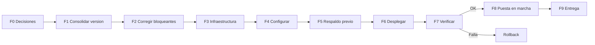

# Plan de implementación

| Campo | Valor |
|---|---|
| ID documental | DOC-06-01 |
| Versión | 1.0 |
| Estado | BORRADOR — PENDIENTE DE VALIDACIÓN |
| Fecha de generación | 2026-10-16 |
| Responsable | PENDIENTE DE ASIGNACIÓN |
| Evidencia base | rama `feature/verificacion-seguridad`, commit `4742737` |

## Propósito

Definir las fases, entradas, salidas y criterios para llevar la plataforma Suite Institucional (suministros para entidades públicas) desde el entorno de laboratorio actual a un entorno operativo, usando únicamente procedimientos compatibles con la arquitectura observada.

## Alcance

Backend Node.js/Express que sirve la API y el frontend estático (`../backend/server.js`, `../backend/src/app.js`), base MySQL 8 (Clever Cloud en el laboratorio), n8n en Docker (opcional), correo por SMTP con nodemailer (Mailpit en laboratorio). No incluye la pasarela de pagos real (REQ-F-040, DOCUMENTADO, NO IMPLEMENTADO).

## Situación de partida

- **[OBS]** El sistema funciona en un entorno de **laboratorio**: sin HTTPS, con proveedor de pago `mock` y correo de laboratorio (Mailpit o impresión en consola fuera de producción).
- **[OBS]** No existe evidencia de un despliegue productivo formal, de un entorno de preproducción, de CI/CD ni de etiquetas de versión en Git (BUG-018).
- **[OBS]** El trabajo más reciente (REL-004) está en la rama `feature/verificacion-seguridad`, sin fusionar a `main`.
- **[OBS]** El 2026-10-16 se ejecutaron `npm test` (Jest 107/107, `node:test` 51/51). Ninguna otra validación de implementación se ejecutó en esta auditoría.

## Fases propuestas [REC]

| Fase | Objetivo | Entradas | Salidas | Estado |
|---|---|---|---|---|
| F0 | Decisiones previas | Decisión W11/NIT (BUG-014), validación jurídica (RSK-010), responsables (RSK-013) | Decisiones registradas en [07_REGISTRO_DE_DECISIONES](../00_GESTION_DEL_PROYECTO/07_REGISTRO_DE_DECISIONES.md) | PENDIENTE |
| F1 | Consolidar versión | Fusión de `feature/verificacion-seguridad` en `main`, etiqueta de versión | Rama y etiqueta (ver [16_REGISTRO_DE_VERSIONES_Y_LIBERACIONES](16_REGISTRO_DE_VERSIONES_Y_LIBERACIONES.md)) | PENDIENTE |
| F2 | Corregir bloqueantes | BUG-001, BUG-003, BUG-006, BUG-012 | Correcciones probadas | PENDIENTE |
| F3 | Preparar infraestructura | [02_REQUISITOS_DE_INFRAESTRUCTURA](02_REQUISITOS_DE_INFRAESTRUCTURA.md) | Servidor/PaaS, MySQL dedicado, SMTP, HTTPS | PENDIENTE |
| F4 | Configurar | [04_MANUAL_DE_CONFIGURACION](04_MANUAL_DE_CONFIGURACION.md), [08_CONFIGURACION_DE_SEGURIDAD](08_CONFIGURACION_DE_SEGURIDAD.md) | `.env` del entorno en gestor de secretos | PENDIENTE |
| F5 | Respaldo previo | [09_PLAN_DE_RESPALDO_Y_RESTAURACION](09_PLAN_DE_RESPALDO_Y_RESTAURACION.md) | Respaldo verificado de BD, documentos y claves | PENDIENTE |
| F6 | Desplegar | [05_GUIA_DE_DESPLIEGUE](05_GUIA_DE_DESPLIEGUE.md) | Aplicación arrancada, migraciones aplicadas | PENDIENTE |
| F7 | Verificar | [13_LISTA_DE_VERIFICACION_PREPRODUCCION](13_LISTA_DE_VERIFICACION_PREPRODUCCION.md), suites de [05_PRUEBAS](../05_PRUEBAS/01_PLAN_DE_PRUEBAS.md) | Lista diligenciada | PENDIENTE |
| F8 | Puesta en marcha | [14_PROCEDIMIENTO_DE_PUESTA_EN_MARCHA](14_PROCEDIMIENTO_DE_PUESTA_EN_MARCHA.md) | Superadministrador, padrón sincronizado, operación | PENDIENTE |
| F9 | Entrega | [15_ACTA_DE_ENTREGA_Y_RECEPCION](15_ACTA_DE_ENTREGA_Y_RECEPCION.md) | Acta firmada | PENDIENTE |

## Criterios de salida [REC]

1. Lista de verificación preproducción completa sin ítems críticos abiertos.
2. Respaldo previo restaurado con éxito al menos una vez en un entorno de prueba.
3. Suites `npm test` y `npm run test:integration` aprobadas sobre la versión a desplegar.
4. Acta de entrega aprobada por los responsables que se designen.

## Cronograma, presupuesto y responsables

**PENDIENTE DE APROBACIÓN.** No existe evidencia de cronograma, presupuesto ni responsables. Restricción conocida: entorno de costo cero (REQ-NF-018, NO DETERMINADO).

## Riesgos asociados

RSK-001, RSK-002, RSK-003, RSK-005, RSK-007, RSK-012, RSK-015, RSK-017 (ver [06_MATRIZ_DE_RIESGOS](../00_GESTION_DEL_PROYECTO/06_MATRIZ_DE_RIESGOS.md)).

## Referencias

- [../docs/GUIA_INSTALACION_Y_DESPLIEGUE.md](../docs/GUIA_INSTALACION_Y_DESPLIEGUE.md)
- [../docs/REGISTRO_VERIFICADO.md](../docs/REGISTRO_VERIFICADO.md)
- [10_PLAN_DE_ROLLBACK.md](10_PLAN_DE_ROLLBACK.md)
