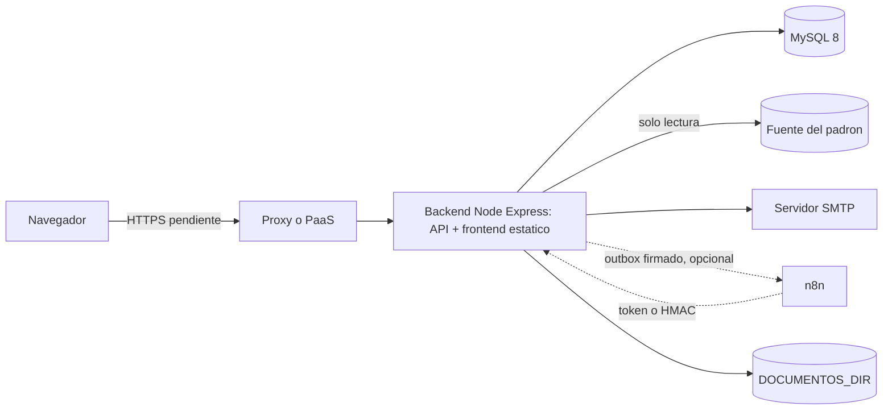

# Guía de despliegue

| Campo | Valor |
|---|---|
| ID documental | DOC-06-05 |
| Versión | 1.0 |
| Estado | BORRADOR — PENDIENTE DE VALIDACIÓN |
| Fecha de generación | 2026-10-16 |
| Responsable | PENDIENTE DE ASIGNACIÓN |
| Evidencia base | rama `feature/verificacion-seguridad`, commit `4742737` |

## Propósito

Describir cómo desplegar una versión del sistema en un entorno destino de forma controlada.

## Alcance

Despliegue manual de un proceso Node.js (servidor propio o PaaS con consola), conectado a MySQL 8. **[OBS]** No existe CI/CD, Dockerfile del backend ni scripts de despliegue en el repositorio. **Todo este procedimiento está PENDIENTE DE VALIDAR**: no se desplegó nada en esta auditoría.

## Arquitectura de despliegue

## Precondiciones

1. Versión identificada (commit o etiqueta; hoy no hay etiquetas — BUG-018).
2. `npm test` aprobado sobre esa versión; `npm run test:integration` aprobado contra un MySQL de pruebas (no ejecutado en esta auditoría).
3. Respaldo de base, `DOCUMENTOS_DIR` y claves ([09](09_PLAN_DE_RESPALDO_Y_RESTAURACION.md)).
4. Lista [13_LISTA_DE_VERIFICACION_PREPRODUCCION.md](13_LISTA_DE_VERIFICACION_PREPRODUCCION.md) revisada.
5. Corrección o aceptación formal de BUG-001 (reportes sin autenticación), BUG-003 (`API_BASE` fijo), BUG-006 (nodemailer) y BUG-012 (HTTPS/CSP/HSTS).

## Procedimiento

1. **Detener** la versión anterior (si existe). Con una sola instancia, habrá indisponibilidad durante el cambio.
2. **Respaldar** la base: `mysqldump` (ver [09](09_PLAN_DE_RESPALDO_Y_RESTAURACION.md)).
3. **Obtener** el código de la versión: `git fetch` y `git checkout <commit|etiqueta>`.
4. **Instalar** dependencias de producción: `cd backend && npm ci --omit=dev` **[REC]** (`npm ci` requiere el `package-lock.json` existente).
5. **Configurar** el entorno ([04](04_MANUAL_DE_CONFIGURACION.md)). En producción (`NODE_ENV=production`) el arranque **falla** si:
   - falta `CORS_ORIGINS`;
   - falta `SMTP_HOST`;
   - `JWT_SECRET`, `MFA_TOKEN_PEPPER` o `CRYPTO_KEY` son débiles o de ejemplo;
   - `ENC_KEY`/`HMAC_KEY` no son válidas;
   - `PAYMENT_MODE` es `sandbox` o `prod` (no hay adaptador real), **y también si es `mock`**: `crearPaymentProvider()` prohíbe el proveedor mock con `NODE_ENV=production` ([../backend/src/paymentProvider.js](../backend/src/paymentProvider.js)).
   > **Bloqueo [OBS]:** con el código actual **no existe ninguna combinación válida para arrancar con `NODE_ENV=production`**: mock está prohibido y sandbox/prod no están implementados (REQ-F-040, RSK-015). Un despliegue productivo real queda **BLOQUEADO** hasta implementar un adaptador de pasarela o tomar una decisión de diseño (p. ej. modo catálogo/cotización sin pagos). Mientras tanto solo es posible operar sin `NODE_ENV=production` (modo laboratorio/demostración), con las consecuencias descritas en "Advertencias".
   Además conviene `TRUST_PROXY_HOPS=1` detrás de un proxy, `BCRYPT_COST=12` y `DOCUMENTOS_DIR` en almacenamiento persistente.
6. **Frontend**: confirmar que el origen público coincide con `API_BASE` de `frontend/js/auth.js` (hoy `http://localhost:8081`, BUG-003). Si no coincide, la aplicación web no podrá llamar a la API.
7. **Arrancar**: `npm start`. Las migraciones se aplican **automáticamente** en el arranque (DDL tolerante en `db.js` y versionadas 001–003 en `schema_migraciones`). **No existe un modo "sin migrar"**: por eso el respaldo del paso 2 es obligatorio.
8. **Verificar** el log de arranque: `[db] Tablas verificadas/creadas correctamente.`, `[migraciones] … aplicada.` (si había pendientes) y `[server] Backend corriendo en …`.
9. **Comprobar migraciones**: `node scripts/migraciones.js estado` (con el servidor detenido o considerando el límite de conexiones).
10. **Pruebas de humo** (sin datos reales): `GET /` responde, `GET /api/auth/registro/tipos` responde, `GET /api/auth/captcha` devuelve un SVG, inicio de sesión con una cuenta autorizada recibe el código.
11. Si algo falla: [10_PLAN_DE_ROLLBACK.md](10_PLAN_DE_ROLLBACK.md).

## Advertencias

- **[OBS]** Incidente histórico (docs/AUDITORIA_TECNICA §7): `npm run dev` (`node --watch`) apuntando a la base real aplicó una migración al guardar un archivo. Nunca usar `npm run dev` contra producción (RSK-003).
- **[OBS]** `/api/pagos/dev/simular-webhook` solo se deshabilita con `NODE_ENV=production` o `PAYMENT_MODE=prod`; un entorno con datos reales sin `NODE_ENV=production` lo deja activo.
- **[OBS]** Una sola instancia (BUG-010).

## Referencias

- [../docs/GUIA_INSTALACION_Y_DESPLIEGUE.md](../docs/GUIA_INSTALACION_Y_DESPLIEGUE.md)
- [../backend/server.js](../backend/server.js)
- [14_PROCEDIMIENTO_DE_PUESTA_EN_MARCHA.md](14_PROCEDIMIENTO_DE_PUESTA_EN_MARCHA.md)
