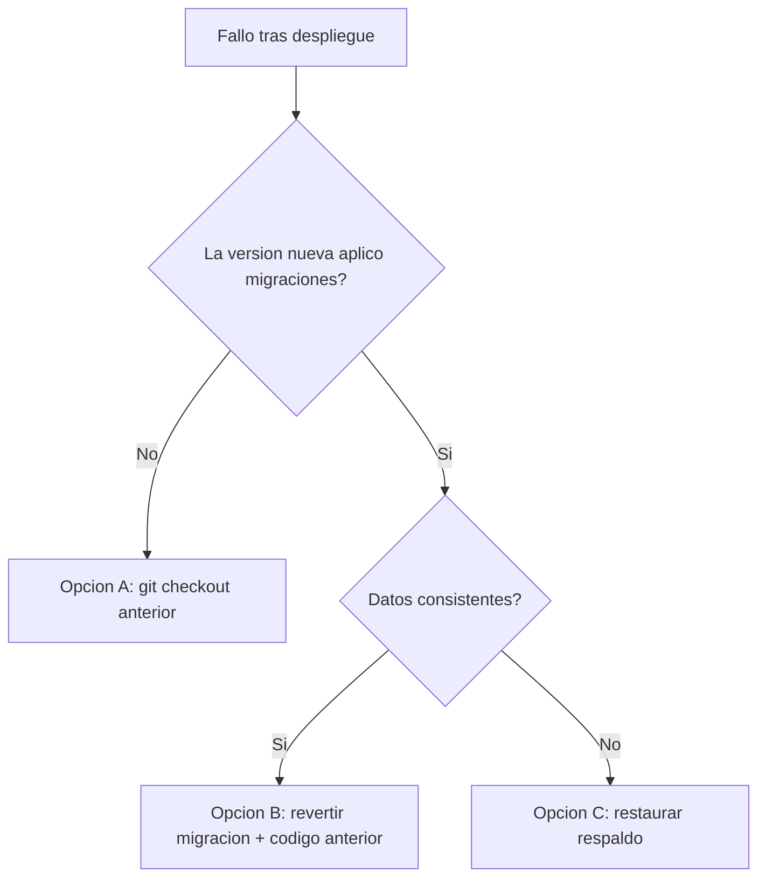

# Plan de rollback

| Campo | Valor |
|---|---|
| ID documental | DOC-06-10 |
| Versión | 1.0 |
| Estado | BORRADOR — PENDIENTE DE VALIDACIÓN |
| Fecha de generación | 2026-10-16 |
| Responsable | PENDIENTE DE ASIGNACIÓN |
| Evidencia base | rama `feature/verificacion-seguridad`, commit `4742737` |

## Propósito

Definir cómo volver a una versión anterior si un despliegue falla.

## Alcance

Código (Git), esquema (migraciones versionadas) y datos (respaldo). No se ejecutó ningún rollback en esta auditoría.

## Criterios para activar el rollback [REC]

- El servidor no arranca tras el despliegue y no se corrige en el tiempo acordado (PENDIENTE DE DEFINIR).
- Fallan las pruebas de humo de [05_GUIA_DE_DESPLIEGUE.md](05_GUIA_DE_DESPLIEGUE.md).
- Errores de descifrado, pérdida de acceso de administradores o pagos inconsistentes.

## Opciones

### A. Solo código (la nueva versión no añadió migraciones)

```bash
git checkout <commit-o-etiqueta-anterior>
cd backend && npm ci --omit=dev
npm start
```

### B. Código + migración versionada

**[OBS]** `scripts/migraciones.js` permite revertir 001, 002 o 003 de forma individual; elimina las tablas y columnas que la migración agregó, con **pérdida de datos** de esas estructuras.

```bash
cd backend
node scripts/migraciones.js estado
node scripts/migraciones.js revertir 003_registro_verificado --confirmo-perdida-de-datos
# y, si corresponde, en orden inverso: 002_verificacion_en_compra, 001_verificacion_institucional
```
Después desplegar el código anterior (opción A). **Advertencia:** si se arranca el código nuevo otra vez, la migración se reaplica sola.

Datos perdidos por versión:
- 003: `solicitudes_registro`, `padron_institucional` (reconstruible desde la fuente), `usuarios.estado_cuenta`.
- 002: solicitudes y comprobaciones de verificación, identificadores personales, autorizaciones de compra, nonces, marcas de superadmin/cuentas de prueba, permisos heredados.
- 001: historial y documentos de verificación (metadatos), elegibilidad, permisos de staff, columnas de estado de clientes y `revision_legal`.

**[OBS]** Las ALTER de `db.js` (no versionadas) no tienen reversión.

### C. Restauración completa

Cuando hay datos corruptos o la reversión no basta: restaurar el respaldo previo al despliegue ([09](09_PLAN_DE_RESPALDO_Y_RESTAURACION.md)) y el código del mismo momento. Se pierden los datos posteriores al respaldo.



## Respaldo histórico citado

La documentación previa menciona `.respaldo-pre-verificacion/backend-frontend-2026-10-13.tgz` (excluido de git, solo en el equipo local; no inspeccionado en esta auditoría).

## Referencias

- [../backend/scripts/migraciones.js](../backend/scripts/migraciones.js)
- [../docs/MODELO_DATOS.md](../docs/MODELO_DATOS.md)
- [../docs/GUIA_INSTALACION_Y_DESPLIEGUE.md](../docs/GUIA_INSTALACION_Y_DESPLIEGUE.md)
