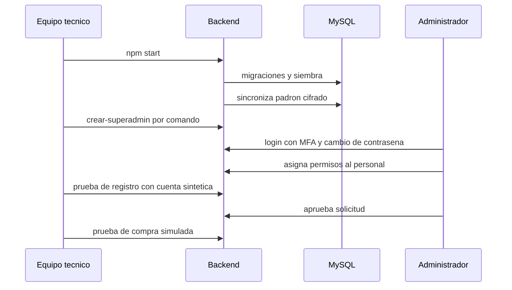

# Procedimiento de puesta en marcha

| Campo | Valor |
|---|---|
| ID documental | DOC-06-14 |
| Versión | 1.0 |
| Estado | BORRADOR — PENDIENTE DE VALIDACIÓN |
| Fecha de generación | 2026-10-16 |
| Responsable | PENDIENTE DE ASIGNACIÓN |
| Evidencia base | rama `feature/verificacion-seguridad`, commit `4742737` |

## Propósito

Secuencia ordenada para iniciar la operación del sistema una vez desplegado.

## Alcance

Desde el primer arranque hasta la primera operación completa. Aplica hoy solo a un entorno de **laboratorio/demostración** (sin `NODE_ENV=production`, ver bloqueo en [05](05_GUIA_DE_DESPLIEGUE.md)). Todos los pasos están PENDIENTE DE VALIDAR.

## Secuencia

| # | Paso | Responsable | Verificación |
|---|---|---|---|
| 1 | Confirmar lista preproducción ([13](13_LISTA_DE_VERIFICACION_PREPRODUCCION.md)) | PENDIENTE DE ASIGNACIÓN | Lista firmada |
| 2 | Arrancar con `npm start` y revisar el log | PENDIENTE DE ASIGNACIÓN | `[server] Backend corriendo…` sin `Configuración insegura` |
| 3 | `node scripts/migraciones.js estado` (con el servidor detenido o vigilando conexiones) | PENDIENTE DE ASIGNACIÓN | 001–003 aplicadas |
| 4 | Comprobar la sincronización del padrón (o `npm run padron:importar`) | PENDIENTE DE ASIGNACIÓN | Filas en `padron_institucional` |
| 5 | Crear el superadministrador ([12 §2](12_MANUAL_TECNICO_Y_ADMINISTRATIVO.md)) | PENDIENTE DE ASIGNACIÓN | Login con MFA y cambio de contraseña |
| 6 | Revisar *Diagnóstico* | Superadministrador | Configuración presente, colas sin errores |
| 7 | Crear personal y asignar permisos mínimos | Superadministrador | `staff_permisos` revisado |
| 8 | Revisar catálogo: precios, inventario, `restringido`, `revision_legal`, elegibilidad | Personal con `catalogo.gestionar` / `productos.cumplimiento` | Catálogo aprobado por el negocio |
| 9 | Completar textos `[COMPLETAR: …]` del asistente (`faq_asistente`) | PENDIENTE DE ASIGNACIÓN | Sin marcadores |
| 10 | Prueba de humo de registro → aprobación → login con MFA, con una cuenta sintética | PENDIENTE DE ASIGNACIÓN | Correo recibido |
| 11 | Prueba de compra simulada y comprobante | PENDIENTE DE ASIGNACIÓN | Pedido `pagado`, PDF descargable |
| 12 | Activar workflows n8n decididos | PENDIENTE DE ASIGNACIÓN | Outbox en `enviado` |
| 13 | Comunicar inicio de operación a usuarios | PENDIENTE DE ASIGNACIÓN | — |
| 14 | Diligenciar el acta ([15](15_ACTA_DE_ENTREGA_Y_RECEPCION.md)) | PENDIENTE DE ASIGNACIÓN | Acta firmada |

## Monitoreo inicial [REC]

Durante las primeras 48 h: revisar el log del servidor (errores `[auth]`, `[solicitudes]`, `[n8n]`, `[padron]`), colas de `correo_outbox` y `automation_outbox`, y conexiones abiertas en MySQL.

## Referencias

- [05_GUIA_DE_DESPLIEGUE.md](05_GUIA_DE_DESPLIEGUE.md)
- [../07_MANTENIMIENTO_Y_SOPORTE/03_GUIA_DE_DIAGNOSTICO.md](../07_MANTENIMIENTO_Y_SOPORTE/03_GUIA_DE_DIAGNOSTICO.md)
