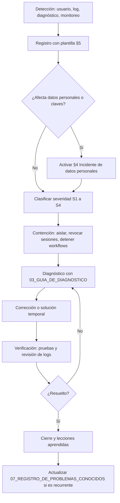

# Procedimiento de gestión de incidentes

| Campo | Valor |
|---|---|
| ID documental | DOC-07-02 |
| Versión | 1.0 |
| Estado | BORRADOR — PENDIENTE DE VALIDACIÓN |
| Fecha de generación | 2026-10-16 |
| Responsable | PENDIENTE DE ASIGNACIÓN |
| Evidencia base | rama `feature/verificacion-seguridad`, commit `4742737` |

## Propósito

Establecer un procedimiento **propuesto [REC]** para detectar, registrar, clasificar, contener, resolver y cerrar incidentes de la plataforma, incluidos los que afectan datos personales.

## Alcance

Incidentes de disponibilidad, integridad, confidencialidad y funcionalidad del backend, frontend, base de datos MySQL, correo (nodemailer/SMTP) y n8n. **[OBS]** No existe en el repositorio un procedimiento de incidentes, una mesa de ayuda ni un SLA; este documento no crea compromisos de tiempo: los tiempos objetivo quedan **PENDIENTES DE DEFINIR**.

## 1. Clasificación

| Severidad | Criterio | Ejemplos en este sistema | Tiempo objetivo |
|---|---|---|---|
| S1 Crítica | Servicio caído para todos, o compromiso confirmado de datos personales o claves | El servidor no arranca (`[server] No se pudo iniciar`); fuga de `ENC_KEY`; base inaccesible | PENDIENTE DE DEFINIR |
| S2 Alta | Función de negocio principal no disponible | Login/MFA no entrega códigos; checkout falla; panel de solicitudes 503 | PENDIENTE DE DEFINIR |
| S3 Media | Función secundaria degradada | Comprobantes en cola `fallido`; n8n caído (los jobs internos siguen); padrón sin sincronizar | PENDIENTE DE DEFINIR |
| S4 Baja | Cosmético o con alternativa | Textos sin traducir (BUG-016); imágenes faltantes | PENDIENTE DE DEFINIR |

Categoría adicional: **Incidente de datos personales** (cualquier severidad), con tratamiento de §4.

## 2. Flujo



## 3. Acciones de contención disponibles en el sistema [OBS]

| Acción | Cómo | Efecto |
|---|---|---|
| Suspender una cuenta | `admin-verificaciones.html` (permiso `cuentas.suspender`) | Cancela solicitudes, revoca autorizaciones de compra y cierra sesiones (RN-020) |
| Cerrar todas las sesiones de un usuario | `POST /api/mi-cuenta/sesiones/cerrar-todas` (el propio titular) | Incrementa `session_version` y revoca refresh tokens |
| Cerrar todas las sesiones del sistema | Rotar `JWT_SECRET` y reiniciar | Todos los access tokens dejan de validar [INF] |
| Retirar permisos de staff | Panel de permisos (`staff.permisos`) | Efecto en la siguiente petición (permisos leídos de BD) |
| Desactivar automatizaciones | Desactivar el workflow en n8n o vaciar la URL en `.env` y reiniciar | El outbox reintenta; checkout no se bloquea (REQ-NF-010) |
| Deshabilitar el registro | Sin `ENC_KEY`/`HMAC_KEY` el registro responde 503 — **no recomendado**: el servidor tampoco arranca sin ellas [OBS `configSegura.js`] | — |

## 4. Incidente de datos personales

> **Validación jurídica pendiente.** El procedimiento formal de notificación a la Superintendencia de Industria y Comercio (SIC) y a los titulares, con plazos y responsables, **no existe** (`docs/TRATAMIENTO_DATOS_PERSONALES.md` §6). Lo siguiente es una propuesta [REC] que debe revisar un asesor jurídico antes de usarse.

1. Contener: detener el acceso afectado, revocar sesiones, rotar las claves comprometidas.
2. Determinar el alcance sin descifrar datos innecesariamente: tablas afectadas (por ejemplo `clientes`, `identificadores_personales`, `documentos_verificacion`, `solicitudes_registro`, `padron_institucional`) y si los datos estaban cifrados.
3. Evaluar: si solo se filtró la base y no las claves, los campos cifrados AES-256-GCM e índices HMAC no son legibles sin `ENC_KEY`/`CRYPTO_KEYS`/`HMAC_KEY`/`IDENT_HMAC_KEY` [OBS diseño]; `usuarios.correo` está en claro.
4. Rotar claves según [../06_IMPLEMENTACION/08_CONFIGURACION_DE_SEGURIDAD.md](../06_IMPLEMENTACION/08_CONFIGURACION_DE_SEGURIDAD.md).
5. Decidir notificación a la SIC y a los titulares: **PENDIENTE DE DEFINIR** por el responsable de datos personales.
6. Registrar en `auditoria` y en este procedimiento, sin copiar los datos expuestos.

## 5. Plantilla de registro de incidente

```text
ID del incidente: INC-AAAA-NNN
Fecha y hora de detección:
Detectado por (rol):
Severidad (S1-S4):            ¿Datos personales? (Sí/No)
Componente: backend | frontend | MySQL | SMTP | n8n | padrón | otro
Síntoma observado:
Mensajes de log relacionados (sin datos personales ni secretos):
Acciones de contención (hora y responsable):
Causa raíz:
Solución aplicada:
Verificación realizada (pruebas, logs):
BUG/RSK relacionados:
Fecha de cierre:            Cerrado por (rol):
Lecciones aprendidas:
```

## 6. Registro histórico

| ID | Fecha | Descripción | Severidad [INF] | Fuente | Estado |
|---|---|---|---|---|---|
| INC-2026-001 | 2026-10-13 | Mientras corría `node --watch server.js` con `backend/.env` apuntando a la base de Clever Cloud, cada guardado reinició el servidor y desde las 09:58 se aplicó la migración `001_verificacion_institucional` sobre la base real. Efectos: clientes existentes pasaron a `borrador`, productos restringidos a `revision_legal = 'pendiente'`, `auditoria.accion` de ENUM a VARCHAR(40), administradores recibieron siete permisos. No se borraron filas. | S2 | [../docs/AUDITORIA_TECNICA.md](../docs/AUDITORIA_TECNICA.md) §7 | Decisión del negocio pendiente según la fuente; la migración 002 cambió parcialmente el efecto (`docs/GUIA_INSTALACION_Y_DESPLIEGUE.md`). Relacionado con RSK-003 |

**[OBS]** No hay otros incidentes documentados. No se inventan incidentes adicionales.

## Referencias

- [03_GUIA_DE_DIAGNOSTICO.md](03_GUIA_DE_DIAGNOSTICO.md)
- [07_REGISTRO_DE_PROBLEMAS_CONOCIDOS.md](07_REGISTRO_DE_PROBLEMAS_CONOCIDOS.md)
- [08_PLAN_DE_CONTINUIDAD.md](08_PLAN_DE_CONTINUIDAD.md)
- [../docs/TRATAMIENTO_DATOS_PERSONALES.md](../docs/TRATAMIENTO_DATOS_PERSONALES.md)
- [../00_GESTION_DEL_PROYECTO/06_MATRIZ_DE_RIESGOS.md](../00_GESTION_DEL_PROYECTO/06_MATRIZ_DE_RIESGOS.md)
