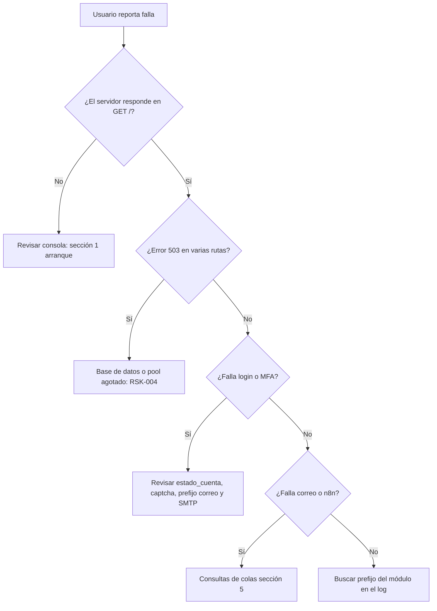

# Guía de diagnóstico

| Campo | Valor |
|---|---|
| ID documental | DOC-07-03 |
| Versión | 1.0 |
| Estado | BORRADOR — PENDIENTE DE VALIDACIÓN |
| Fecha de generación | 2026-10-16 |
| Responsable | PENDIENTE DE ASIGNACIÓN |
| Evidencia base | rama `feature/verificacion-seguridad`, commit `4742737` |

## Propósito

Ayudar a localizar la causa de una falla usando los mensajes y herramientas que **realmente existen** en el código.

## Alcance

Backend (`backend/server.js`, `backend/src/**`), base MySQL, correo, padrón y n8n. Los mensajes citados se obtuvieron con búsqueda en el código el 2026-10-16 [OBS]; no se ejecutó el servidor en esta auditoría.

> Los registros del backend se escriben en la consola del proceso (`console.log/warn/error`). **[OBS]** No hay archivo de log ni agregador configurado.

## 1. Fallas de arranque

`backend/server.js` ejecuta, en orden: validación de `ASSISTANT_MODE` → `validarConfiguracionSegura()` → proveedor de pagos → `validarConfiguracionCorreo()` → `migrar()` → workers y jobs → sincronización del padrón → `listen(PORT)`.

| Mensaje | Causa probable | Acción |
|---|---|---|
| `[server] No se pudo iniciar (revisa tu .env y la conexión a la base de datos): Configuración insegura: …` | `JWT_SECRET` < 32 caracteres o de ejemplo; `ENC_KEY`/`HMAC_KEY` ausentes o inválidas (32 bytes hex, distintas); en producción, otros secretos débiles | `npm run claves:generar` (solo agrega las faltantes); revisar `.env` sin compartirlo |
| `… ASSISTANT_MODE debe ser rules o llm` | Valor inválido | Usar `rules` |
| `… SMTP_HOST es obligatorio en producción.` | `NODE_ENV=production` sin SMTP | Configurar `SMTP_*` |
| `… CORS_ORIGINS debe configurarse …` (desde `app.js`) | Producción sin `CORS_ORIGINS` | Definir orígenes |
| `… TRUST_PROXY_HOPS debe ser un entero no negativo.` | Valor inválido | Corregir |
| `[server] El puerto <PORT> ya está en uso: hay OTRO backend corriendo.` | Otro proceso en el puerto | Cerrar el otro proceso |
| `[server] No se pudo iniciar …: ECONNREFUSED / ETIMEDOUT / ER_ACCESS_DENIED_ERROR` | Base inaccesible o credenciales | Revisar `DB_*`, red, estado de Clever Cloud |
| `ER_CON_COUNT_ERROR` / "Too many connections" [INF] | Más de 5 conexiones (plan gratuito) | Detener scripts que abran conexiones; el servidor usa 4 (RSK-004) |
| `[db] No hay administradores. Define ADMIN_EMAIL y ADMIN_PASSWORD …` | Sin admin y sin contraseña ≥12 | Definir variables o crear superadmin por comando |
| `[db] No se pudo agregar institucion_id a productos:` | DDL rechazado | Revisar permisos del usuario MySQL |
| `[migraciones] Aplicando <versión>...` | Normal: aplica una migración pendiente | Confirmar con `estado` (§3) |

Avisos no bloqueantes (`[config] …`) fuera de producción:

- `JWT_SECRET no está definido: se usa un secreto temporal; las sesiones se perderán al reiniciar.`
- `CRYPTO_KEYS no está definido: los datos nuevos se cifran con la clave heredada CRYPTO_KEY.`
- `CRYPTO_KEYS o IDENT_HMAC_KEY no están configurados: la verificación de identidad en la compra queda deshabilitada.`
- `N8N_W11_CALLBACK_SECRET no está configurado: las respuestas de n8n sobre la entidad serán rechazadas.`

Arranque correcto: `[db] Tablas verificadas/creadas correctamente.` y `[server] Backend corriendo en http://localhost:<PORT>`.

## 2. Prefijos de log en ejecución

| Prefijo | Componente | Mensajes frecuentes |
|---|---|---|
| `[auth]` | `routes/auth.js` | `ENC_KEY/HMAC_KEY no configuradas: el registro está deshabilitado.`; `Error iniciando el desafío MFA`; `La clave de MFA no está configurada correctamente`; `No se pudo validar la versión de sesión` (BD inaccesible → 503) |
| `[solicitudes]` | `routes/solicitudesRegistro.js` | `Error listando/contando/aprobando/rechazando`, `No se pudo validar la sesión` |
| `[padron]` | `seguridad/padron.js` | `Sincronizado: N en la fuente, …`; `No se pudo sincronizar:`; `Consulta no disponible:` (resultado `padron_no_disponible`) |
| `[correo]` | `seguridad/correo.js` | `No se pudo enviar:`; `El SMTP de laboratorio no respondió:` |
| `[correo-laboratorio]` | `seguridad/correo.js` | Bloque que imprime el mensaje completo en consola cuando no hay SMTP fuera de producción. **Contiene códigos MFA**: no compartir la consola [OBS/REC] |
| `[n8n]` | `seguridad/avisosN8n.js` | `No se pudo entregar el aviso de registro:` (no bloquea) |
| `[automation-outbox]` | `automationOutbox.js` | `Error consultando la cola`, `No se pudo enviar el evento`, `No se pudo revisar stock bajo` |
| `[email-outbox]` | `emailOutbox.js` | `Error consultando la cola`, `No se pudo enviar el correo` |
| `[automatizaciones]` | `routes/automatizaciones.js` | resumen diario, expiración, resultado y mantenimiento de verificaciones |
| `[payment-jobs]` / `[pagos]` | `paymentJobs.js`, `routes/pagos.js` | `No se pudieron expirar pedidos`; `Webhook no procesado`; `Simulación mock no completada` |
| `[verificacion-jobs]` / `[verificacion]` | `verificacionJobs.js`, `routes/verificacion.js` | `Falló el mantenimiento`; errores de documentos, permisos, autorizaciones de compra, diagnóstico |
| `[checkout]`, `[pedidos]`, `[productos]`, `[comprobantes]`, `[clientes]`, `[mi-cuenta]`, `[atencion]`, `[assistant]`, `[assistant-llm]`, `[auditoria]`, `[autorizacion]` | rutas respectivas | errores de operación; se registran códigos, no datos |
| `[server] Error no controlado:` | `app.js` | Respuesta 500 genérica |

**[OBS]** La mayoría de errores registran solo `err.code`, no mensajes con datos. Excepción: `routes/auth.js` (refresh/logout) usa `console.error(err)` completo.

## 3. Herramientas de diagnóstico

### 3.1 Estado de migraciones

```bash
cd backend
node scripts/migraciones.js estado
```

Usa la base de `backend/.env` e imprime base y host (`[migraciones] Base: …`) y una tabla versión/aplicada. **No** usar `revertir` para diagnosticar: elimina datos.

### 3.2 Diagnóstico del superadministrador

`GET /api/verificacion/admin/diagnostico` (solo superadministrador; pestaña *Diagnóstico* de `admin-verificaciones.html`). Devuelve [OBS]: entorno, estado de migraciones, conteo de `automation_outbox` por workflow/estado, solicitudes de verificación por estado, cuentas por `estado_verificacion` y presencia (sin valores) de configuración: `cifradoV2`, `proteccionIdentificadores`, `mfaN8n`, `w11Eventos`, `w11Respuestas`, `w11Mantenimiento`, `modoPagos`.

> Discrepancia: `mfaN8n` refleja `N8N_MFA_WEBHOOK_URL`, que ya no se usa desde 2026-10-15 (MFA por nodemailer). Su valor no indica si el MFA funciona.

### 3.3 Salud HTTP

`GET /` con `Accept: application/json` responde `{status:"ok", servicio:…}` sin consultar la base [OBS `app.js`]. No existe endpoint de salud de la base de datos.

## 4. Árbol de decisión rápido



| Síntoma | Comprobación |
|---|---|
| Login responde 403 `CUENTA_PENDIENTE` | Es correcto: solicitud no aprobada (RN-001). Revisar `admin-solicitudes.html` |
| 400 `CAPTCHA_INVALIDO` repetido | Captcha de un solo uso y 5 min, en memoria: un reinicio del servidor invalida los retos (BUG-010) |
| 429 `RATE_LIMITED` | Límites por IP (RN-005); se liberan al pasar la ventana o reiniciar |
| No llega el código MFA | Sin SMTP fuera de producción el código va a consola `[correo-laboratorio]`; con Mailpit ver `http://localhost:8025` |
| 403 `PASSWORD_CHANGE_REQUIRED` | Cuenta con contraseña inicial: usar `cambiar-password.html` |
| Frontend no conecta desde otro dominio | `API_BASE` fijo a `http://localhost:8081` (BUG-003) y CORS |
| Registro siempre `padron_no_disponible` | Fuente del padrón inaccesible; ver `[padron]` |

## 5. Consultas SQL de solo lectura

```sql
-- Colas de correo y automatización
SELECT estado, COUNT(*) AS total, MIN(disponible_en) AS proximo FROM correo_outbox GROUP BY estado;
SELECT workflow, estado, COUNT(*) AS total, MAX(intentos) AS max_intentos
FROM automation_outbox GROUP BY workflow, estado;
SELECT id, workflow, intentos, ultimo_error_code, actualizado_en
FROM automation_outbox WHERE estado = 'fallido' ORDER BY actualizado_en DESC LIMIT 20;

-- Solicitudes de registro y verificación
SELECT estado, resultado_verificacion, COUNT(*) FROM solicitudes_registro GROUP BY estado, resultado_verificacion;
SELECT estado, COUNT(*) FROM solicitudes_verificacion GROUP BY estado;
SELECT estado_cuenta, COUNT(*) FROM usuarios GROUP BY estado_cuenta;

-- Padrón y migraciones
SELECT estado, COUNT(*), MAX(sincronizado_en) FROM padron_institucional GROUP BY estado;
SELECT version, aplicada_en FROM schema_migraciones ORDER BY aplicada_en;

-- Pedidos pendientes de pago vencidos (deberían liberarse en ≤ 60 s)
SELECT COUNT(*) FROM pagos WHERE estado IN ('creado','pendiente') AND expira_en <= NOW();
```

No incluyen columnas cifradas ni correos. Recordar el límite de 5 conexiones: una consola SQL ocupa una.

## Referencias

- [02_PROCEDIMIENTO_DE_GESTION_DE_INCIDENTES.md](02_PROCEDIMIENTO_DE_GESTION_DE_INCIDENTES.md)
- [../04_DESARROLLO/14_SOLUCION_DE_PROBLEMAS_CONOCIDOS.md](../04_DESARROLLO/14_SOLUCION_DE_PROBLEMAS_CONOCIDOS.md)
- [../backend/server.js](../backend/server.js), [../backend/src/configSegura.js](../backend/src/configSegura.js), [../backend/scripts/migraciones.js](../backend/scripts/migraciones.js)
