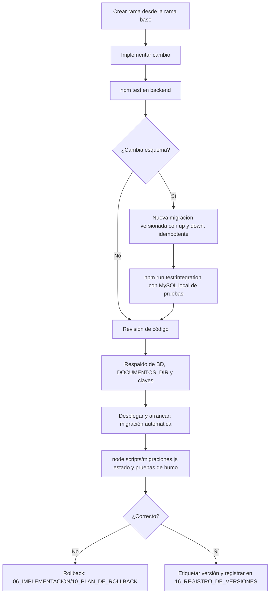

# Procedimiento de actualización

| Campo | Valor |
|---|---|
| ID documental | DOC-07-04 |
| Versión | 1.0 |
| Estado | BORRADOR — PENDIENTE DE VALIDACIÓN |
| Fecha de generación | 2026-10-16 |
| Responsable | PENDIENTE DE ASIGNACIÓN |
| Evidencia base | rama `feature/verificacion-seguridad`, commit `4742737` |

## Propósito

Describir cómo aplicar un cambio de código, de dependencias o de esquema con riesgo controlado.

## Alcance

Cambios en `backend/`, `frontend/`, `n8n/` y migraciones. **[OBS]** No hay pipeline CI/CD, ni etiquetas de versión, ni entorno de staging en el repositorio; el procedimiento es **propuesto [REC]** salvo los comportamientos marcados [OBS].

## 1. Hechos que condicionan la actualización [OBS]

- Las migraciones se aplican **automáticamente al arrancar** el servidor (`migrar()` → `aplicarMigraciones()`), sobre la base definida en `backend/.env`.
- `npm run dev` usa `node --watch`: cada guardado reinicia y vuelve a ejecutar migraciones. Con `.env` apuntando a producción esto causó el incidente INC-2026-001 (RSK-003).
- Las migraciones versionadas solo agregan; `scripts/migraciones.js revertir <versión> --confirmo-perdida-de-datos` elimina lo que agregaron (pérdida de datos).
- El trabajo actual vive en `feature/verificacion-seguridad`, sin fusionar a `main` (BUG-018).

## 2. Flujo

## 3. Pasos

1. **Rama:** crear `feature/<descripcion>` o `fix/<descripcion>`; ver [../04_DESARROLLO/13_GESTION_DE_VERSIONES_GIT.md](../04_DESARROLLO/13_GESTION_DE_VERSIONES_GIT.md).
2. **Entorno:** `backend/.env` apuntando a una base **local o de pruebas**, nunca a Clever Cloud de producción.
3. **Pruebas unitarias:** `cd backend && npm test` (2026-10-16: Jest 107/107, node:test 51/51).
4. **Migración (si aplica):** crear `backend/src/migraciones/00N_<nombre>.js` con `version`, `descripcion`, `up`, `down`; registrarla en `migraciones/index.js`; opcionalmente SQL equivalente en `backend/sql/`.
5. **Integración:** `npm run test:integration` con MySQL Docker local (base cuyo nombre contenga `test`; la suite borra tablas).
6. **Respaldo previo:** [06_RESPALDO_Y_RECUPERACION.md](06_RESPALDO_Y_RECUPERACION.md).
7. **Despliegue:** detener el servidor, actualizar código, `npm ci` (o `npm install`), arrancar con `npm start`.
8. **Verificación:** `node scripts/migraciones.js estado`; login con MFA de una cuenta sintética; abrir catálogo, panel de solicitudes y diagnóstico del superadministrador.
9. **Registro:** etiqueta Git propuesta (`vAAAA.MM.DD` o semántica, PENDIENTE DE DEFINIR) y entrada en [../06_IMPLEMENTACION/16_REGISTRO_DE_VERSIONES_Y_LIBERACIONES.md](../06_IMPLEMENTACION/16_REGISTRO_DE_VERSIONES_Y_LIBERACIONES.md).

## 4. Actualizaciones particulares

| Tipo | Consideración |
|---|---|
| Dependencias npm | Ver [05_GESTION_DE_DEPENDENCIAS.md](05_GESTION_DE_DEPENDENCIAS.md); no usar `npm audit fix --force` sin probar |
| Workflows n8n | Exportar el workflow activo antes de importar uno nuevo; los JSON del repo están `active: false`; W11/W12 se regeneran con `node n8n/generar-w11.js` / `generar-w12.js` |
| Imagen n8n | Cambiar `n8nio/n8n:1.110.1` en `n8n/docker-compose.yml`; respaldar el volumen `n8n_n8n_data`; **no cambiar `N8N_ENCRYPTION_KEY`** |
| Claves de cifrado | Rotación con versión (no reemplazar sin conservar la anterior) |
| Node.js | Probado en 24.19.0; README declara ≥18 (no verificado) |

## 5. Ventana y comunicación [REC]

Ventana de mantenimiento, aviso a usuarios y aprobación: **PENDIENTE DE DEFINIR**.

## Referencias

- [../06_IMPLEMENTACION/05_GUIA_DE_DESPLIEGUE.md](../06_IMPLEMENTACION/05_GUIA_DE_DESPLIEGUE.md)
- [../06_IMPLEMENTACION/10_PLAN_DE_ROLLBACK.md](../06_IMPLEMENTACION/10_PLAN_DE_ROLLBACK.md)
- [../docs/GUIA_INSTALACION_Y_DESPLIEGUE.md](../docs/GUIA_INSTALACION_Y_DESPLIEGUE.md)
- [../backend/src/migraciones/index.js](../backend/src/migraciones/index.js)
