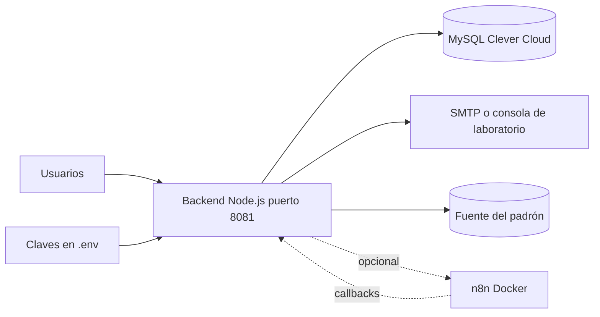

# Plan de continuidad

| Campo | Valor |
|---|---|
| ID documental | DOC-07-08 |
| Versión | 1.0 |
| Estado | BORRADOR — PENDIENTE DE VALIDACIÓN |
| Fecha de generación | 2026-10-16 |
| Responsable | PENDIENTE DE ASIGNACIÓN |
| Evidencia base | rama `feature/verificacion-seguridad`, commit `4742737` |

## Propósito

Identificar escenarios de interrupción y las acciones propuestas para mantener o recuperar el servicio.

## Alcance

Plataforma completa en su estado de laboratorio. **[OBS]** No existe plan de continuidad, análisis de impacto al negocio, RTO ni RPO aprobados. **RTO y RPO: PENDIENTES DE DEFINIR** por el responsable del negocio. Todo el contenido es propuesta [REC] salvo lo marcado [OBS].

## 1. Dependencias críticas

## 2. Escenarios

| ID | Escenario | Impacto [INF] | Comportamiento actual [OBS] | Respuesta propuesta [REC] | Relación |
|---|---|---|---|---|---|
| CON-01 | Caída o inaccesibilidad de MySQL en Clever Cloud | Total: sin login, catálogo ni compras | El servidor no arranca si la base falla en `migrar()`; en ejecución las rutas responden 503/500 | Verificar estado del proveedor; si es prolongado, restaurar el último respaldo en una base alternativa y cambiar `DB_*` | RSK-004, RSK-012 |
| CON-02 | Pérdida de claves (`ENC_KEY`, `HMAC_KEY`, `CRYPTO_KEYS`, `IDENT_HMAC_KEY`) | Muy alto: padrón, solicitudes, documentos e identificadores ilegibles; sin `ENC_KEY`/`HMAC_KEY` el servidor no arranca | No hay copia de claves fuera del `.env` documentada | Prevención: copia en bóveda separada. Si ocurre: generar claves nuevas, re-sincronizar el padrón desde la fuente (re-cifrable), pedir a solicitantes que se registren de nuevo; documentos y datos cifrados se pierden | RSK-001 |
| CON-03 | Caída del SMTP | Alto: sin MFA no hay inicio de sesión; sin avisos | En producción el envío falla (error); fuera de producción se imprime en consola; `correo_outbox` reintenta comprobantes hasta 5 veces | Proveedor SMTP alternativo configurado (variables `SMTP_*`); reencolar fallidos | REQ-F-006, REQ-F-025 |
| CON-04 | Caída de n8n | Bajo | Los eventos quedan en `automation_outbox` y reintentan (8 intentos); expiración de pedidos (60 s) y mantenimiento de verificaciones (5 min) corren en jobs internos; avisos W12 se pierden sin bloquear | Restablecer el contenedor `empresa-n8n`; revisar fallidos | REQ-NF-010, RSK-011 |
| CON-05 | Compromiso de secretos | Alto | `configSegura.js` impide arrancar con secretos débiles en producción | Rotar: `JWT_SECRET` (cierra sesiones), `MFA_TOKEN_PEPPER` (invalida retos), claves de cifrado con versión, secretos n8n en ambos lados, contraseña de la base y del padrón; aplicar [02_PROCEDIMIENTO_DE_GESTION_DE_INCIDENTES.md](02_PROCEDIMIENTO_DE_GESTION_DE_INCIDENTES.md) §4 | RSK-002 |
| CON-06 | Pérdida del equipo de laboratorio | Alto: el backend, n8n, `.env`, `DOCUMENTOS_DIR` y Mailpit viven en ese equipo [INF a partir de docs] | El código está en GitHub; `.env`, `backend/storage/` y el volumen n8n no | Respaldos externos de claves, documentos y volumen n8n; reinstalación según [../06_IMPLEMENTACION/03_MANUAL_DE_INSTALACION.md](../06_IMPLEMENTACION/03_MANUAL_DE_INSTALACION.md) | RSK-012, RSK-013 |
| CON-07 | Fuente del padrón no disponible | Medio: los registros se crean con `padron_no_disponible` | Se usa la última copia cifrada; la sincronización reintenta cada `PADRON_SYNC_MINUTOS` | Aprobación con confirmación explícita y verificación manual (RN-003) | REQ-F-003 |
| CON-08 | Ausencia del único administrador | Alto: nadie aprueba registros | No hay segundo superadministrador documentado | Crear un segundo superadministrador con `--adicional` | RSK-013 |

## 3. Objetivos de recuperación

| Servicio | RTO | RPO |
|---|---|---|
| Inicio de sesión y catálogo | PENDIENTE DE DEFINIR | PENDIENTE DE DEFINIR |
| Compras y pagos | PENDIENTE DE DEFINIR | PENDIENTE DE DEFINIR |
| Verificación y registro | PENDIENTE DE DEFINIR | PENDIENTE DE DEFINIR |
| Automatizaciones n8n | PENDIENTE DE DEFINIR | PENDIENTE DE DEFINIR |

## 4. Pruebas del plan [REC]

Simulacro semestral de CON-01 (restauración) y CON-04 (n8n detenido), con acta. **[OBS]** Ningún simulacro realizado a la fecha.

## Referencias

- [06_RESPALDO_Y_RECUPERACION.md](06_RESPALDO_Y_RECUPERACION.md)
- [../06_IMPLEMENTACION/09_PLAN_DE_RESPALDO_Y_RESTAURACION.md](../06_IMPLEMENTACION/09_PLAN_DE_RESPALDO_Y_RESTAURACION.md)
- [../00_GESTION_DEL_PROYECTO/06_MATRIZ_DE_RIESGOS.md](../00_GESTION_DEL_PROYECTO/06_MATRIZ_DE_RIESGOS.md)
- [../docs/SUPERUSUARIO_Y_CUENTAS_PRUEBA.md](../docs/SUPERUSUARIO_Y_CUENTAS_PRUEBA.md)
